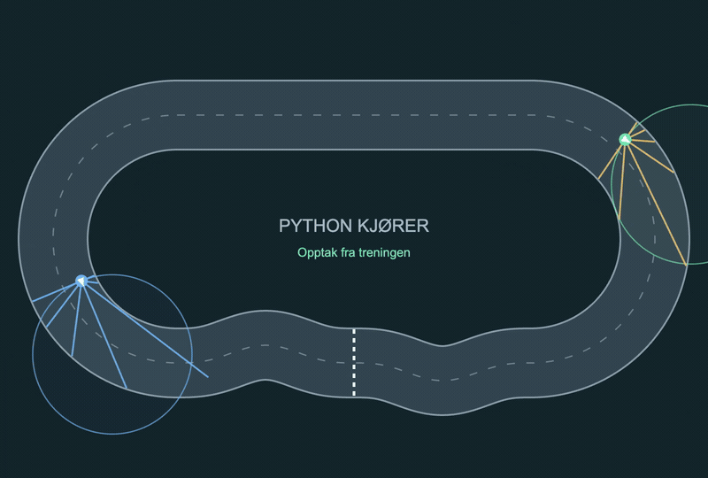
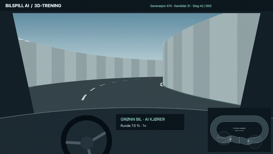
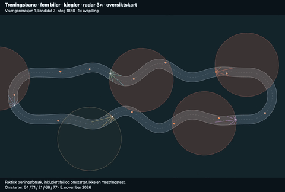
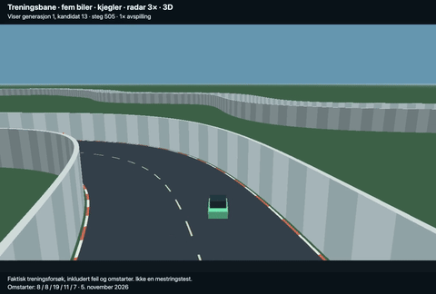
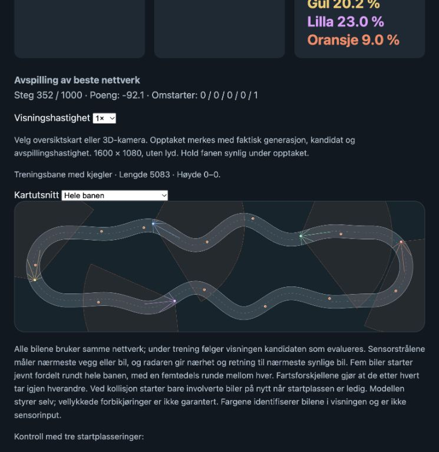
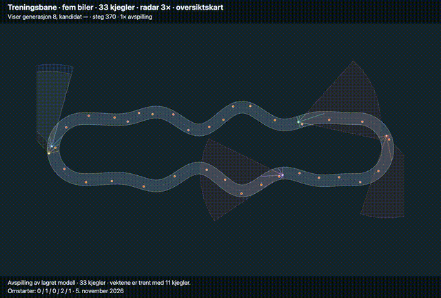
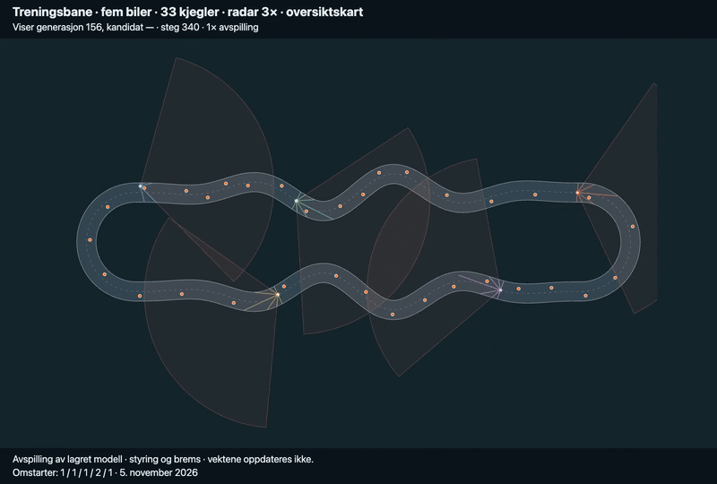
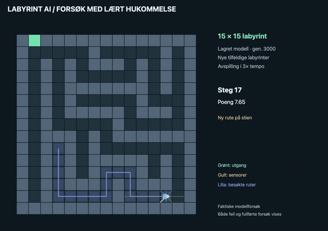

# AI-spill

Et felles prosjekt for spill som lærer med nevrale nettverk. Bilspillet og labyrintspillet har hver sin motor og visning. Hvert nytt spill får sin egen mappe, egne spilleregler, observasjoner, poengberegning, visning og modellfiler.

## To forskjellige læringsforsøk

**Bilspillet undersøker valg ut fra øyeblikkstilstanden.** Nettverket får aktuelle sensorverdier og velger styring direkte, uten historikk over tidligere observasjoner eller handlinger. Det er en form for innlært, «intuitiv» reaksjon på situasjonen her og nå. Erfaring fra treningen ligger i vektene, men bilen har ikke et eget minne om turen den kjører.

**Labyrintspillet undersøker læring med historikk.** Målet er å bruke informasjon om tidligere besøkte steder og valg til å lære rutevalg, utforske labyrinten og finne veien ut. Prosjektet har prøvd både nevrale hukommelsesmekanismer og deterministisk lagret historikk. I det nåværende forsøket får beslutningsnettet dagens sensorverdier sammen med lagrede målinger fra tidligere registrerte hjørner og forgreninger. Dette er et forsøk på å lære å bruke historikken, ikke en påstand om at nettet allerede har lært pålitelig ruteplanlegging.

## Hvordan prosjektet utvikles

Les [utviklingsloggen for bilforsøket](docs/UTVIKLINGSLOGG_BIL.md) for forslagene,
presiseringene, metodeendringene og resultatene steg for steg. Prosjekteieren
utformer og utfordrer hypotesene; Codex implementerer, tester og bidrar med
tekniske forslag. Loggen viser også forsøk som forverret kjøringen, og skiller
mellom fungerende kode og dokumentert bedre læring. Dette er et arbeid underveis.

[Gjeldende logg: tilfeldige kjegler og starter, vekslende kjøreretning](docs/experiments/random800-generation-progress.md).
Fra generasjon 383 trekkes 4–8 kjegler og startposisjoner tilfeldig. Alle fem biler kjører samme vei, vekselvis med og mot klokka per generasjon. Videoene nedenfor viser tidligere oppsett.
Treningsbudsjettet er utvidet til **1000 generasjoner totalt**, med automatisk videreføring etter 800. Målet er bedre passeringer og håndtering av biler og kjegler.
Nettverkene bytter nå bil mellom kjøringer; den forrige metoden er bevart nedenfor.

[Forbedring per generasjon i det nye 100-generasjoners forsøket](docs/experiments/deep-100-generation-progress.md)
viser testpoeng, kjørt distanse, kollisjoner og endring fra startmodellen.
Loggen oppdateres lokalt under kjøringen; GitHub viser sist pushede versjon.

[Tidslinje med alle metodeendringer og trendgraf](docs/experiments/car-training-timeline.md).
Grafmarkeringene og tidslinjen hentes fra samme hendelsesregister.

## Nå: trening på svinger, kjegler og trafikk

Den oppdaterte treningsbanen har vekslende svinger, 33 kjegler og fem biler som kjører samme vei med 80–120 % grunnfart. Radaren har 120° åpningsvinkel og rekkevidde 540. Den gir nærhet, sideplassering, relativ lengdehastighet og tilnærmingsfart for de fire nærmeste objektene; manglende objekter gir nuller. Sju sensorstråler måler avstand til vegger, kjegler og biler. Nettverket har 23 innganger, fire skjulte lag med åtte nevroner og to utganger: styring og brems (0–50 % fartsreduksjon). Rust beregner nettverk, gradienter, veigeometri, radar og kollisjonsavstander. [Metodehistorikk og resultater](docs/UTVIKLINGSLOGG_BIL.md).

## Kjøringen utvikler seg — minst trening først

Opptakene følger utviklingen fra de tidlige forsøkene til den nyeste modellen.
Treningsmetode, sensorer og bane ble endret underveis, og enkelte forsøk startet
med nye vekter. Generasjonsnumrene tilhører derfor forskjellige forsøksserier.
Se [utviklingsloggen](docs/UTVIKLINGSLOGG_BIL.md) for overgangene.

### Tidlige forsøk — før kjegletreningen

Et [pågående eksperiment med begrenset synsfelt og hukommelse](docs/BIL_HUKOMMELSE.md) har nå en lang åttetallsbane med overpass og en første evaluering med eksisterende vekter. Prøv den med `python3 -m games.car.app --track figure_eight --replay`. Fargeavlesing, rundetider og hukommelse følger i steg 2.

| Oversiktskart med biler og sensorer | 3D fra førerplassen med banekart |
| --- | --- |
| [](docs/media/bilspill-training.mp4) | [](docs/media/bilspill-3d-training.mp4) |
| [Se hele videoen · 1 minutt og 40 sekunder](docs/media/bilspill-training.mp4) | [Se 3D-videoen · ca. 28 sekunder](docs/media/bilspill-3d-training.mp4) |

Begge videoene viser faktiske treningsforsøk. 3D-visningen bruker samme bane og bilposisjoner som oversiktskartet. Klippene viser den tidligere perspektivrendereren i JavaScript og Canvas. Dagens 3D-visning bruker Rust/WebAssembly og WebGPU. Ved Rust-kjøring beregnes også nettverket, veigeometrien og kantfølerne i Rust; Python styrer resten av simuleringen og treningsløkken. Se [kjøreinstruksjoner og beskrivelse av 3D-visningen](games/car/README.md#førerplass-i-3d).

### Første generasjon — kjegler og trafikk

| Oversiktskart · 31 sekunder | Rust/WebGPU i 3D · 60 sekunder |
| --- | --- |
| [](docs/media/training-cones-overview.mp4) | [](docs/media/training-cones-3d.mp4) |

Opptak fra **første generasjon**, kandidat 7 og 13, i **1× avspilling**. De viser faktiske forsøk med feil og omstarter, ikke en ferdigtrent modell. Begge klipp er tatt 5. november 2026. Klikk på forhåndsvisningene for MP4-videoene.

### Generasjon 5 — stillbilde fra hybridtrening



Stillbilde fra avspilling 5. november 2026 med den lagrede vinneren ved
**generasjon 5 av 30** i hybridforsøket. Alle fem bilene bruker vinnernettverket
med forskjellig fart. Bildet viser faktisk kjøring med omstarter ved kollisjon,
ikke en feilfri demonstrasjon eller selve treningen. Dette er et datert
øyeblikksbilde, ikke en automatisk oppdatert visning.

### Generasjon 8 — flere kjegler og smalere radar

[](docs/media/hybrid-33cones-60deg-overhead.mp4)

[Se videoen — 60 sekunder, MP4](docs/media/hybrid-33cones-60deg-overhead.mp4).
Filmet 5. november 2026 i 1× avspilling. Alle fem bilene bruker vinnernettverket
lagret ved **hybridgenerasjon 8**. Banen i opptaket har **33 kjegler** og radaren **60°
åpningsvinkel**. Vektene i dette opptaket var trent med 11 kjegler og 120° radar;
videoen viser overgangen til den vanskeligere banen, med faktiske kollisjoner
og omstarter. Vektene ble beholdt ved videre trening.

### Generasjon 156 — styring og brems

[](docs/media/hybrid-generation156-overhead.mp4)

[Se den nye videoen — 60 sekunder, MP4](docs/media/hybrid-generation156-overhead.mp4).
Filmet 5. november 2026 i **1× avspilling**, ovenfra med hele banen synlig.
Alle fem biler bruker den lagrede modellen fra **generasjon 156**. Vektene
oppdateres ikke i opptaket; videre trening kjører separat uten visualisering.
Kollisjoner og omstarter er med, og bare biler som krasjer starter på nytt.

I de 100 utvelgelsestestene kjørte denne modellen i gjennomsnitt **771 banenheter
før krasj**, mot **405** ved generasjon 110: omtrent **90 % lengre** under samme
testoppsett. Alle 100 tester endte fortsatt i krasj. [Lagrede testresultater](docs/experiments/2026-11-05-generation156.json). Videoen er en illustrasjon,
ikke selve testen: her bruker alle bilene samme modell og får starte på nytt.
I testene prøves kandidaten i én bilrolle av gangen mot fast referansetrafikk.

## Labyrintforsøk i aksjon

[](docs/media/maze-attempts.mp4)

[Se labyrintvideoen · ca. 32 sekunder](docs/media/maze-attempts.mp4). Videoen viser nye forsøk på tilfeldige 15 × 15-labyrinter med den lagrede modellen `learned_memory_40_three_layers.json` fra generasjon 3000. Avspillingen går i 3× tempo; vektene oppdateres ikke under opptaket. Gult viser sensorer, lilla viser besøkte ruter, og grønt markerer utgangen. Klippet viser modellens faktiske valg og er ikke et mål på generell løsningsgrad.

GIF-bildene er korte forhåndsvisninger. Klikk på et bilde eller en videolenke for hele MP4-opptaket.

## Flytt til Mac Studio

Se [installasjon, GPU-oppstart og videre trening](MAC_STUDIO.md). Alle lagrede modeller og treningsrapporter følger repoet; lokale Python-miljøer og cache ignoreres.

## Rust på CPU

Bil- og labyrintspillet støtter `--backend rust` for raskere nettverksberegning og vektmutasjoner. Se [installasjon, bruk og målinger](docs/RUST_BACKEND.md). Modellformatet er beholdt, og simuleringen styres fortsatt av Python.

## Struktur

- `ai/network.py`: den felles klassen `NeuralNetwork`. Velger lagstørrelser, beregner nettverkets utdata, trener med utvalg og mutasjon, utvider innganger og lagrer/laster modeller.
- `games/car/`: bilspillet med Python-simulering, bane, webvisning og treningens kobling til spillets poengberegning.
- `games/maze/`: tilfeldig labyrintmotor, mann med trådfølere, komprimert hukommelse og automatisk 50 % størrelsesøkning.
- `games/car/models/`: eksisterende modeller og sikkerhetskopier, flyttet uten endring av innholdet.
- `tests/`: tester av den felles nettverksklassen; `v2/test_*.py`: eksisterende regresjonstester for bilspillet.
- `versions/v1/`: historisk, selvstendig V1-demo. Arkivet beholdes uendret og brukes ikke som grunnlag for nye spill.
- `v2/demo.py` og `v2/advance.py`: kompatible startkommandoer som videresender til bilspillet.

Nettverksklassen kjenner ingen spilleregler. Spillet normaliserer sine egne observasjoner og gir klassen en funksjon `evaluate(weights)` som returnerer poeng. Høyere poeng er bedre. Nettverket kan ha vilkårlig antall og størrelse på skjulte lag samt flere utganger. Bilspillet bruker ni innganger og én utgang.

## Kjør bilspillet

```sh
python3 -m games.car.app
# eller: python3 demo.py
```

Åpne http://127.0.0.1:8766/. Vanlig oppstart starter ny trening. Vis en eksisterende modell med:

```sh
python3 -m games.car.app --replay
```

Standardnettverket er 9 → 8 → 8 → 1. Velg en annen størrelse og en egen fil for et forsøk:

```sh
python3 -m games.car.app --hidden 16 8 --seed 42 --model games/car/models/experiment_42.json
python3 -m games.car.app --hidden 16 8 --model games/car/models/experiment_42.json --fast-generations 20
python3 -m games.car.app --hidden 16 8 --model games/car/models/experiment_42.json --replay
```

Uten `--model` brukes en fil med lagstørrelsene i navnet. Bruk unike modellnavn for forsøk som skal sammenlignes; ny trening på samme fil erstatter det tidligere forsøket. `--hidden` uten tall gir et nettverk uten skjulte lag. Ved avspilling og videre trening må lagstørrelsene stemme med filen.

Videre trening uten server eller animasjon leser størrelsen fra modellfilen og tar sikkerhetskopi før trening:

```sh
python3 -m games.car.advance 100 --model games/car/models/experiment_42.json
```

Modellfiler inneholder lagstørrelser, vekter, generasjon, poeng, seed, spillinnstillinger og historikk for fullførte generasjoner med mutasjonsstyrke og populasjonsstørrelse. Eldre modellfiler kan leses; de mangler historikk fra før omleggingen. Hver generasjon lagres atomisk. Videre trening starter en ny populasjon rundt den lagrede vinneren og måler denne på nytt; den gjenoppretter ikke nøyaktig samme optimizer-tilstand som et uavbrutt løp. Seed gir repeterbare nye forsøk når evalueringen og innstillingene er identiske.

## Kjør labyrintspillet

```sh
python3 -m games.maze.app
```

Åpne http://127.0.0.1:8767/. Start i et åpent 30 × 30-landskap med 50 grå bokser først, fra midten til kanten. Etter 20 feilfrie forsøk på rad går modellen videre til tilfeldige 5 × 5-labyrinter. 20 nye labyrinter løst feilfritt på rad gir 50 % økning i begge dimensjoner: 5 → 8 → 12 → 18. Nettet får sju følere og de siste 50 handlingene, komprimert som handling/antall. 50 skritt frem bruker dermed to aktive minneinnganger. Spillene deler bare `NeuralNetwork`.

Se [full dokumentasjon for labyrintspillet](games/maze/README.md) for regler, inputformat, motor, treningsprogresjon og alle innstillinger.

## Gjenbruk i neste spill

```python
from ai.network import NeuralNetwork

network = NeuralNetwork([4, 12, 2], seed=42)
actions = network.forward([0.1, 0.2, 0.3, 0.4])
# evaluate tilhører det nye spillet og returnerer ett poengtall.
network.train(evaluate, 100, checkpoint="games/my_game/models/run_42.json")
network = NeuralNetwork.load("games/my_game/models/run_42.json")
```

Opprett `games/<spillnavn>/`, og importer bare `ai.network` for nettverk og trening. Spillene skal ikke importere hverandre. Hold modeller og evalueringsoppsett i spillets mappe. Sensorer, belønning, fysikk og presentasjon hører til spillet; lag, vekter, mutasjoner, læring og modellformat hører til `NeuralNetwork`.

## Tester

```sh
python3 -m unittest discover -s tests -v
python3 -m unittest discover -s v2 -p 'test_*.py' -v
```

Detaljer og tidligere designnotater for bilspillet finnes i [games/car/README.md](games/car/README.md). Den historiske V1-demoen kjøres med `python3 versions/v1/demo.py` på port 8765.


Nyeste bilforsøk: radaren er en 60° kjegle uten veggsperring, med avstand,
sideposisjon, objektfart og relativ tilnærmingsfart. 1000 generasjoner er
startet fra nye vekter uten visning. Videoene fra treningsbanen er fra før
denne radarendringen. Se [status og kjørekommando](docs/BIL_HUKOMMELSE.md#ny-radar-og-ny-trening-1000-generasjoner-uten-visning).
