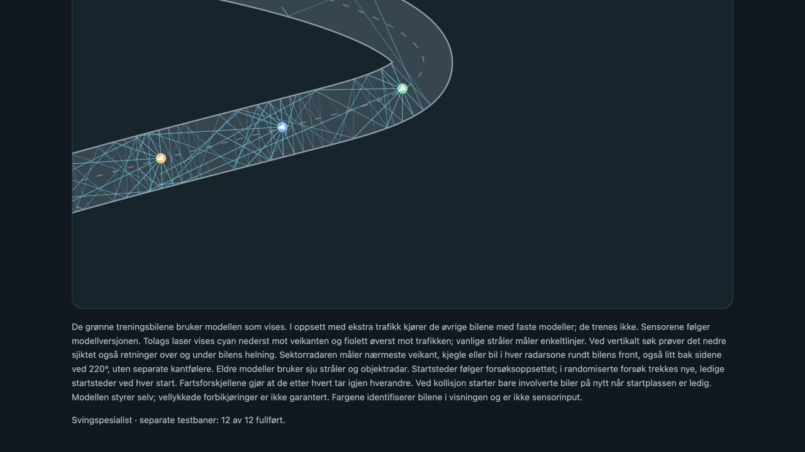

# To svingspesialister

Implementert 11. november 2026. Separate modeller; eksisterende hovedmodeller
endres ikke. Begge kan lastes med vanlig `games.car.app --replay`.

## Notat etter gjennomgang – 11. november 2026

**Beslutning: Behold begge nettverkene som de er. Videre arbeid avgjøres senere.**
De valgte modellene og resultatrapportene er kopiert uendret til
[`preserved_2026-11-11`](../games/car/models/turn_specialists/preserved_2026-11-11/).
`manifest.json` inneholder SHA-256 for hver fil. Bruk en ny `--output`-mappe
ved senere trening, slik at dette utgangspunktet bevares.

Begge nettverkene lærte ved å etterligne en lærer som brukte senterlinjen.
Under kjøring får nettverkene bare følerverdier og egen fart; de får ingen
senterlinjeinformasjon. De har **ikke lært gjennom belønning for fremdrift
eller straff for krasj**. Slike utfall ble brukt til evaluering og valg av
modell, mens selve vekttilpasningen fulgte lærerens handlinger. Resultatet
er et nyttig forsøk med læring fra hjelp, ikke dokumentasjon på selvstendig
forsterkningslæring eller robust kjøring med trafikk.

**Brukerens vurdering er at ekkovarianten har størst verdi videre.**
Refleksjonene kan følge en vei rundt et hjørne og gi målinger fra områder
utenfor direkte sikt. De bøyde følerne følger faste kurver og stopper ved
første veikant; slik de er nå, gir de ikke den samme muligheten til å følge
refleksjoner videre rundt hjørner. Begge beholdes, slik at forskjellene kan
undersøkes senere. Like fullføringstall i dagens test viser ikke at det ene
sensoroppsettet generelt er bedre enn det andre.

Ekkovarianten minner om en **flaggermus** og kan brukes som inspirasjon til
videre arbeid. Dagens modell er likevel idealiserte refleksjoner i veikantene,
ikke en fysisk simulering av ekkolokalisering med lyd som returnerer til øret.

Den opprinnelige ideen beholdes: Når hovedbilen krasjer eller setter seg fast,
spoles situasjonen tilbake, og spesialistene prøver fra samme tilstand.
Hovedbilen kan lære fra en spesialist som faktisk oppnår et bedre resultat i
situasjonen. Spesialistene skal ikke automatisk regnes som fasit. Mer kompleksitet,
særlig andre biler, krever videre vurdering av sensorer og trening; dagens
spesialister oppdager ikke biler og har ikke trent med trafikk.

Ingen ny trening eller utvidelse av dette opplegget startes som del av notatet.

## Sensorene

- `turn_curved`: sju vanlige rette kantfølere (180 rekkevidde), pluss seks
  følere med en innledende sirkelbue (radius 22) og deretter rett tangent.
  Sluttvinklene er ±25°, ±80° og ±155°. De ytterste peker altså bakover.
  Buelengde og rett del har samlet rekkevidde omtrent 360. Buen tilnærmes
  med 12 linjestykker. Målingen stopper ved første veikant.
- `turn_echo`: ti stråler fordelt fra −100° til +100°, i høyde 0,5 over
  bilen/veien. Speilrefleksjon i veikantene, opptil fem treff per stråle,
  maksimalt 360 samlet reiselengde. Hvert ekko har akkumulert avstand,
  styrke `0.7 ** treffnummer` og en tilstedeværelsesverdi. Manglende ekko
  fylles med nuller. Det gir styrkene 0,7, 0,49, 0,343, 0,2401 og 0,16807.

Begge får også egen fart som input. Nettverkene er henholdsvis
14 → 48 → 32 → 2 og 151 → 48 → 32 → 2. Utgangene er styring og brems.
Banekartet viser de faktiske følerbanene, inkludert refleksjoner.

Dette er idealiserte sensorer mot veikantene. Det er ikke akustisk simulering
av bølger som returnerer til en mottaker. Gulvrefleksjoner er ikke implementert;
høydefilteret skiller veikantene på ulike plan, men disse modellene trenes bare
på flate baner. Sensorene oppdager foreløpig ikke biler og kjegler.

## Trening og kontroll

Kun `tight_turns` og `tight_turns_mirrored` brukes til trening, i begge
kjøreretninger. Tilfeldige treningsposisjoner har sideavvik ±18, retningsavvik
±0,45 radianer og fartsfaktor 0,8–1,2. Ingen vanlig bane inngår i treningen.

Først etterligner nettverket en lærer basert på banens senterlinje, med
22 lengdeenheters fremoversikt. Deretter samles korrigerte treningsmål fra
nettverkets egne kjøreforsøk (DAgger). Bare læreren får senterlinjen;
nettverket får utelukkende sensorverdier og fart, også under avspilling.
Dette er veiledet spesialtrening, ikke prosjektets vanlige mutasjonsutvalg.
Krasjtilbakespoling der spesialistene vurderer hovedbilen er ikke koblet inn.

Læreren bruker 80 % brems (60 % av grunnfarten). Modellen lærer også denne
bremsen. Den eksisterende kubiske styreforsterkningen settes til 1 og lagres
med modellen. Treningen sikter mot sikker gjennomkjøring, ikke høyest fart.

Hver evaluering har 12 forsøk: to baner × begge retninger × tre kombinasjoner
av startavvik og fart. Holdout-banene har geometrisk skala 0,9/1,1 og halv
veibredde 34/42. De er varianter av samme svingfamilie, ikke helt nye
banetyper. De brukes ikke til treningsdata eller valg av modell.
Beste runde velges etter fullføringer og fremdrift på treningsbanene.
Rapportene beholder alle forsøk og sammenligner mot utrente tilfeldige vekter.

## Kjøring

Fra prosjektroten, med NumPy og den lokale Rust-modulen installert:

```sh
.venv-training/bin/python -m pip install numpy ./rust/ai_native
.venv-training/bin/python -m games.car.train_turn_specialists --mode turn_curved --samples 4000 --epochs 100 --rounds 3
.venv-training/bin/python -m games.car.train_turn_specialists --mode turn_echo --samples 6000 --epochs 100 --rounds 2

.venv-training/bin/python -m games.car.app --replay --backend rust --model games/car/models/turn_specialists/turn_curved.json --port 8871
.venv-training/bin/python -m games.car.app --replay --backend rust --model games/car/models/turn_specialists/turn_echo.json --port 8872
```

Åpne henholdsvis http://127.0.0.1:8871 og http://127.0.0.1:8872.
`--mode turn_curved` eller `--mode turn_echo` trener bare én variant.
`--output` velger en annen mappe; standardmappen overskrives ved ny kjøring.
`*_latest.json` er siste treningsrunde; filen uten `_latest` er valgt modell.

Tester:

```sh
.venv-training/bin/python -m unittest discover -s v2 -p 'test_turn*.py'
```

## Teknisk kontroll

43 målrettede tester for sensorer, svingbaner, styring, bremsing og vanlig
simulering bestod. Den fulle V2-samlingen kjørte 210 tester, med én feilet
assert og fem feil i eksisterende hybridtester: bakgrunnstrafikk og
kollisjonsstraff bruker testbiler uten x/y, mens testen av distansegrenser
forventer `distance_limit` og får `step_limit`. Disse områdene var allerede
endret i arbeidsmappen og ble ikke omskrevet som del av denne oppgaven.

Avspilling av begge modellene er kontrollert i nettleseren, inkludert
tegning av bøyde følere og flere refleksjoner. Standard avspillingstid for
disse modellene er utvidet slik at også den tregeste bilen rekker hele banen.



## Resultater fra kjøringen 11. november 2026

| Modell | Trening | Separate testbaner | Utrent på testbanene |
| --- | --- | --- | --- |
| Bøyde følere | 12/12 fullført | 12/12 fullført | 0/12 fullført |
| Ekko | 12/12 fullført | 12/12 fullført | 0/12 fullført |

Alle fullførte forsøk var uten krasj. Seed: `20261111`. Bøyde følere fikk
4 000 innledende eksempler, tre runder à 100 epoker; ekko fikk 6 000
innledende eksempler, to runder à 100 epoker. Egne kjøreforsøk supplerte
treningsdataene mellom rundene. Runde 2 ble valgt for begge modeller,
utelukkende basert på resultatene fra treningsbanene.

- [Modell med bøyde følere](../games/car/models/turn_specialists/turn_curved.json)
  og [alle måleresultater](../games/car/models/turn_specialists/turn_curved_report.json).
- [Ekkobilens modell](../games/car/models/turn_specialists/turn_echo.json)
  og [alle måleresultater](../games/car/models/turn_specialists/turn_echo_report.json).

Dette dokumenterer mestring av den undersøkte familien av flate svingbaner
ved redusert fart. Det dokumenterer ikke generell kjøring på vilkårlige baner.

## Video av den bevarte ekko-bilen

Ny simulering 11. november 2026 med den bevarte `turn_echo.json`: én bil,
`tight_turns`, retning fremover, normal fartsfaktor, uten trafikk. Bilen nådde
enden etter **4265 steg uten krasj**. Dette er én demonstrasjon, ikke en ny
bred evaluering. Nettverket styrer og bremser; senterlinjelæreren brukes ikke.

[Se opptaket](media/turn-echo-drive.mp4). Refleksjonene viser sensorbanene fra
den faktiske biltilstanden. Opptaket har tre simuleringssteg per bilde ved
30 bilder per sekund og varer omtrent 49 sekunder, inkludert sluttbildet.
Modellens SHA-256 og alle viste tilstander ligger i `media/turn-echo-drive.json`.

Gjenskap opptaket fra prosjektroten:

```sh
.venv-training/bin/python scripts/record_echo_specialist.py simulate
.venv-media/bin/python scripts/record_echo_specialist.py render
```

Det finnes en egen bakkeøvingsbane (`bridge_straight`), men ingen separat
trent bakkespesialist blant de lagrede spesialistmodellene. Opp- og nedkjøring
er del av den bredere treningsplanen; de to svingspesialistene er trent flatt.
