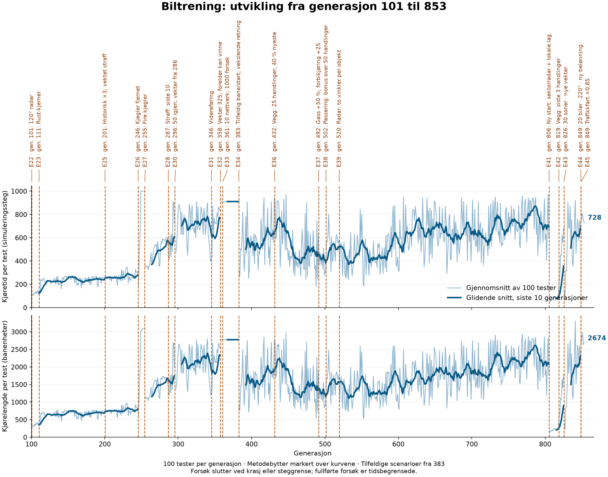

# Utviklingslogg: hvordan bilforsøket faktisk ble til

Sist oppdatert 5. november 2026. Dette er en kronologisk logg over beslutninger,
endringer og resultater fra arbeidet med bilspillet. Første del er rekonstruert
fra samtalen og eksisterende forsøksnotater; rekkefølgen er dokumentert, men vi
har ikke satt oppdiktede klokkeslett på hvert forslag. Arbeidet startet
4. november og fortsatte 5. november 2026.

Prosjekteieren har formulert målene, foreslått læringshypotesene og korrigert
oppsettet underveis. Codex har skrevet kode og dokumentasjon, kjørt tester og
målinger, og foreslått tekniske løsninger og kontrollforsøk. Dette er ikke et
prosjekt der én innledende bestilling ga en ferdig løsning. Både problemstillingen
og treningsmetoden er endret gjennom mange konkrete vurderinger. Flere av
metodene som er implementert korrekt, har foreløpig gitt dårligere kjøring.

[Detaljert forsøksoppsett](BIL_HUKOMMELSE.md) ·
[Arkiverte målinger og innstillinger](experiments/2026-11-05-results.json)

## Treningsutvikling med metodeendringer

Dette er samme bildefil som i README, referert med relativ sti. Når grafen
regenereres, oppdateres begge dokumentenes visning uten nye bildehenvisninger.
Kjør `.venv-media/bin/python scripts/plot_car_training_progress.py` fra
prosjektroten. GitHub viser sist pushede bildefil, ikke løpende treningsdata.
Se [tidslinjen](experiments/car-training-timeline.md) for koblingen mellom
markeringene og oppføringene nedenfor. Tilfeldige testoppsett og metodebytter
påvirker resultatene; markeringene alene dokumenterer ikke årsakssammenhenger.

## 01 — Hukommelse ble delt i to separate spørsmål

**Prosjekteierens forslag:** Først en vanskeligere bane med begrenset synsfelt
og saktere biler. Deretter undersøke om modellen kan huske kommende svinger og
forbedre rundetidene. Fargede banesegmenter skulle gi gjenkjennelige kjennetegn.

**Viktig korrigering fra prosjekteieren:** Fargeavlesing hører til del 2. Del 1
skal først kunne prøves med eksisterende vekter. Det var derfor ikke riktig å
legge alle nye sensorinput inn i det første forsøket.

**Status:** Nye baner og kjøretrening er prøvd. Veggfarger som input og minne
under kjøring er fortsatt hypoteser. En historikkø brukt under trening er ikke
i seg selv hukommelse tilgjengelig for bilen når den senere kjører.

## 02 — Fra oval til åttetall, høyde og trafikk

**Prosjekteierens forslag:** En baneklasse, minst ti ganger lengre bane, mange
svinger begge veier, og et kryss med veier på forskjellige høyder. Fem biler
skulle kjøre samme vei med omtrent ±20 % hastighetsforskjell.

**Presisering:** Bilene skulle ikke starte på samme sted.

**Codex gjennomførte:** Felles banegenerator, xyz-geometri, åttetallsbane med
overpass og fem spredte startposisjoner med fart 80, 90, 100, 110 og 120 %.
Høyde må brukes ved sensorer og kollisjoner, ikke bare tegnes i bildet.

**Senere endring fra prosjekteieren:** Banen viste seg å være for stor for
hyppige møter. Formen skulle beholdes, bredden økes og banen krympes til en
fjerdedel. Det opprinnelige størrelseskravet ble dermed erstattet etter utprøving.

## 03 — Egen treningsbane og mer informasjon om andre biler

**Prosjekteierens forslag:** En bane med raske venstre-/høyresvinger og kjegler.
Bilene måtte bli flinkere til å observere hverandre. Radaren skulle bli omtrent
tre ganger større og gi avstand og høyre-/venstre-posisjon.

**Codex gjennomførte:** Treningsbane med 11 kjegler, radarrekkevidde 540 og
separat nærhet og sideposisjon. Denne sensorendringen krevde et eget forsøk med
nye vekter. Gamle modeller ble beholdt.

**Læringsregel på dette stadiet:** Evolusjon med 36 kandidater per generasjon og
seks eliter. Alle fem biler brukte samme kandidatnettverk. Nærhet og kollisjoner
ga straff; det var ingen egen fremdriftspremie. En generasjon var dermed ikke
bare fem biler eller fem handlinger.

## 04 — Visualisering og faktisk treningshastighet

**Prosjekteierens spørsmål og beslutninger:** Kan Rust tegne bildet? Bør GPU
brukes med en gang? Videoene bør vise hele banen ovenfra, så alle bilene synes.
Trening av 1000 generasjoner skal kjøres uten visning.

**Codex gjennomførte:** Rust/WebAssembly/WebGPU-visning, videoklipp og
ovenfra-visning som standard for treningsopptak. Senere ble de visuelle veggene
senket fra 26 til 2 høydeenheter etter ønske om lave kanter. Kantfølerne beholdt
veigrensen som sensorgrunnlag.

**Måling som korrigerte forventningen:** Å flytte bare nettverket til Rust ga
omtrent 4 % raskere total kjøring i en kort måling. Det var ikke grunnlag for å
si at hele simuleringen allerede kjørte raskt i Rust.

## 05 — Radaren fikk veggskjerming, og så ble det valgt bort

**Prosjekteierens innvending:** Radar gjennom vegger kan registrere irrelevante
objekter på andre deler av banen.

**Codex gjennomførte:** Siktsjekk mot veigrensen og omstart med nye vekter.

**Ny beslutning fra prosjekteieren:** Forenkle geometrien til en kjegle foran
bilen uten veggskjerming. Rapporter avstand, sideposisjon og hastighet til
nærmeste objekt.

**Codex gjennomførte:** 120° kjegle med rekkevidde 540, objektfart og relativ
tilnærmingsfart, i tillegg til avstand og sideposisjon. Sammen med syv kantfølere
ble dette 11 input. Treningsforsøket ble startet på nytt. Dette er to forskjellige
sensoroppsett; resultater fra dem skal ikke beskrives som én uendret treningsserie.

## 06 — Måling lokaliserte flaskehalsen

**Prosjekteierens spørsmål:** Er fysikken fortsatt flaskehalsen, og må den også
skrives i Rust? Målet var omtrent en sjettedel av kjøretiden.

**Codex målte:** Kantfølerne tok omtrent 87 % av tiden i en profilert kortkjøring;
kjegleradaren omtrent 2,5 %. Problemet var gjentatte avstandsberegninger mot
veien, ikke avansert kjøredynamikk.

**Endring og kontroll:** Veiprojeksjon, kandidatcache og kantstråler ble flyttet
til Rust. Tre 500-stegs evalueringer ga i snitt 3,33 s før og 0,195 s etter,
omtrent 17× raskere. Poengsum, distanse og omstarter var identiske. Geometri og
sensorverdier ble også sammenlignet på alle fire banetypene.

**Begrensning:** Dette er en kort ytelsesmåling, ikke en garanti for samme
akselerasjon gjennom hele treningen. Den nye 1000-generasjoners kjøringen
fortsatte som evolusjonsforsøket og ble holdt separat fra senere læringspiloter.

## 07 — Prosjekteieren utfordret hvordan straffen brukes

**Prosjekteierens spørsmål:** Straffes bare selve kollisjonsøyeblikket, eller
også handlingene som skapte situasjonen? Det kan allerede være for sent å
unngå sammenstøtet når bilen faktisk treffer noe.

**Avklaring fra Codex:** Evolusjonen brukte samlet poengsum over hele forsøket.
Den oppdaterte ikke bestemte tidligere handlinger. Å flytte samme straff mellom
tidspunkter uten å endre læringsregelen ville ikke endret totalsummen.

**Konsekvens:** Forslaget om en kø var ikke bare en loggendring. Det krevde en
ny måte å oppdatere vektene på, og dermed et separat eksperiment.

## 08 — Fra halvering bakover til hovedvekt før kollisjonen

**Prosjekteierens første hypotese:** Lagre input/output og fordel straffen med
halvering bakover, fra kollisjonen og to steg av gangen ut til 16 steg.

**Videre presisering:** En kø på 100 steg per bil. Ved objekttreff bør historikken
knyttes til objektet bilen faktisk observerte. Handlingene 3, 6, 12 og 24 steg
før sammenstøtet kan være viktigere enn handlingen i selve kollisjonsøyeblikket.
Størst påvirkning ved 3 og 6, halvparten så mye ved 12 og 24.

**Teknisk forslag fra Codex, deretter prøvd:** 10/30/30/15/15 % ved
0/3/6/12/24 steg, jevnet over nabosteg. Objektidentitet, livnummer og tømming av
historikken ved omstart skulle hindre at straffen traff feil bil eller forrige
forsøk. Policygradient med en lært tilstandsbaseline ble brukt til å endre
handlingssannsynlighetene. Det er en heuristisk ansvarsfordeling, ikke et bevis
på hvilke handlinger som forårsaket kollisjonen, og ikke en full Bellman-critic.

**Resultat:** To varianter fikk 20 treningsforsøk fra samme generasjon-55-modell.
I etterfølgende deterministisk evaluering over 2542 steg og tre startplasseringer:

| Variant | Kollisjoner per 1000 verdenheter |
| --- | ---: |
| Uendret startmodell | 0,685 |
| Forsinket straff | 1,187 |
| Bare umiddelbar straff | 1,755 |

Forsinket straff slo kontrollvarianten, men begge forverret startmodellen.
Piloten viste derfor ikke at den nye metoden var bedre enn eksisterende kjøring.
Én kort kjøring med én seed avgjør heller ikke om ideen kan fungere med andre
innstillinger eller mer trening.

## 09 — Positiv belønning og evolusjon ble eksplisitte krav

**Prosjekteierens neste forslag:** Kjør til kollisjon, straff de siste 50
input/output-handlingene, la fem biler lære uavhengig, og velg den beste etter
flere treningsforsøk. Evolusjon måtte være en del av metoden.

**Viktig presisering fra prosjekteieren:** Det skal ikke bare være straff.
Kollisjonsfri kjøring må premieres.

**Codex gjennomførte:** Hvert sikkert steg gir 0,02 poeng, fremdrift gir 0,05 per
verdenhet, og kollisjon gir totalt 50 i straff jevnt fordelt på inntil 50 siste
handlinger. Hver bil har egne vekter, optimizer, tilfeldighetsgenerator og kø.
Vektene oppdateres etter forsøket. Første kollisjon eller steggrensen avslutter
forsøket. Vinneren kan danne én uendret og fire muterte kopier i neste generasjon.

**Kontrolltiltak foreslått av Codex:** Behold den uendrede forelderen som kandidat,
så gode vekter ikke går tapt bare fordi alle nye varianter er dårligere. Test alle
kandidater i alle bilposisjoner og hastigheter med faste motstandere.

**Første tekniske pilot:** 30 forsøk per bil, én test per bilposisjon, to
generasjoner. Forelderen vant begge. Dette var ikke sluttprotokollen.

## 10 — Prosjekteieren skjerpet protokollen til 100/20

**Presisering fra prosjekteieren:** Øk til 100 treningsforsøk per bil. Test
deretter alle nettverk på alle bilene i 20 runder, og la det beste overleve.

**Gjennomført tolkning, uttrykkelig meldt tilbake:** 20 felles testscenarier i
hver av de fem bilposisjonene, altså 100 testforsøk per nettverk. Ingen læring
eller tilfeldig utforskning under testen. De fem nye nettverkene og forelderen
møter samme oppsett. Vinneren bestemmes av samlet testpoengsum.

**Resultat fra én full generasjon:**

| Kandidat | Samlet testpoeng | Kollisjoner / 100 tester |
| --- | ---: | ---: |
| Uendret forelder | 5699,41 | 84 |
| Nytt nettverk 1 | −204,60 | 100 |
| Nytt nettverk 2 | 415,07 | 100 |
| Nytt nettverk 3 | 1614,58 | 98 |
| Nytt nettverk 4 | −1388,66 | 100 |
| Nytt nettverk 5 | 3879,61 | 100 |

Forelderen vant og ble beholdt. Den nye kombinasjonen ga ingen forbedring i denne
generasjonen. 63 programtester passerte, men det betyr at den kontrollerte koden
oppfører seg som forventet — det dokumenterer ikke at læringsmetoden lykkes.
Testpoengene her kan ikke sammenlignes direkte med evolusjonens gamle poengsum
eller forrige pilots kollisjonsrate; belønning og evalueringsprotokoll er forskjellige.

## 11 — Utvidelse til 30 generasjoner med samme hybridmetode

**5. november 2026 — prosjekteierens beslutning:** Kjør 30 generasjoner på det
nye oppsettet, slik at vurderingen ikke bare bygger på én kort generasjon.

**Startet av Codex:** En separat bakgrunnskjøring med fem uavhengige lærere,
100 treningsforsøk per bil per generasjon og 20 testscenarier i hver av de fem
bilposisjonene per nettverk. Steggrensen er fortsatt 1000. Belønning for trygg
kjøring og fremdrift, jevn straff på de siste 50 handlingene, mutasjon og vern
av forelderen beholdes uendret.

Startvektene er vinneren fra 100/20-piloten (den uendrede forelderen). Kjøringen
har 30 nye generasjoner, nummerert 1–30 lokalt, med seed 20261106. Nye optimizere
og tilfeldighetssekvenser opprettes; dette er en ny kjøring fra lagrede vekter,
ikke en nøyaktig gjenopptakelse av pilotens optimizer. Alle kandidater testes
på de samme seedede scenariene innenfor den nye kjøringen.

**Status ved oppføring:** Startet, ingen sluttresultater ennå. Forrige pilot
brukte omtrent 136 sekunder for én generasjon inkludert innledende evaluering.
Dette er bare et utgangspunkt for tidsanslag; resultat og varighet for 30
generasjoner er ikke kjent. Den opprinnelige evolusjonskjøringen fortsetter
separat. Ny logg og checkpoints: `.ai-service/car-hybrid-100train-20test-30generations/`.

## 12 — Flere kjegler og smalere radar uten å forkaste vektene

**5. november 2026 — prosjekteierens endringer:** Tredoble antallet kjegler og
behold det som allerede er lært. Deretter halvere bredden på radarkjeglen.

**Gjennomført:** De opprinnelige 11 banekjeglene beholdes, og to nye plasseres
i hvert mellomrom langs banen: 33 totalt. Tester kontrollerer klaring til
veikant, andre kjegler og startposisjoner. Radaren er innsnevret fra 120° til
60° total åpningsvinkel; rekkevidden 540 og de 11 nettverksinputene beholdes.
Dette tolker «halv bredde» som halv åpningsvinkel, ikke halve kjegleradiusen på
banen. Veikjeglene beholder størrelse 6 verdenheter i radius.

**Overgang:** Den aktive hybridgenerasjonen får fullføre. Siste vinnervekter
brukes til resten av målet på 30 generasjoner, med fortsatt generasjonsnummer
og en ny separat logg. Optimizerne opprettes på nytt ved generasjonsgrensen,
slik de også gjør mellom vanlige hybridgenerasjoner. Ny seed er 20261107.
Resultater før og etter endringen skal holdes adskilt; flere hindringer og
smalere radar endrer oppgaven. Den gamle evolusjonskjøringen med 11 kjegler
beholdes som separat referanse.

**Video:** Prosjekteieren påpekte at README bare hadde fått et stillbilde og
fortsatt viste gamle filmer. Et nytt faktisk ovenfra-opptak viser derfor
33 kjegler og 60° radar med lagrede vekter fra generasjon 8, som ennå var trent
med 11 kjegler og 120° radar. Opptaket er en demonstrasjon av overgangen, ikke
et resultat fra ferdig trening i det nye oppsettet.

## 13 — Fire radarobjekter og utvidelse av det trente nettet

**5. november 2026 — prosjekteierens hypotese:** Nærmeste objekt alene gir for
lite informasjon. Radaren skal gi de fire nærmeste objektene, både kjegler og
biler. Manglende objekter skal gi nuller. Prosjekteieren presiserte at det
allerede trente nettet bør brukes og utvides.

**Gjennomført:** Ny inputmodus `cone4` med fire objekter sortert etter avstand
til overflaten. Hver plass gir nærhet, signert sideposisjon, objektfart og
relativ tilnærmingsfart. Tomme plasser gir fire nuller. De syv kantfølerne er
uendret: totalt 7 + 4 × 4 = 23 input, mot tidligere 11. Kjeglens vinkel 60°,
rekkevidde 540 og banens 33 kjegler beholdes.

**Bevaring av læring:** De gamle 11 inputene står først i samme rekkefølge.
Tolv nye input kobles inn med nullvekter; alle gamle vekter og bias beholdes.
En test bekrefter identisk styring for samme opprinnelige input selv når de
nye inputene varierer. Det nye nettet kan deretter lære vekter for objekt
nummer 2–4. Dette er en kontrollert utvidelse, ikke trening fra tilfeldige vekter.
Overgangen ble gjennomført etter fullført generasjon 12. Generasjon 13–30
kjører med det utvidede nettet, ny seed 20261108 og de bevarte vinnervektene.
Den faktiske migrerte startmodellen ga identiske output som originalen på
100 testvektorer; dette kommer i tillegg til regresjonstestene.
Tilstand: `.ai-service/car-hybrid-radar4-transition.json`; ny kjøring:
`.ai-service/car-hybrid-four-targets/`.

**Ytterligere presisering fra prosjekteieren:** Biler som ikke har krasjet må
få fortsette selv om andre krasjer. Dette var allerede implementert i
hybridforsøket: hver bil kjører til egen kollisjon eller steggrensen 1000.
De andre stoppes ikke av dens kollisjon. En test dekker at bil 1 krasjer ved
første steg mens de fire andre fortsetter. En krasjet bil starter først igjen
ved neste felles treningsforsøk; historikk og oppdateringer er individuelle.

## 14 — Fortsett fra samme sted, og behold historikken

**5. november 2026 — prosjekteierens innvending:** Om bilen settes tilbake til
start etter hver vektoppdatering, kan den få for mye trening på samme segment.
Presiseringen var at en bil som **ikke har krasjet** skal fortsette fra samme
sted, og at historikken skal kunne bygges videre fra forrige treningsdel.

**Endring:** Overlevende biler beholder posisjon, høyde, retning, fart og
fremdrift mellom treningsdeler og mellom hybridgenerasjoner i den aktive
kjøringen. Etter maksimalt 1000 steg oppdateres nettverket, og bilen fortsetter.
Krasjede biler håndteres som før: de avslutter sin treningsdel og starter ved
en ledig opprinnelig startplass i neste del. En krasj stopper ikke de andre.
Tester som avgjør generasjonsvinneren bruker fortsatt standardiserte starter;
disse endrer ikke de lagrede treningsposisjonene.

**Historikk:** Hver bil beholder sine siste 50 input/output med sammenhengende
stegnummer over vektoppdateringer. En kollisjon kan derfor fordele straff på
handlinger fra forrige del. Historikken tømmes ved krasj. Allerede innlært
belønning markeres som behandlet og telles ikke på nytt. Nye negative bidrag
fra en senere kollisjon behandles separat.

**Teknisk valg fra Codex:** Tidligere handlinger ble valgt med eldre vekter.
Derfor lagres også den opprinnelige utforskningsverdien og forventningen til
handlingen. For ny straff på en allerede behandlet handling beregnes gradienten
på nytt med gjeldende nettverk, med sannsynlighetsforhold begrenset oppad til 2.
Dette er en begrenset importance-vektet heuristikk, ikke en garanti for korrekt
årsaksfordeling eller stabil læring. Den samme behandlingen brukes når en
bil får nye vinner-/mutasjonsvekter ved generasjonsbyttet.

**Kontroll:** 70 biltester passerer. Nye tester dekker uendret posisjon/retning/
fart mellom deler, videreføring av historikk, straff over en oppdateringsgrense
og at positiv belønning ikke læres to ganger. En kort kjøring over to
generasjoner bekrefter at oppdatering, utvelgelse og videreføring kjører sammen.
Det er ikke dokumentert en læringsforbedring for denne endringen ennå.

**Overgang:** Kjøringen byttet etter fullført generasjon 15 med bevarte
vinnervekter og fortsetter generasjon 16–30. Startvektene er kontrollert
identiske. Ny seed 20261109. Fra prosessbyttet opprettes nye
treningsposisjoner og ny historikk; kontinuiteten gjelder videre innenfor den
nye prosessen. Full gjenopptakelse av bilposisjon, historikk og optimizer etter
prosessavbrudd er ikke implementert. Overgangsstatus:
`.ai-service/car-hybrid-continuous-transition.json`; ny logg og checkpoints:
`.ai-service/car-hybrid-continuous/`.

## 15 — Avgrens til fem generasjoner før ny vurdering

**5. november 2026 — prosjekteierens beslutning:** Gi den nye metoden fem
 generasjoner, og vurder deretter å starte fra nye vekter fordi radaren er
 endret. Dette tolkes som generasjon 16–20, de første fem generasjonene med
 sammenhengende kjøring og historikk. Generasjon 16–18 var ferdige da grensen
 ble satt.

**Tiltak fra Codex:** En separat stoppkontroll venter til generasjon 20 er
 ferdig evaluert og vinneren er lagret, og stopper deretter hybridprosessen.
 Opprinnelig mål 30 er dermed erstattet av en vurderingsgrense på 20 for denne
 kjøringen. Vinnervekter og resultater beholdes. Oppstart med tilfeldige vekter
 er **ikke** bestilt ennå; det er et mulig neste forsøk som skal vurderes ut
 fra resultatene. Den separate evolusjonsreferansen omfattes ikke av stoppen.
 Kontroll og femgenerasjoners resultatoversikt lagres i
 `.ai-service/car-hybrid-continuous/stop-control.json`.

## 16 — Brems, ny initialisering og relativ fart i radaren

**5. november 2026 — prosjekteierens forslag:** Bilen trenger en brems som kan
redusere farten 0–50 %. Når bilen bremser, skal den få mindre fremdriftspremie.
Prosjekteieren bestemte at dette forsøket skal starte på nytt med nye vekter,
og presiserte at brems må inngå i historikken og at radarhastighet må være
relativ til bilen som måler, ikke til bakken.

**Gjennomført:** Ny arkitektur 23 → 8 → 8 → 2. Første output styrer, andre
output omformes fra tanh-området til brems i [0,1]. Faktisk fart er normalfart ×
(1 − 0,5 × brems). Normalfarten har fortsatt bilens individuelle faktor
80–120 %. Bremsingen er direkte fartsregulering i denne enkle modellen, uten
forsinkelse, gir eller akselerasjonsfysikk. Bremsekommando, latent utforskning
og handlingssannsynlighet lagres sammen med styringen i hver erfaring.
Begge outputhodene lærer av belønning og historisk kollisjonsstraff; historikk
som krysser en oppdatering bruker sannsynligheten for den samlede handlingen.

Fremdriftspremien er fortsatt 0,05 per faktisk verdenhet. Halv fart gir dermed
omtrent halv fremdriftspremie per steg på samme rette strekning. Den separate
premien 0,02 for et kollisjonsfritt steg beholdes. Ingen ekstra vilkårlig
bremsestraff er lagt til.

**Radarens nye betydning:** Hvert av de fire objektene gir nærhet,
sideposisjon, relativ fart langs bilens kjøreretning og relativ tilnærmingsfart
langs siktlinjen. Begge fartene bruker forskjellen mellom de to faktiske
hastighetsvektorene etter forrige bevegelsessteg. Negativ langsgående relativ
fart betyr at målet sakker akterut; positiv tilnærmingsfart betyr at avstanden
minker. Like hastigheter i samme retning gir null. En stillestående kjegle
har negativ relativ fart sett fra bilen, ikke null. Normaliseringen av begge
fartsinputene er /7,2 med avgrensning til ±1. Manglende objekter gir fortsatt
nuller. Ny modus/version: `cone4relative` / `seven_rays_four_relative_targets_v6`.
De gamle inputmodusene beholdes for korrekt tolkning av eldre modeller.

**Forsøksrekkefølge:** Den første korte bremseoppstarten brukte fremdeles ett
absolutt fartsinput i tillegg til tilnærmingsfart. Etter prosjekteierens
presisering ble den avsluttet og merket som erstattet. Den korrigerte kjøringen
startet fra nye tilfeldige vekter med seed 20261110; ingen tidligere trente
vekter ble brukt. «Nullstille» betyr her ny tilfeldig initialisering, ikke
identiske nuller i alle nevroner. Gamle modeller beholdes som referanser.

**Nytt budsjett:** Fem generasjoner som første vurderingspunkt, med 100
treningsforsøk per bil og 20 tester i hver bilposisjon per nettverk, steggrense
1000, fem uavhengige lærere, 33 kjegler og 60° radar. Sammenhengende posisjon
og historikk beholdes for biler som ikke krasjer. Evalueringene har faste
starter og ingen læring. Nye kjøredata:
`.ai-service/car-brake-relative-fresh-5generations/`.

**Kontroll:** 77 biltester passerer, inkludert 0/25/50 % faktisk fartsreduksjon,
relativ fart ved lik hastighet og ved bremsing, retning/rotasjon, stasjonære
kjegler, gradienter for begge output mot numerisk differensiering, og
kollisjonsstraff på begge handlingene over en oppdateringsgrense. En kort
kjøring gjennom to generasjoner er også fullført. Ingen læringsgevinst er
rapportert ennå for det nye bremseforsøket.

## 17 — Resultat etter fem generasjoner med brems

**5. november 2026 — målt oppfølging:** Forsøket fra tilfeldige vekter er ferdig
etter fem generasjoner og omtrent 6 minutter og 14 sekunder. Det stoppet som
planlagt. Et nytrent nettverk slo forelderen i hver generasjon.

| Generasjon | Testpoeng | Kollisjoner / 100 tester | Samlet distanse |
| --- | ---: | ---: | ---: |
| Tilfeldig startmodell | −3473,05 | 100 | 26 346 |
| 1 | −3428,06 | 100 | 27 048 |
| 2 | −3068,61 | 100 | 33 039 |
| 3 | −2669,35 | 100 | 39 957 |
| 4 | −2629,15 | 100 | 40 577 |
| 5 | −2595,10 | 100 | 41 176 |

Distansen før kollisjon økte fra omtrent 263 til 412 verdenheter per test,
omtrent 56 %. Alle 100 testforsøk endte likevel i kollisjon, også etter
treningen. De to ekstra startforskyvningene hadde også fem kollisjoner hver.
Dette viser lengre kjøring og bedre poengsum, ikke kollisjonsfri eller stabil
kjøring. Forsøket isolerer ikke effekten av brems fra øvrig læring; det gir
ikke grunnlag for å si at brems alene forårsaket forbedringen. Resultat og
oppsett er arkivert i [resultatfilen](experiments/2026-11-05-braking-results.json).
Ingen videre trening er startet automatisk etter de fem generasjonene.

## 18 — To ekstra skjulte lag og 100 generasjoner fra nye vekter

**5. november 2026 — prosjekteierens forslag og presiseringer:** Prøv minst ett,
gjerne to ekstra lag siden andre beregninger tidligere tok mest tid. Start på
nytt og øk treningsbudsjettet. Budsjettet ble først presisert til 20, deretter
til **100 generasjoner**, med ønske om et tidsanslag mens kjøringen går uten
visning.

**Codex sitt konkrete valg:** Fire skjulte lag med åtte nevroner hver:
23 → 8 → 8 → 8 → 8 → 2, mot tidligere 23 → 8 → 8 → 2. Antall trenbare
vekter og bias øker fra 282 til 426. Baseline-nettverket får tilsvarende fire
skjulte lag, men fortsatt én verdioutput. `--hidden` gjør dybden konfigurerbar.
Bremseoutput, relative radarinput, 33 kjegler, 60° radar, belønningsregler,
sammenhengende kjøring og 50-stegs historikk beholdes.

**Ny kjøring:** 100 generasjoner fra tilfeldige vekter med seed 20261110,
100 treningsforsøk per bil og 20 tester i hver bilposisjon per nettverk.
Den korte 20-generasjoners oppstarten ble avsluttet da budsjettet ble økt;
den nye kjøringen bruker samme initialiseringsseed og nye loggfiler. Gamle
modeller og oppstartsloggen er beholdt. Ingen gamle trente vekter brukes i
100-generasjoners kjøringen.

**Kontroll:** 78 biltester passerer, inkludert numerisk kontroll av gradienter
gjennom fire skjulte lag og historisk straff på begge output. En kort kjøring
gjennom to generasjoner med den dypere arkitekturen er fullført. Dette beviser
ikke at flere lag gir bedre kjøring. Både kapasitet og treningsbudsjett er endret;
resultater bør også sammenlignes ved likt antall generasjoner.

**Tid og observasjon:** Den tidligere femgenerasjoners kjøringen med to skjulte
lag tok omtrent 374 sekunder. Det er ikke tilstrekkelig som eksakt anslag for
det dypere nettet: kjøringer kan vare lenger når bilene overlever lenger, og
policygradientberegningen er en annen arbeidslast enn den tidligere profilerte
evolusjonen. Første fullførte generasjon i den korte oppstarten med samme dype nett tok
62,3 sekunder inkludert innledende evaluering. Lineært tilsvarer det omtrent
1 time og 45 minutter for 100, men anslaget settes foreløpig til 2–4 timer
fordi økt overlevelse kan gi lengre forsøk. Fremdrift og faktisk tid må leses
fra den nye kjøringens logger.

Ny mappe: `.ai-service/car-brake-deep-100generations/`.
Prosessinfo: `.ai-service/car-brake-deep-100generations-process.json`.
Kjøringen lagrer kandidater og vinner etter hver generasjon og skriver
`complete.json` når alle 100 er ferdige. Start er ikke et ferdig læringsresultat.

## 19 — Automatisk forbedringslogg per generasjon

**5. november 2026 — prosjekteierens ønske:** Loggfør hvor mye forbedring hver
generasjon gir, ikke bare den siste beste poengsummen.

**Gjennomført:** `scripts/log_car_generation_progress.py` leser eksisterende
målinger uten å endre eller starte treningen på nytt. En separat prosess
oppdaterer [tabellen](experiments/deep-100-generation-progress.md) og
[CSV-filen](experiments/deep-100-generation-progress.csv) lokalt hvert tiende
sekund ved nye data. Kun fullførte generasjoner føres. Prosessen avslutter når
treningen er ferdig eller treningsprosessen avsluttes.

Loggen viser valgt vinner, testpoeng og poengendring, gjennomsnittlig distanse
per test, distanseendring, kollisjoner, antall tester uten krasj og endring fra
startmodellen. Resultater fra de ekstra startforskyvningene står separat.
Distanse per test er ikke nødvendigvis distanse til krasj når bilen når
steggrensen. Poengforbedring og kollisjonsreduksjon holdes adskilt. GitHub får
ikke automatisk nye tall uten push. En test dekker valg av vinner, fortegn,
uendrede resultater og utelatelse av uferdige generasjoner.

## 20 — Trening uten løpende visualisering

**5. november 2026 — prosjekteierens presisering:** Ressursene skal brukes til
trening; mange forsøk må gjennomføres mellom visualiseringene.

**Kontroll:** Den aktive 100-generasjoners hybridprosessen kjører allerede uten
webserver, rendering, videoopptak eller avspillingspauser. Også testkjøringene
mellom generasjonene beregnes uten bilder. Generasjonsloggen leser lagrede tall
og lager tekst/CSV. Den separate avspillingen som tidligere ble åpnet etter
ønske om å se modellen, var fortsatt aktiv og er nå stoppet.

Videre visninger skal være korte, separate avspillinger av lagrede modeller ved
forespørsel, ikke en kontinuerlig del av treningsløkken. Treningen ble ikke
stoppet eller startet på nytt ved denne endringen.

## 21 — Asynkron rotasjon av nettverk mellom bilene

**5. november 2026 — prosjekteierens forklaring og forslag:** Flate generasjoner
kunne skyldes at forelderen stadig vant. Nettverkene bør trene på forskjellige
biler og hastigheter, ikke være låst til hver sin bil. Ved avsluttet kjøring
skal bilen plukke neste nettverk fra en ringkø, uavhengig av når andre stopper.
Vinneren skal velges blant nettverkene som faktisk har trent.

**Gjennomført:** `--rotate --trained-only`. De fem nettverkene tildeles i
rullerende rekkefølge ved hver nye kjøring. Et nettverk får nøyaktig 100
avsluttede treningskjøringer per generasjon. Når flere biler avslutter samtidig,
roteres også rekkefølgen de får tildeling i, slik at synkron avslutning ikke
låser samme nettverk til samme bil. Fordelingen av kjøringer per nettverk og
bil lagres som en 5×5-matrise. Ringkøen gir ikke i seg selv garanti for nøyaktig
like mange kjøringer i hver bil ved asynkrone avslutninger; matrisen skal brukes
til å kontrollere variasjonen.

Biler trenger ikke vente på en felles rundeslutt. En krasjet bil kan starte
igjen når startplassen er ledig; en overlevende fortsetter fra samme posisjon
med neste tildelte nettverk. Biler som er ferdige med hele generasjonens
treningsbudsjett parkeres mens gjenstående kjøringer fullføres.

**Viktig teknisk avklaring:** Codex nevnte først å unngå samtidig bruk av samme
nettverk. For å unngå at bilene må vente på nettverket i køen, bruker hver
kjøring i stedet en frosset kopi av vektene. Samme nettverk kan dermed ha flere
kjøringer i gang. Oppdateringene bruker lagret handlingssannsynlighet og
begrenset importance-vekt, ikke en antakelse om at alle handlinger ble valgt
med de nyeste vektene. Dette er en off-policy-heuristikk.

Historikken eies av bilen, ikke nettverket. Hver handling merkes med sitt
opprinnelige nettverk. Ved senere kollisjon sendes bare det nye straffebidraget
til dette nettverket. Historikk fra bil A flyttes ikke til bil B, og opptjent
belønning telles ikke to ganger. Handlinger fra en tidligere generasjons
nettverk tilordnes originalen; de ommerkes ikke til et ubeslektet nytt barn.

**Utvelgelse:** Forelderen testes fortsatt som referanse, men er ikke kandidat
i den nye varianten. Den beste av de fem trente modellene overlever, selv om
alle er dårligere enn forelderen. Derfor kan resultatet gå ned fra én generasjon
til neste. Både rotasjon og utvelgelsesregel er endret; en eventuell effekt kan
ikke tilskrives rotasjon alene.

**Overgang og kontroll:** Generasjon 27 ble fullført under forrige metode.
Vinnervektene er kontrollert identiske ved oppstart av generasjon 28–100 med
rotasjon; nettet nullstilles ikke. Ny prosess betyr at posisjoner, optimizer og
historikk initialiseres på nytt ved denne overgangen, og videreføres så innenfor
kjøringen. Fire rotasjonstester dekker ringrekkefølge, eksakt antall kjøringer,
variasjon ved samtidige avslutninger, uavhengig gjenstart og riktig eier av
historisk straff. En teknisk pilot over to generasjoner er fullført.

Ny kjøring: `.ai-service/car-brake-deep-rotating/`.
[Ny generasjonslogg](experiments/rotating-generation-progress.md).
[Forrige metodes logg](experiments/deep-100-generation-progress.md) beholdes
separat. Testscenarienes seed er uendret, men referansetrafikken bruker nå
startmodellen fra denne overgangen; bruk derfor den nye startmålingen ved
sammenligning innenfor rotasjonsforsøket.

## 22 — Bredere sidesyn og 300 nye generasjoner med beholdte vekter

**Dato:** 5. november 2026. Prosjekteieren observerte kjøringen ovenfra og
påpekte at bilen trengte bedre sidesyn. Deretter ba han om minst tre ganger
så mye trening og foreslo å beholde vektene siden inngangsformatet er uendret.

**Endring:** Radarens totale åpningsvinkel økes fra 60° til 120° (±60°).
Fire nærmeste objekter, rekkevidde 540, relative hastigheter, nullutfylling,
brems og arkitekturen 23 → 8 → 8 → 8 → 8 → 2 beholdes.
83 programtester passerer, inkludert deteksjon på begge sider ved 45° og
59°, og avvisning ved 61°. Dette verifiserer implementeringen, ikke læring.

**Videreføring:** Startvektene er kontrollert identiske med vinneren fra
generasjon 100 i rotasjonsforsøket. Ingen vekter nullstilles. Optimizer,
bilposisjoner og handlingshistorikk initialiseres på nytt ved prosessstart.
Det bredere synsfeltet endrer observasjonsfordelingen selv om formatet er
kompatibelt; bedre resultater er derfor en hypotese, ikke en garanti.

**Budsjett:** 300 nye generasjoner, nummerert 101–400, uten rendering.
Fem nettverk med asynkron rotasjon får 100 treningsforsøk hver per generasjon.
Hvert nettverk testes i 20 scenarier × fem bilroller. Beste trente kandidat
velges; forelderen er bare referanse. Steggrense 1000, seed 20261110.
Treningsbelønning og 50-stegs historikk er uendret.

**Måling:** Ny startmåling med 120° radar og generasjon-100-modellen som fast
referansetrafikk. Sammenlign framgang mot denne målingen; tidligere 60°-tester
har andre observasjoner og annen referansetrafikk. Loggen viser gjennomsnittlig
distanse per test, endring per generasjon, kollisjoner og ekstra testforskyvninger.
Startmålingen vises som rad 0 og betyr generasjon-100-vektene før videre trening.

Kjøring: `.ai-service/car-brake-deep-wide-300/`.
[Fortløpende resultatlogg](experiments/wide-300-generation-progress.md).
Status ved oppføring: startet; ingen konklusjon om forbedring ennå.
Forrige 73 generasjoner tok 7339,6 sekunder; lineært tilsvarer 300 omtrent
8,4 timer. Lengre overlevelse eller maskinbelastning kan øke tiden.

## 23 — Gradienter, radar og kollisjonsavstander flyttes til Rust

**Dato:** 5. november 2026. Prosjekteieren spurte hva flaskehalsen var og ba
om å flytte også disse beregningene til Rust. En kort profilering viste at
Python-gradienter tok rundt 56 % av treningstiden; radar og kontinuerlige
kollisjonsavstander tok henholdsvis rundt 43 % og 38 % av testtiden.
Disse tallene gjelder separate profiler, ikke andeler av én hel generasjon.

**Endring:** Rust beregner nå nettverkets gradienter, radarens geometri og
relative hastigheter, samt kontinuerlige avstander mellom biler og kjegler.
Radaren og kollisjonsavstandene sendes som grupper til Rust. Python beholder
historikk, belønningsfordeling, gradientoppsummering, Adam, hendelsesrekkefølge
og styringen av forsøket. Høydefilteret i radaren bruker fortsatt samme
veibasert logikk. Python beregner avstand på synlige radarmål på nytt for å
bevare avrunding og rekkefølge ved lik avstand. Python-versjonene beholdes
som referanse og reserve når Rust ikke er valgt.

Ved valg av handling beregnes nå bare nettverkets ubundne utdata, ikke en
full gradient som deretter kastes. Støy legges fortsatt til før tanh; vi
bruker ikke allerede begrensede utdata som om de var ubundne.

**Kontroll:** 87 tester passerer. Nye tester sammenligner gradienter for
flere arkitekturer, numerisk derivasjon, radar på begge sider av synsfeltet,
høydeforskjeller, kontinuerlige 3D-avstander, hendelser og belønning.
En separat CLI-pilot har fullført trening, utvelgelse og lagring.

**Målt effekt:** Tre repetisjoner med 25 treningsforsøk og 15 testforsøk,
med samme modell og seed og Rust-veigeometri i begge varianter. Medianen
viser 3,65× raskere trening og 3,49× raskere testing. Største forskjell i
trente vekter var 1,11e-16; testpoeng var identiske. Dette er en kort
mikromåling, ikke en garanti om samme gevinst gjennom hele langtidsforsøket.
[Alle målinger](experiments/2026-11-05-rust-training-kernels.json).
Kjør om målingen med `scripts/benchmark_car_training_kernels.py`.

**Videreføring:** Den gamle prosessen ble stoppet etter ferdig generasjon 110
og lagring av alle modellfilene. Generasjon 111–400 kjører nå med Rust.
Startvektene er kontrollert identiske med vinneren fra 110, og starttestens
poeng, kjørelengde og kollisjonsantall samsvarer med før byttet.
Den nye kjøringen beholder vinnervektene og
bruker den opprinnelige generasjon-100-modellen som fast testtrafikk.
Budsjettet slutter fortsatt ved generasjon 400. Ny prosess initialiserer
bilposisjoner, historikk, optimizer og tilfeldighetsgenerator på nytt;
dette er videre trening fra vekter, ikke eksakt gjenopptakelse av RAM-tilstand.
Metodeparametre og belønning endres ikke.

Ny kjøring: `.ai-service/car-brake-deep-wide-rust/`.
[Resultatlogg etter byttet](experiments/wide-rust-generation-progress.md).
[Resultater før byttet](experiments/wide-300-generation-progress.md) beholdes.

## 24 — Ny video etter observert framgang

**5. november 2026:** Prosjekteieren observerte tydelig bedre kjøring og ba
om et nytt opptak i README. En ny 60-sekunders video viser generasjon 156
ovenfra i 1× hastighet, med 33 kjegler, 120° radar, fire radarobjekter og brems.
Alle fem biler bruker samme lagrede modell. Vektene er faste i avspillingen;
treningen fortsetter separat. Opptaket inkluderer faktiske krasj og omstarter.

Modellens 100 utvelgelsestester ga gjennomsnittlig kjørelengde 771,37, mot
405,14 ved generasjon 110. Alle 100 endte fortsatt i krasj. Videoen er ikke
selve testoppsettet; testene bruker én kandidatrolle mot faste motstandere.
[Resultater](experiments/2026-11-05-generation156.json).
Den tidligere videoen fra generasjon 8 beholdes i README som historikk.
En utdatert, hardkodet tekst om trening med 11 kjegler er fjernet fra opptaksbåndet.

## 25 — Lengre historikk og større kollisjonsstraff på siste handling

**Dato:** 5. november 2026. Prosjekteieren spurte hvordan historikken før
krasj faktisk ble brukt, og hvor langt bilen kjørte på 50 steg. Etter å ha
fått forklart at 50 steg bare dekker omtrent 120–180 banenheter uten brems,
foreslo han å lagre hvert tredje steg og beholde de trente vektene.
Deretter foreslo han avtakende straff bakover i tid og presiserte fordelingen:
**20 % til nyeste handling, resten lineært bakover**.

**Observasjon og mål:** Prosjekteieren opplever bilen som litt dvask når den
nærmer seg et hinder. Målet hans er å få bilen til å lære tydeligere reaksjoner
nær hinderet, samtidig som tidligere handlinger som førte til situasjonen
fortsatt får straff. Dette er en hypotese om hva endringen kan forbedre, ikke
et dokumentert læringsresultat. Negativ tilbakemelding lærer heller ikke i seg
selv hvilken alternativ handling som ville vært riktig.

**Implementering:** Bilen observerer, velger styring og brems og beveger seg
hvert steg som før. Historikken beholder 50 oppføringer, men lagrer input og
valgt handling hvert tredje steg. Belønningen fra de mellomliggende stegene
summeres på den lagrede oppføringen. Slik forsvinner ingen framdriftsbelønning
eller belønning for å kjøre uten krasj. Ved bytte av nettverk eller nytt
treningsforsøk lagres alltid første handling, slik at belønning ikke havner
på forrige nettverks handling. Dette kan gjøre det faktiske tidsvinduet noe
kortere enn 150 steg. Historikken bevares ved fortsettelse uten krasj.

**Kollisjonsstraff:** Totalen er fortsatt 50. Med full historikk får nyeste
oppføring 10. De øvrige 40 fordeles med lineært stigende vekter 1–49 fra
eldste til nest nyeste: omtrent 0,033 på eldste og 1,6 på nest nyeste.
Det er dermed et bevisst sprang fra 1,6 til 10 ved siste oppføring, ikke én
rett linje gjennom alle 50. Ved kortere historikk brukes den nyeste delen av
samme vektskjema og normaliseres til totalstraff 50; da får nyeste mer enn
20 %. Med bare én oppføring får den hele straffen. Siste lagrede handling
kan ligge inntil to steg før selve krasjet.

**Uendret:** Nettverkets arkitektur og sensorformat, radar på 120°, brems,
belønningskoeffisienter, asynkron rotasjon, 100 forsøk per nettverk og
20 × 5 tester per kandidat. Handlinger krediteres sitt opprinnelige nettverk;
allerede gitt belønning telles ikke på nytt. Vektene nullstilles ikke.

**Kontroll og forsøk:** 91 tester passerer. Nye tester dekker lagring hvert
tredje steg, alle mellomliggende belønninger, krasj i et ufullstendig intervall,
straffens sum og vekter, og riktig eier uten dobbel belønning. En separat
CLI-pilot har fullført trening, utvelgelse og lagring. Dette kontrollerer
implementeringen; effekten på kjøringen er ennå ikke målt over generasjoner.

**Overgang bekreftet:** Generasjon 200 ble fullført med forrige metode.
Generasjon 201–400 er startet med den nye varianten. Startvektene er
kontrollert identiske med vinneren fra generasjon 200.

Videreføringen har egen mappe `.ai-service/car-history3-weighted/` og
[egen resultatlogg](experiments/history3-weighted-generation-progress.md).
Den faste referansetrafikken beholdes. Budsjettet slutter fortsatt ved
generasjon 400. Ved prosessbyttet gjenbrukes lagrede vekter, mens posisjoner,
korttidshistorikk, optimizer og tilfeldighetsgenerator initialiseres på nytt.
Begge endringer prøves samtidig; en eventuell effekt kan derfor ikke tilskrives
bare lengre historikk eller bare straffefordelingen.

## 26 — Kjøring og videre trening uten kjegler

**5. november 2026:** Prosjekteieren ba om å fjerne alle kjeglene og se hvordan
bilene kjører uten dem. Kjeglene fjernes fra fysikk, sensorstråler, radar og
visualisering gjennom flagget `--no-cones`. Banens form, fem biler, 120° radar,
brems og læringsmetoden med 50 oppføringer hvert tredje steg beholdes.

Avspillingen viser generasjon 244 uten kjegler. Treningen fullførte generasjon
245 før overgang; vektene derfra er videreført uendret til generasjon 246–400.
Referansetrafikkens nettverk er også beholdt. Posisjoner, historikk, optimizer
og tilfeldighetsgenerator initialiseres på nytt ved prosessbyttet.

**Hypotese:** Ved å ta bort kjeglene kan vi observere hvordan bilen håndterer
veggene og de andre bilene. Dette er et enklere testmiljø; bedre kjørelengde
enn i kjegleforsøket er ikke alene dokumentasjon på bedre læring. Ny startmåling
uten kjegler er sammenligningsgrunnlaget for videre framgang. Testgrensen er
fortsatt 1000 steg. Forsøk som når grensen er ikke målt tid til krasj.

91 eksisterende tester passerer. Oppsett og startvekter er kontrollert ved
oppstart. Kjøringen lagres separat i `.ai-service/car-no-cones/` med
[egen resultatlogg](experiments/no-cones-generation-progress.md).

**Budsjettpresisering etter oppføring 26:** Prosjekteieren ba om 100 treninger
uten kjegler. Dette ble tolket og meldt som 100 generasjoner totalt i dette
forsøket, 246–345, inkludert allerede fullførte generasjoner. Det tidligere
målet 400 er dermed redusert for denne kjøringen. Hver generasjon har fortsatt
100 forsøk per nettverk og 20 × 5 tester per kandidat. En egen stoppovervåker
stopper etter lagret og ferdig evaluert generasjon 345. Ingen vekter nullstilles.

## 27 — Fire kjegler tilbake etter kjøring uten kjegler

**5. november 2026:** Etter å ha sett generasjon 250 uten kjegler ba
prosjekteieren om fire kjegler i runden. De plasseres jevnt langs veien ved
12,5 %, 37,5 %, 62,5 % og 87,5 % av runden, vekselvis 12 banenheter til hver
side av midtlinjen. Radiusen er fortsatt 6. Radar, sensorer, fysikk og
visualisering bruker de samme fire kjeglene. Plasseringene er kontrollert
innenfor veien og uten overlapping med bilenes normale startplasser.

Avspillingen bruker fortsatt generasjon 250, nå med fire kjegler, så effekten
kan ses uten at modellen samtidig er byttet. Videre trening starter ved
**generasjon 255**, med uendrede vinnervekter fra ferdig generasjon 254.
Generasjon 246–254 kjørte uten kjegler; 255–345 skal kjøre med fire.
Stoppunktet 345 beholdes, altså fortsatt 100 generasjoner totalt siden 245.
Treningsmetode og fast referansetrafikk beholdes. Ved prosessbyttet starter
posisjoner, historikk, optimizer og tilfeldighetsgenerator på nytt.

Kjegleantallet endrer vanskelighetsgraden: resultater før og etter byttet er
ikke en ren måling av læring. En ny startmåling med fire kjegler tas før
videre trening. 91 eksisterende tester passerer, startvekter og kjegleantall
er kontrollert, og nettleseren viser nøyaktig fire kjegler.
Kjøringen ligger i `.ai-service/car-four-cones/` med
[egen resultatlogg](experiments/four-cones-generation-progress.md).

## 28 — Kollisjonsstraff begrenses til de ti siste lagrede handlingene

**5. november 2026:** Prosjekteieren mente kollisjonsstraffen omfattet for mye
historikk. Han ba om bare de ti siste handlingene, og bekreftet etter avklaring
at nyeste betyr handlingen rett før kollisjon: 25 % dit og de øvrige 75 %
lineært bakover til null på den eldste av de ti. Målet er å konsentrere
læringssignalet nærmere kollisjonen; effekten er foreløpig en hypotese.

50 oppføringer beholdes i køen, og det lagres fortsatt hvert tredje steg.
Bare de ti siste kan få kollisjonsstraff, tilsvarende omtrent 30 steg.
Nyeste lagrede handling kan ligge 0–2 steg før krasjet. Med minst ti
oppføringer blir straffen 12,5 på den nyeste; de øvrige 37,5 fordeles
lineært med vekter 0–8 fra tiende siste til nest siste. Den tiende siste
får dermed null, nest siste omtrent 8,33. Eldre oppføringer får ingen
kollisjonsstraff; deres framdriftsbelønning beholdes. Ved færre enn ti
oppføringer normaliseres den tilgjengelige nyeste delen av skjemaet til
samme totalstraff 50. Da kan nyeste få mer enn 25 %.

Fire kjegler, radar, brems, nettverksrotasjon og testoppsett beholdes.
Vektene nullstilles ikke. Ved prosessbyttet initialiseres posisjoner,
historikk, optimizer og tilfeldighetsgenerator på nytt som ved tidligere
videreføringer. Stoppunktet er fortsatt generasjon 345.

**Overgang:** Generasjon 286 er fullført med forrige metode; generasjon
287–345 er startet med den nye. Startvektene er kontrollert identiske med
vinneren fra 286.

92 tester passerer. Den nye testen kontrollerer totalstraff, 25 % til nyeste,
lineær rest, korte historikker og at eldre oppføringer beholder belønningen.
En separat pilot har fullført trening, evaluering og lagring.
[Resultatlogg](experiments/last10-generation-progress.md) lagres separat i
`.ai-service/car-last10/`.

## 29 — Hypotese: skille radar fra kantfølere i læringen

**5. november 2026 — prosjekteierens hypotese:** Prosjekteieren tror vi trenger
å splitte radar fra kantfølere, fordi de «ødelegger litt for hverandre» med
straffesystemet som brukes nå. Han ønsker dette dokumentert som en mulig
forklaring og retning for videre arbeid.

**Kontekst:** Radarverdiene og de sju sensorstrålene går inn i samme nettverk.
Kollisjonsstraffen påvirker nå de ti siste lagrede handlingene, uten å skille
mellom veggkontakt, kjeglekontakt og kollisjon med en annen bil. Sensorstrålene
måler dessuten nærmeste vegg, kjegle eller bil; de er ikke rene veggsensorer.

**Mulig forklaring, ikke bekreftet:** En felles straff kan gjøre det vanskelig
å lære hvilken informasjon og hvilket handlingsvalg som var relevant for
krasjet. En reaksjon på et radarobjekt kan for eksempel komme i konflikt med
å holde avstand til veikanten. Dette er en hypotese om læringen, ikke påvist
sensorfeil eller dokumentasjon på at en oppdeling vil fungere bedre.

**Åpent spørsmål:** «Splitte» er foreløpig ikke definert som en bestemt
arkitektur eller metode. Separate deler av nettverket, ulik behandling av
sensorinput og straff avhengig av kollisjonstype er mulige tolkninger som må
avklares og testes før en implementering. Ingen av disse er valgt nå.

**Status:** Dokumentert forslag. Ingen endring i sensorer, nettverk, belønning
eller pågående trening. Oppføringen har derfor ingen startgenerasjon og skal
ikke vises som en gjennomført metodeendring på resultatgrafen.

## 30 — Tilbake til kollisjonsstraff over 50 lagrede handlinger

**5. november 2026:** Etter å ha sett grafen ba prosjekteieren om å gå tilbake
til tidligere historikk. Hans vurdering var at utviklingen før innkortingen
var positiv, men hadde blitt dårligere etterpå. Dette dokumenteres som
begrunnelsen for tilbakeføringen; det korte forsøket beviser ikke alene en
årsakssammenheng.

Kollisjonsstraffen går tilbake til `latest20_linear`: med full historikk får
nyeste oppføring 20 % av totalstraffen 50, og de øvrige 80 % fordeles lineært
bakover over de resterende 49. Lagring hvert tredje steg beholdes, slik at
straffen igjen dekker omtrent 150 steg. Normalisering ved kort historikk,
framdriftsbelønning, fire kjegler, radar, brems og testmotstandere beholdes.

**Presisering fra prosjekteieren:** Han ba deretter også om å rulle tilbake
vektene til før innkortingen. Checkpointet fra **generasjon 286** finnes og er
gjenopprettet; startvektene er kontrollert identiske. En kort oppstart med
vekter fra 295 ble avbrutt og merket som erstattet før den nye videreføringen.

Generasjon 287–295 med kort straffehistorikk beholdes som forsøksresultater.
Den nye grenen bruker vektene fra 286, men nummereres **296–345** for å bevare
en entydig kronologisk tidslinje. Generasjon 296 er dermed ikke en etterkommer
av vektene fra 295. Ny startmåling viser modellen fra 286 på uendret testoppsett.
Prosessbyttet initialiserer posisjoner, historikk, optimizer og
 tilfeldighetsgenerator på nytt; bare modellvektene gjenopprettes, ikke hele
RAM-tilstanden fra generasjon 286. Stoppunktet er fortsatt 345.
Dette er den tidligere testede fordelingen, ikke en ny implementering.
Forsøket med ti oppføringer og resultatene beholdes i loggen.

[Ny resultatlogg](experiments/rollback286-generation-progress.md).
Kjøringen lagres i `.ai-service/car-rollback286/`.

## 31 — Treningsbudsjettet utvides til 800 generasjoner totalt

**5. november 2026:** Prosjekteieren ba om å fortsette til 800 generasjoner.
Den aktive kjøringen får fullføre 296–345. En separat, startet overvåker
venter på ferdigmarkeringen og starter deretter automatisk **346–800** fra
lagret vinner ved 345. Ingen modell eller metode byttes under det aktive
forsøket. Fire kjegler, 50 historikkoppføringer hvert tredje steg, 20 % straff
til nyeste, nettverksrotasjon og testoppsett beholdes.

Videreføringen beholder også den faste referansetrafikken. Vektene sjekkes
mot checkpointet ved oppstart. Som tidligere initialiseres posisjoner,
handlingshistorikk, optimizer og tilfeldighetsgenerator på nytt mellom
prosessene; dette er ikke eksakt gjenopptakelse av RAM-tilstand.

Kontrollfil: `.ai-service/car-rollback286/continuation.json`.
Planlagt kjøring: `.ai-service/car-continued800/`.
Fortsatt logging per generasjon; resultatloggen for 346–800 opprettes ved
oppstart. En kort, separat pilot har kontrollert at videreføringen starter
med samme vekter og fullfører sitt nye budsjett. Dette er en budsjettendring,
ikke et nytt læringsresultat. Grafen utvides med nye fullførte generasjoner.

## 32 — Foreldremodellen får delta i utvelgelsen igjen

**5. november 2026:** Etter at grafen viste oppgang fulgt av nedgang, spurte
prosjekteieren om den gamle modellen kunne tas med i evalueringen. Den ble
allerede testet som referanse, men var utelukket fra å vinne siden oppføring 21.
Nå aktiveres eksisterende støtte for beskyttet forelder ved å utelate
`--trained-only`.

Fem nettverk trener fortsatt med asynkron rotasjon. Deretter testes både de
fem kandidatene og den uendrede forelderen på de samme 20 × 5 forsøkene, uten
læring eller tilfeldig handlingsstøy. Modellen med høyest samlet testpoeng
velges. Ved lik poengsum beholdes forelderen fordi den står først i listen.
Hvis alle barna gjør det dårligere, beholder vi forelderens vekter.

Dette beskytter testpoeng på det faste utvelgelsesoppsettet, ikke nødvendigvis
kjørelengde, krasjantall eller generalisering hver for seg. Etter oppfølgingsønsket nedenfor brukes den beste historiske modellen som
startforelder. Senere velges forelderen fra forrige generasjon, uten nye
søk bakover gjennom alle modellene. Metoden kan også stå stille over flere generasjoner
når ingen barn vinner, slik tidligere observert. Forelderens beskyttelse er
en endring av utvelgelsen, ikke av radar, historikkstraff eller treningsbelønning.

Fire kjegler, 50 oppføringer hvert tredje steg, 20 % til nyeste, testscenarier
og referansetrafikk beholdes. Stoppunktet er 800. Prosessbyttet initialiserer
posisjoner, historikk, optimizer og tilfeldighetsgenerator på nytt; vektene
videreføres uendret. **Presisering:** Prosjekteieren ba også om å gå tilbake til en modell fra da
resultatene var gode. Lagrede vinnere på det sammenlignbare oppsettet med fire
kjegler og samme testmotstandere ble gjennomgått. **Generasjon 325** hadde
høyest testpoeng (15247,48), gjennomsnittlig kjørelengde 2775,30 og 9 krasj av
100 tester. Generasjon 340 hadde marginalt større distanse (2794,35), men
lavere testpoeng og 11 krasj. Valget av 325 følger den eksisterende poengregelen.

Vektene fra 325 er gjenopprettet og kontrollert identiske. Oppstarten med
vekter fra 357 ble avbrutt og merket erstattet. Den nye grenen nummereres
**358–800** for å bevare kronologien; 358 stammer fra 325, ikke fra 357.
Dette er både tilbakeføring av vekter og endret utvelgelse, så en effekt kan
ikke tilskrives bare én av dem. Optimizer, historikk og posisjoner gjenopprettes
ikke fra 325; de initialiseres på nytt som ved andre prosessoverganger.

Resultater bevares separat i `.ai-service/car-best325-elite800/`.
[Ny resultatlogg](experiments/best325-elite800-generation-progress.md).

## 33 — Ti nettverk roterer mellom fem biler

**5. november 2026:** Prosjekteieren foreslo å øke fra fem til ti modeller,
la dem rotere gjennom bilene og doble treningsmengden slik at alle får trent.
Dette er implementert som **ti uavhengig trente kandidater, fem biler og
100 treningsforsøk per kandidat**: 1000 forsøk per generasjon mot tidligere
500. Antall simuleringssteg per forsøk er fortsatt maksimalt 1000; vi dobler
antall forsøk, ikke steggrensen eller forsøkene per nettverk.

Den eksisterende asynkrone køen roterer de ti nettverkene mellom de fem
bilene. Nytt forsøk tar neste nettverk med gjenværende budsjett. Bilene venter
ikke på at alle andre avslutter. Fordelingen mellom bilrollene logges i en
10 × 5-matrise; den er ikke tvunget til nøyaktig 20 forsøk per bilrolle.
Handlingshistorikk og senere straff tilordnes nettverket som valgte handlingen.

Alle ti kandidater og den uendrede forelderen testes i samme 20 × 5
scenarier, totalt 1100 utvelgelsestester per generasjon. Forelderen kan vinne,
og beholdes ved lik poengsum. Fire kjegler, radar, brems, belønning og
50 historikkoppføringer hvert tredje steg beholdes. Vinnervektene fra siste
ferdige generasjon videreføres uten nullstilling. Posisjoner, optimizer,
historikk og tilfeldighetsgenerator initialiseres på nytt ved prosessbyttet.
Målet er fortsatt 800 generasjoner; flere kandidater øker tidsbruken.

93 tester passerer. Ny rotasjonstest kontrollerer ti nettverk på fem biler,
fullt forsøksbudsjett og at alle bilroller besøkes. En separat CLI-pilot
fullførte 20 treningsforsøk (to per nettverk), evaluerte elleve kandidater og
lagret resultatet. Disse kontrollene dokumenterer funksjon, ikke bedre læring.

**Overgang bekreftet:** Generasjon 360 ble fullført med fem kandidater.
Generasjon 361–800 kjører med ti. Startvektene er kontrollert identiske
med vinneren fra 360.

Kjøring: `.ai-service/car-ten-models800/`.
[Resultatlogg](experiments/ten-models800-generation-progress.md).

## 34 — Tilfeldige banescenarioer og felles retning som veksler

**5. november 2026 — prosjekteierens forslag og presiseringer:** Først ble
veksling i kjegleantall foreslått; det ble presisert til et tilfeldig antall
**4, 5, 6, 7 eller 8**, med tilfeldige plasseringer. Deretter ønsket han
helt tilfeldige startsteder og foreslo to møtende biler, men korrigerte dette:
**Alle fem kjører samme vei. Retningen veksler med/mot klokka for hver ny
generasjon.** Oppsettet ble bekreftet før implementering.

**Presisert formål fra prosjekteieren:** Poenget med endringene er
**randomisering av hele oppsettet**. Kjegleantall, kjegleplasseringer,
startposisjoner og kjøreretning skal variere slik at treningen ikke låses til
én bestemt situasjon. Målet er at modellen lærer å vurdere situasjonen fra
sensorene og håndtere variasjon, framfor å tilpasse seg faste hinderplasseringer
og starter. Bedre generalisering er målet, men er ennå ikke dokumentert.

«Hele oppsettet» beskriver her kjøresituasjonen: banens form og bredde,
sensoroppsett og de fem fartsfaktorene er fortsatt uendret. Retningen veksler
systematisk mellom generasjonene; den trekkes ikke tilfeldig. Forelder og
kandidater deler like scenarioer innen hver evaluering, slik at randomisering
ikke gjør utvelgelsen urettferdig.

Hver generasjon trekker 4–8 kjegler med lik sannsynlighet, og nye tilfeldige
posisjoner langs banen og på tvers av den. De ligger innenfor veien og uten
overlapping. Biler trekkes tilfeldig langs hele banen og innenfor sikker
veibredde, med klaring til vegger, kjegler og andre aktive biler. Fartsrollene
80–120 % beholdes. Ved hver ny kjøring, også etter steggrensen uten krasj,
trekkes nytt startsted. Dette erstatter tidligere videreføring fra samme sted.
Bare bilen som avslutter sitt forsøk starter på nytt; andre kjører videre.

Alle fem følger samme generasjonsretning. Positiv retning følger banens
punktrekkefølge, negativ retning legger pi til heading og snur fortegnet på
framdriftsmålingen. Med/mot klokka registreres også eksplisitt i scenariofilen.
Retningen byttes ved generasjonsgrensen, ikke for hver bil individuelt.

**Historikk:** 50 oppføringer, lagring hvert tredje steg og 20 % straff til
nyeste beholdes. Ved flytting til nytt startsted og ved ny generasjon tømmes
bilens historikk, slik at en kollisjon ikke straffer handlinger fra et annet
sted eller motsatt kjøreretning. Opptjent belønning krediteres før tømming.

**Rettferdig utvelgelse:** Ti trente kandidater og den uendrede forelderen
bruker samme kjegler og samme 20 forhåndstrukne sett med fem startposisjoner.
Hver kandidat prøves i alle fem fartsroller, uten læring eller støy. Alle får
kopier av de samme starttilstandene. To andre tilfeldige startsett rapporteres
uten å inngå i utvelgelsen. Referansetrafikkens vekter beholdes.

Kjegler, retning, teststarter, ekstra teststarter og første treningsstarter
lagres i `generation-N-scenario.json`. Hvert avsluttet treningsforsøk logger
sin faktiske startposisjon. Separate seed-strømmer for oppsett, treningsstarter
og teststarter gjør forsøket reproduserbart og hindrer treningsaktivitet i å
endre testscenarioene.

**Tolkning av resultatene:** Vanskelighetsgraden varierer mellom generasjoner.
Forelderens beskyttelse gjelder poeng på den aktuelle generasjonens scenarioer,
ikke tidligere baner. En egen tabell viser vinner minus forelder på identiske
scenarioer. Vanlige endringer fra forrige generasjon blander læring med endret
miljø; dette er merket i loggen. Tidligere konstante scenarioer er ikke direkte
sammenlignbare med det nye forsøket.

**Kontroll:** 97 tester passerer. Nye tester dekker reproduserbare oppsett,
alle kjegleantall, begge retninger med positiv framdrift, sikre tilfeldige
omstarter, uendrede øvrige biler, felles teststarter og historikktømming ved
ny start. En to-generasjoners pilot med ti nettverk fullførte begge retninger,
alle forsøksbudsjetter og evaluering av elleve modeller.

Eksisterende vekter beholdes. Ny prosess initialiserer optimizer og
handlingshistorikk på nytt. Målet er fortsatt 800 generasjoner.
**Overgang bekreftet:** Generasjon 382 fullførte med fast oppsett.
Generasjon 383–800 kjører med tilfeldige scenarioer. Startvektene er
kontrollert identiske med vinneren fra 382.

Kjøring: `.ai-service/car-random800/`.
[Resultatlogg](experiments/random800-generation-progress.md).

## 35 — Utvidelse til 1000 generasjoner: passeringer og ulike hindringer

**5. november 2026:** Prosjekteieren vurderer at vi må nærme oss 1000
generasjoner for at bilene skal lære å passere hverandre og håndtere forskjellen
mellom andre biler og kjegler. Budsjettet utvides til **1000 totalt**. Den aktive
kjøringen fortsetter til 800; en startet overvåker viderefører automatisk
801–1000 fra lagret vinner, med samme faste referansetrafikk og innstillinger.

Ti nettverk, fem biler, 100 forsøk per nettverk, tilfeldig antall 4–8 kjegler,
tilfeldige startsteder og felles retning som veksler per generasjon beholdes.
Forelderen kan fortsatt vinne. Vektene beholdes; prosessovergangen etter 800
initialiserer posisjoner, historikk, optimizer og tilfeldighetsgenerator på nytt.

**Mål, ikke bekreftet resultat:** Bedre passeringer og ulik håndtering av
bevegelige biler og stillestående kjegler. Nettverket får fortsatt ikke en
objekttype som input. Det må bruke avstand, sideplassering og relative
hastigheter; en bil i ro kan derfor være vanskelig å skille fra en kjegle
med radarverdiene alene. Ingen arkitektur- eller sensorendring er gjort her.
Mer trening er ikke i seg selv dokumentasjon på at disse ferdighetene læres.
Loggen måler kjørelengde, overlevelse og krasj, men teller foreløpig ikke
vellykkede forbikjøringer separat.

Kontrollfil: `.ai-service/car-random800/continuation.json`.
Planlagt videreføring: `.ai-service/car-random1000/`, generasjon 801–1000.
Denne oppføringen er en budsjettendring; videreføringen er planlagt, ikke startet.

## 36 — Kortere historikk for veggkontakt

**5. november 2026, fra generasjon 432:** Prosjekteieren ba uttrykkelig om
å aktivere forslaget om kortere veggstraff. Begrunnelsen er at veggkontakt i
større grad handler om umiddelbar styring enn planlegging langt fram i tid.
Den tidligere observerte friere sideplasseringen og vinglingen skjedde før
aktivering; dette er derfor en hypotese, ikke en målt effekt av endringen.

Ved ren veggkontakt fordeles samme totalstraff på 50 over de siste **25 av 50
lagrede handlingene**: **40 % til nyeste**, de resterende **60 % lineært over
de 24 eldre**, ned til null på den eldste av disse. Det lagres fortsatt hvert
tredje steg: vinduet dekker omtrent 75 simuleringssteg. Ved kortere historikk
brukes den tilgjengelige slutten av fordelingen, normalisert til samme total.
Nyeste lagrede handling kan være opptil to steg før kollisjonssteget.

Bil- og kjeglekollisjoner beholder 50 oppføringer med 20 % til nyeste og 80 %
lineært bakover. Ved samtidig vegg- og objektkontakt brukes objektfordelingen,
uten dobbel straff. Belønning for trygg framdrift beholdes. Kollisjonstype
registreres nå i treningsloggen.

Generasjon 431 ble fullført med gammel metode. Startvektene er kontrollert
identiske med denne vinneren; ingen nullstilling. Ny prosess initialiserer
optimizer, historikk og tilfeldighetsgenerator på nytt. Ti nettverk, tilfeldig
oppsett, samme referansetrafikk og forelder i evalueringen beholdes.
Kjøringen går direkte til **1000 totalt**, og erstatter den planlagte overgangen
ved 800 i oppføring 35. Ny logg: `.ai-service/car-wall1000/`.

**Validering:** 99 programtester passerer, inkludert straffordeling, bevart
sum og skille mellom vegg-, bil-, kjegle- og blandet kontakt. Læringseffekten
er ennå ikke målt. Følg kjørelengde og kollisjoner mot forelderen på samme oppsett.

**Prosjekteierens observasjon etter visning av generasjon 434 (5. november
2026):** Bilene holdt seg for sterkt mot sentrum av veien, og passeringer
opplevdes som nesten umulige. Prosjekteierens forklaring er at veggkrasj ble
straffet for langt tilbake i tid: også tidligere handlinger som flyttet bilen
ut fra sentrum for å passere, fikk straff for en senere veggkontakt. Dette
kan ha lært modellen å unngå nødvendig sidebevegelse, selv når selve feilen
var en senere styrekorreksjon. Kortere vegghistorikk skal gjøre det mulig å
bruke mer av veibredden uten å straffe hele innledningen til en forbikjøring.

Dette er prosjekteierens kvalitative observasjon og årsakshypotese, ikke en
kontrollert påvisning av årsak. Vi bør følge sideplassering, vellykkede
passeringer, vingling og veggkollisjoner for å vurdere avveiningen. Disse
atferdsmålene er ennå ikke samlet som egne evalueringsmålinger. Notatet
presiserer begrunnelsen for endring 36; det innfører ingen ny treningsendring.

## 37 — Bevar læringen, legg til gass og belønn forbikjøringer

**6. november 2026, fra generasjon 492:** Prosjekteieren foreslo å beholde
treningen, legge til en tilfeldig initialisert utgang for gass med 50 % ekstra
fart og belønne forbikjøringer tydelig. Bakgrunnen inkluderer prosjekteierens
observasjon av to forbikjøringer ved visning av generasjon 456 — en kvalitativ
observasjon, ikke en systematisk måling av passeringsevnen.

Arkitekturen utvides fra 23 → 8 → 8 → 8 → 8 → 2 til samme nettverk med **3
utganger**. Alle 426 eksisterende vekter fra generasjon 491 beholdes;
kun den nye utgangens åtte tilkoblinger og bias initialiseres tilfeldig
(normalfordeling med standardavvik 0,1). Totalt 435 vekter. Styring og brems
gir identiske utganger før videre læring. Nye kandidater muteres og trenes
som før; eksisterende vekter er ikke frosset under videre trening.

Gass = max(0, nettverkets tredje tanh-utgang), i intervallet 0–1. Negative
utgangsverdier betyr ingen gass. Farten blir grunnfart × (1 − 0,5 × brems)
× (1 + 0,5 × gass). Full gass gir 50 % økning, uten tidsbegrensning eller
nedkjøling; modellen lærer når den lønner seg. Gass inngår sammen med styring
og brems i lagret handling, utforskning og gradienter. Radaren bruker faktisk
hastighet etter begge kontrollene; eksisterende inputnormalisering beholdes.

**Codex valgte første bonusnivå: +25 poeng** per bekreftet forbikjøring,
sammenlignet med −50 ved kollisjon. Dette er en forsøksparameter, ikke et
optimalisert nivå. Både treningsbelønning og evaluering/utvelgelse bruker
samme bonus. Kandidater og forelder testes fortsatt på identiske oppsett.
Fast referansetrafikk beholder sine opprinnelige to utganger og ingen gass.

En passering registreres når en bil først er 18–120 banenheter bak en annen
bil i samme retning/høydenivå, så blir minst 18 foran i ti sammenhengende
steg. Begge må fortsatt bevege seg fremover og være uten krasj. Maksimal
avstand under hendelsen er 180 banenheter langs veien. Kun biler teller,
ikke kjegler; omstarter nullstiller hendelsen. Samme ordnede bilpar belønnes
høyst én gang per levetid, også om de bytter plass flere ganger. Metoden
håndterer begge kjøreretninger og passering over rundeskillet. Det er en
konkret måleregel, ikke en garanti for at alle visuelt gode passeringer telles.

Historikk, kortere veggstraff, randomisering og ti kandidater beholdes.
Ny prosess fortsetter fra generasjon 492 til **1000 totalt**, med optimizer,
historikk og RNG initialisert på nytt. Kjøring: `.ai-service/car-throttle1000/`.
Passeringstall logges per treningsforsøk og evaluering, og vises for vinner
og forelder i [generasjonsloggen](experiments/throttle1000-generation-progress.md).

**Validering:** 103 tester passerer, inkludert identiske gamle utganger i
Python/Rust, gass/brems-fart, handlingshistorikk, passering begge veier og over
rundeskillet, ingen dobbelttelling eller bonus for vrak/omstart/motgående bil.
En liten ende-til-ende-prøve med utvidet nettverk og gammel referansetrafikk
fullførte trening, evaluering og lagring. Ingen læringseffekt er konkludert ennå.

## 38 — Forbikjøringsbonus fordeles over hele handlingshistorikken

**6. november 2026, fra generasjon 502:** Prosjekteieren presiserte at en
belønnet passering må belønne handlingene bakover omtrent likt, over omtrent
samme tidsrom som straffen ved bilkollisjon. Målet er å lære handlingene som
bygger opp en passering, ikke bare handlingen i bekreftelsesøyeblikket.

Tidligere fikk den nyeste lagrede handlingen hele bonusen. Nå fordeles samme
**+25 poeng jevnt over alle tilgjengelige oppføringer i køen på 50**. Med full
historikk blir dette +0,5 per oppføring. Lagring hvert tredje steg beholdes,
så vinduet dekker omtrent 150 simuleringssteg, som ved bil-/kjeglekollisjon.
Ved kortere historikk fordeles hele bonusen likt på oppføringene som finnes.
Fordelingen er jevn, mens bilkollisjon fortsatt har 20 % på nyeste og resten
lineært bakover. Veggstraffen beholdes separat som før.

Vinduet slutter når passeringen bekreftes etter ti steg tydelig foran den
andre bilen. Historikken tømmes ikke ved passering, og bilen fortsetter.
Bare den nye bonusen legges til; tidligere utbetalt framdriftsbelønning
utbetales ikke på nytt. Kreditten følger nettverket som eide hver handling,
og omfatter styring, brems og gass. Bonusen inngår i den eksisterende køen for vektoppdateringer ved
forsøkets slutt; dette er ikke en endring av oppdateringsfrekvensen.

Totalbonus, deteksjon av passering og evalueringspoeng er uendret. Kun
fordelingen av treningsbelønning endres. Alle vekter fra generasjon
501 er bevart, kontrollert identiske. Ny prosess initialiserer optimizer,
historikk og RNG på nytt og fortsetter til **1000 generasjoner totalt**.
Kjøring: `.ai-service/car-passhistory1000/`; innstilling `overtake_credit=uniform50`.

**Validering:** 104 tester passerer. Den nye testen kontrollerer lik fordeling
for kort/full historikk, bevart totalbonus og historikk, riktig opprinnelig
eier og ingen dobbel utbetaling av tidligere belønninger. Læringseffekten er
ikke målt ennå.

## 39 — To vinkler per radarobjekt; bevar tidligere læring

**6. november 2026, fra generasjon 520:** Prosjekteieren ba om vinkel til
objektet og vinkelen det beveger seg i relativt til bilen, for alle fire
radarplasser, med tilfeldige nye vekter. Nettverket utvides fra 23 til **31
innganger**: sju kantfølere og fire objekter med seks verdier hver. Arkitekturen
er 31 → 8 → 8 → 8 → 8 → 3, totalt **499 vekter**.

De to nye verdiene er:

- **Objektvinkel:** atan2(sideavstand, framoveravstand) i bilens koordinatsystem.
- **Relativ bevegelsesvinkel:** atan2(relativ sidehastighet, relativ
  lengdehastighet). Objektets faktiske hastighetsvektor minus bilens faktiske
  hastighetsvektor roteres inn i bilens koordinatsystem. Dette beskriver
  bevegelsen sett fra bilen, ikke bare forskjellen mellom bilenes neseretning.

Begge vinkler deles på π og ligger i −1 til 1. Null betyr rett fram; positiv
vinkel peker mot bilens høyre side i kartets koordinatsystem. Ved tilnærmet
null relativ fart settes bevegelsesvinkelen til null, fordi retning da er
udefinert. En stillestående kjegle beveger seg relativt bakover når bilen
kjører framover. Manglende objekter gir null for alle seks verdier. Vinklene
har vanlig omslag ved ±π; de er ikke sin/cos-par. De fire nærmeste objektene
og radarens 120°/540-rekkevidde beholdes, uten veggokklusjon.

For kompatibilitet beholdes de 23 eksisterende inngangene i gammel rekkefølge;
de åtte vinklene legges til sist som fire par i samme objektorden. Alle
**435 gamle vekter** beholdes, inkludert bias og skjulte lag. Kun **64 nye
koblinger** fra de åtte ekstra inngangene til de åtte nevronene i første
skjulte lag initialiseres tilfeldig (normalfordeling, standardavvik 0,1).
Med null på nye innganger er gamle utganger identiske; med reelle vinkler kan
nyinitialiseringen påvirke kjøringen. Nye og gamle vekter trenes videre.

Radarformatet heter `cone4angles`, observasjonsversjon
`seven_rays_four_relative_angles_v7`. Rust finner mål og beregner avstander
som før; de to nye vinklene beregnes i Python med samme formel for begge
backendene. Den faste referansetrafikken beholder sitt gamle nettverk og
mottar bare de opprinnelige 23 inngangene. Forelder og kandidater får samme
utvidede observasjoner og identiske testoppsett.

Startmodell: generasjon 519; alle gamle vekter er kontrollert bevart.
Kjøring `.ai-service/car-angles1000/` fortsetter til **1000 totalt**. Prosessbyttet
initialiserer optimizer, historikk og RNG på nytt. Gass, passeringbonus over
50 handlinger, kollisjonsstraff og randomisering beholdes.

**Validering:** 107 tester passerer, inkludert vinkelrotasjon, kjegler og lik
fart, fire mål/nullutfylling, bevart gammel inputrekkefølge, Python/Rust-paritet
og bevart gammel nettverksfunksjon ved null ekstra input. Kort ende-til-ende
trening og separat replay/API-kontroll med 31 innganger fullførte. Dette er
teknisk validering, ikke dokumentert bedre læring.

## 40 — Ny video av generasjon 793

**6. november 2026:** Etter å ha sett generasjon 793 ba prosjekteieren om
et nytt opptak og oppdatert README. Et 60 sekunders opptak ovenfra i 1× viser
hele banen, fem biler og åtte kjegler. Alle bilene bruker samme lagrede modell;
treningen fortsetter separat. Kollisjoner og omstarter er beholdt. README
viser opptaket etter de eldre klippene, med GIF-forhåndsvisning og MP4-lenke.

[Video](media/hybrid-generation793-overhead.mp4) ·
[Testresultater](experiments/2026-11-06-generation793.json).
Testene hadde 1593 banenheter i snitt, 74 kollisjoner og to bekreftede
forbikjøringer per 100 tester; videoen er en illustrasjon, ikke selve testen.
En foreldet fast dato i opptaksfotnoten ble oppdaget ved visuell kontroll.
Den nederste tekstlinjen i eksporten er erstattet med riktig opptaksdato;
selve kjøringen er uendret. Framtidige opptak henter dato dynamisk i Oslo-tid.
Dette er dokumentasjon og en retting av videoetiketten, ingen treningsendring.

**Oppfølging 6. november 2026:** Prosjekteieren syntes 793-klippet var uheldig
og ba om et nytt opptak av siste modell. README viser nå et nytt 60-sekunders
opptak av **generasjon 797**, ovenfra i 1×. Klippet fra 793 beholdes som lenke,
og ingen treningsinnstillinger endres for opptaket. Generasjon 797 hadde
1693 banenheter i snitt, 74 krasj og null registrerte forbikjøringer i sine
100 utvelgelsestester. Ny video er ikke i seg selv dokumentasjon på bedre
læring. [Video 797](media/hybrid-generation797-overhead.mp4) ·
[Testresultater](experiments/2026-11-06-generation797.json).

## 41 — Ett felles sektorbilde og nettverk med lokale koblinger

**6. november 2026, fra generasjon 806:** Prosjekteieren foreslo å erstatte
hele kombinasjonen av kantfølere og objektradar. Observasjonen/hypotesen er at
modellen sliter med å sammenholde to forskjellige signaltyper. Dette er
begrunnelsen for forsøket, ikke en kontrollert påvisning av årsaken.
Prosjekteieren ønsket 15 like sektorer over 180° foran bilen, to målinger per
sektor, tre lokale «synslag» og fem etterfølgende lag fram mot styring og én
samlet gass/brems-utgang. Dagens læring skulle lagres før den nye varianten.

**Kort sammenligning av skiftet:**

| | Til og med generasjon 805 | Nytt forsøk fra generasjon 806 |
| --- | --- | --- |
| Sensorbilde | Sju kantfølere og fire objekter med seks radarverdier hver | 15 like sektorer, nærmeste punkt på veikant, kjegle eller bil |
| Synsfelt | Objektradar 120°, separate stråler ut til ±90° | Ett felles felt på 180°, 12° per sektor |
| Innganger | 31 | 30: avstand og tilnærmingsfart per sektor |
| Skjulte lag | Fire fullt koblede lag à åtte nevroner | Tre lokale lag, deretter fem fullt koblede beslutningslag |
| Utganger | Styring, brems og gass separat | Styring og samlet fart −50 % til +50 % |
| Vekter | 499 trente vekter | 5226 nyinitialiserte vekter |

**Hva forsøket skal undersøke:** Om et ensartet sensorbilde og lokal behandling
av nabosektorer gjør det lettere å styre og passere hindringer. Flere forhold
endres samtidig: sensorrepresentasjon, arkitektur, antall vekter, fartskontroll
og startvekter. Forsøket tester derfor den samlede varianten; en eventuell
forbedring kan ikke alene bevise at kombinasjonen av de gamle sensorene var
problemet. Det kan undersøkes med separate kontrollforsøk senere.

**Arkivering og ny start:** Den gamle kjøringen avsluttes etter generasjon
805. Modell, alle tidligere checkpoints, scenarioer, innstillinger og
logger beholdes under `.ai-service/car-angles1000/`. Checkpoint og SHA-256
finnes i [overgangsrapporten](experiments/2026-11-06-sector-radar-transition.json).
Det nye forsøket ligger separat under `.ai-service/car-sectors1000/` og starter
med **nye vekter**, ikke en videreføring av den gamle funksjonen.
Generasjonsnummeret 806 fortsetter prosjektets tidslinje; det er **første
generasjon for den nye arkitekturen**. Budsjettet går videre til 1000 totalt.
Grafen brytes ved overgangen, slik at fersk og gammel modell ikke framstår
som samme sammenhengende læringskurve.

**Sensorer:** 15 sektorer på 12° hver, fra −90° til +90° i bilens retning,
rekkevidde 540 banenheter. Hver sektor leverer kun avstand og relativ
radial tilnærmingsfart til nærmeste punkt på veikant, kjegle eller bil.
Ingen sju ekstra stråler, objekttyper, vinkler eller separat objektradar mates
til nettet. Objekter kan dekke flere soner; en sone trenger ikke treffe et
objekts sentrum. Beregningen finner nærmeste punkt på hele sektoren, ikke
bare langs midtstrålen. Et nærmere veggpunkt vinner over et fjernere objekt
innen samme sone, også når de ligger i litt forskjellige retninger.

Avstand normaliseres som d/540 (0 nær, 1 ved rekkeviddegrensen). Tilnærming er
−(v_objekt − v_bil) prikk retningen mot treffpunktet, delt på 10,8 og begrenset
til −1…1. Positiv betyr at bilen nærmer seg punktet, negativ at avstanden
øker. Veikant/kjegle har null bakkehastighet, men relativ hastighet på grunn
av egenbevegelsen. Ingen treff gir (1, 0). Inngangsrekkefølgen er 15 par fra
venstre til høyre: **30 verdier**.

**Geometri:** Rust klipper veggsegmenter mot sektoren og finner nærmeste punkt;
for sirkulære bil-/kjeglekropper brukes nærmeste overflatepunkt eller kryss med
sektorgrensene. Veggene er en sammenhengende offset-polyline fra banens tett
samplede senterlinje. Dette er en geometrisk tilnærming til fysikkens
avstandsbaserte veikant, spesielt i svinghjørner. Denne første varianten er
begrenset til den flate treningsbanen; høydebaner avvises eksplisitt.
Fysikkens kollisjonskontroll beholdes. Det nye sensorbildet vises som 15 soner
med faktiske treffpunkter i oversiktskartet.

**Arkitektur valgt av Codex innenfor forslaget:**
30 → 60 → 60 → 60 → 32 → 24 → 16 → 8 → 4 → 2, **5226 vekter**.
De første tre lagene har 15 sektorer × 4 nevroner. Hvert nevron mottar bare
signaler fra egen sektor og umiddelbar nabosektor på hver side, uten kobling
mellom ytterste venstre/høyre. Etter tre slike lag kan en sektor se opptil
sju nabosektorer. Vektene er lokale, ikke delte som i en vanlig konvolusjon.
Deretter følger fem fullt koblede skjulte lag med 32, 24, 16, 8 og 4 nevroner,
og et separat utgangslag. Tanh brukes i lagene; trening utforsker de lineære
utgangene før tanh som tidligere. Både fremoverberegning og gradienter kjøres
i Rust. Baseline-nettet bruker samme lokale struktur med én utgang.

**Utganger:** styring −1…1 og fartskontroll −1…1. Fart = grunnfart ×
(1 + 0,5 × fartskontroll): −1 betyr 50 % fart, 0 normalfart og +1 150 %.
Gass/brems kan ikke motarbeide hverandre gjennom to uavhengige utganger.
Begge handlingsverdier inngår i historikk, belønning og straff.

**Beholdt forsøksoppsett:** ti kandidater som roterer over fem biler, 100
forsøk per kandidat, 20 teststarter i alle fem bilroller, tilfeldig 4–8
kjegler/startsteder og vekslende felles kjøreretning. Forelderen kan vinne.
Trygg framdrift, +25 for passering jevnt over 50 oppføringer, bilkollisjon
og kortere veggstraff beholdes. Fast referansetrafikk opprettes fra det nye
nettets startvekter og lagres; den gamle referansemodellen har inkompatible
sensorer. Dette er også en endring av testbetingelsene. Ingen resultater på
tvers av overgangen skal omtales som direkte mål på forbedring.

**Validering:** 113 tester passerer. Nye kontroller dekker lokal topologi,
Python/Rust-paritet, gradienter mot numerisk derivasjon, lagring/lasting,
sektorgrenser, nærmeste vegg/objekt, rotert bil, relativ fart, ingen separate
følere og samlet fartskontroll. En liten ende-til-ende-trening og browserkontroll
av replay/API er gjennomført. Den nye nettverksklassen og sektorberegningen
krever oppdatert Rust-modul (`.venv-training/bin/python -m pip install ./rust/ai_native`).
Dette dokumenterer implementeringen; læringshypotesen er ennå ikke evaluert.

## 42 — Mer umiddelbar veggstraff: tre lagrede handlinger

**6. november 2026, fra generasjon 819:** Prosjekteieren ba om at veggkrasj
straffes tre handlinger tilbake i tid, og presiserte at hensikten er mer
umiddelbar straff. Implementasjonen tolker dette som **de tre siste lagrede
handlingene inkludert den nyeste**, ikke bare ett punkt tre steg tilbake.

Ved ren veggkontakt fordeles uendret totalstraff på **−50 likt mellom de tre
oppføringene**, omtrent −16,67 hver. Eldre oppføringer får ingen veggstraff.
Ved kortere historikk fordeles totalen på oppføringene som finnes. Det lagres
fortsatt hvert tredje simuleringssteg, så tre oppføringer dekker omtrent ni
steg; nyeste handling kan være opptil to steg før kollisjonssteget. Det er
ikke tre enkeltsteg av fysikken. Innstilling: `wall_credit=uniform_last3`.
Dette erstatter 25 oppføringer med 40 % til nyeste ved veggkontakt.

Biler/kjegler beholder 50 oppføringer og 20 % til nyeste; samtidig vegg- og
objektkontakt følger fortsatt objektregelen. Passeringsbonusen fordeles
jevnt over 50 oppføringer. Ingen endring i totalstraff, belønning, sensorer,
arkitektur eller rotasjon av nettverk.

Alle vekter fra generasjon 818 er kontrollert identiske i den nye
startmodellen. Prosessbyttet initialiserer optimizer, historikk og RNG på
nytt. Kjøringen `.ai-service/car-sectors-wall3-1000/` fortsetter mot 1000.
**114 tester passerer**, inkludert at bare de tre nyeste oppføringene får
veggstraff, at totalen bevares og at kort historikk håndteres. Effekten på
læringen er ikke konkludert.

## 43 — 30 radarsektorer, tettere foran, og nye vekter

**6. november 2026, fra generasjon 826:** Prosjekteieren opplevde at 15 soner
ga for grov oppløsning til å se smale åpninger. Han ba om 30 soner, omtrent
dobbelt så tett foran som på sidene, en jevn overgang og en ny start fra tilfeldige vekter.
Dette er en hypotese om sensoroppløsning; bedre kjøring er ikke dokumentert ennå.

Synsfeltet er fortsatt 180°. Tettheten avtar lineært med absolutt vinkel,
fra 2 rett frem til 1 ved ±90°. Sonegrensene deler integralet av denne tettheten
i like deler og er speilsymmetriske. Med 30 endelige soner blir bredden
**4.56° nærmest rett frem og 8.59° ytterst**; tetthetsfunksjonen
har nøyaktig 2:1-forhold ved endepunktene, mens de endelige sonebreddene gir
omtrent 1.88:1. Ingen brå overgang mellom sentrum og side.
En hindring som dekker flere soner kan fortsatt gi treff i flere soner.

Hver sone gir avstand og relativ tilnærmingsfart: 60 innganger totalt.
Arkitekturen er **60 → 120 → 120 → 120 → 32 → 24 → 16 → 8 → 4 → 2**,
med 9126 parametere. De tre første lagene beholder fire
nevroner per sone og koblinger til egen/nabosonene. Nettet dekker dermed et
smalere vinkelområde per lokalt reseptivt felt enn før; både oppløsning og
parameterantall endres. De to utgangene er fortsatt ratt og samlet brems/gass.

Siste fullførte gamle modell, generasjon 825, er arkivert sammen med
alle tidligere modeller og logger i `.ai-service/car-sectors-wall3-1000`.
Nye vekter og en ny fast referansemodell brukes fra 826; tallene følger
prosjektets tidslinje, ikke antall generasjoner i det nye forsøket.
Kjøringen `.ai-service/car-sectors30-1000` fortsetter uten visualisering mot
prosjektets generasjon 1000. Ti nettverk roterer mellom fem biler, med 100
treningsforsøk per nettverk, 20 × 5 evalueringer og forelderen som kandidat.
Randomiserte kjegler/startposisjoner, vekslende retning, belønninger,
historikk hvert tredje steg og veggstraff på tre siste oppføringer beholdes.
Seed er 20261113; start av ny prosess nullstiller også optimizer og historikk.

Radarens geometri, nettverk og gradienter beregnes fortsatt i Rust.
Visningen bruker de faktiske sonegrensene. Gamle 15-soners modeller støttes.
**117 tester passerer**, inkludert en smal åpning som den gamle sentralsonen
blandet med sidehindringene, symmetrisk/gradvis sonedeling, lokal topologi,
gradienter og lagring/innlasting. En separat kort trening/evaluering og
visningen med 30 soner er kontrollert. Dette bekrefter implementasjon,
ikke at den nye modellen har lært å kjøre.

## 44 — 20 biler, bare passeringsbonus og kollisjonsstraff, 220° syn

**6. november 2026, fra generasjon 849:** Prosjekteieren foreslo 20 biler,
hvor fem trenes og resten kjører faste modeller. På direkte spørsmål bekreftet
han at belønning for fremdrift og krasjfri kjøring skal fjernes: bare bonus
for forbikjøring og kollisjonsstraff gjenstår. Banen er uten kjegler, som i
den foregående separate testen. Formålet er flere møter og forbikjøringer.

Fem biler har aktive treningsøkter. De ti kandidatnettene roterer fortsatt
asynkront mellom disse fem, med 100 forsøk per nettverk og generasjon.
De 15 ekstra bilene fordeles på lagrede modeller fra generasjon 831, 836 og
845, fem biler per modell. Disse vektene fryses og får verken historikk,
gradientoppdateringer eller treningsbudsjett. Alle 20 har grunnfart 80–120 %,
tilfeldige ledige startsteder og samme kjøreretning, som veksler per generasjon.
Krasjede biler starter på nytt individuelt under trening.

Belønning er nå **+25 for bekreftet passering**, fordelt jevnt på opptil 50
lagrede handlinger, og **−50 ved kollisjon**. Veggkontakt rammer de tre nyeste
oppføringene likt; bilkontakt beholder 50 oppføringer med 20 % på nyeste og
resten lineært bakover. Historikk lagres hvert tredje steg. Fremdrift og
krasjfri tid gir nå null direkte belønning. Poengsummen er dermed ikke direkte
sammenlignbar med tidligere forsøk. Kjørelengde, kollisjoner og passeringer
logges fortsatt. En bil kan fortsatt bare bremse til 50 % av grunnfarten.

Prosjekteieren presiserte også at sidesynet skal ha **en fjerdedel av tidligere
vinkeloppløsning**, ikke kortere rekkevidde, og totalvinkelen økes til **220°**.
30 soner og 60 innganger beholdes. Sonene er speilsymmetriske: de to nærmest
rett frem er fortsatt 4,56° brede; yttersonene økes fra 8,59° til 34,36°.
Sonene strekker seg til ±110°, altså 20° bak hver side. På hver halvdel
fordeles 15 bredder etter `a + (b-a)*(i/14)^p`, der `a` er tidligere sentralbredde,
`b` er fire ganger tidligere ytterbredde og `p≈16,484` løses slik at summen
blir 110°. Dette holder mange smale soner foran og lar bredden øke mot sidene.
Rekkevidde og normalisering beholdes. Rust-radaren håndterer også veikant og
objekter litt bak bilen. Synsfeltet er oppdatert for både lærende og faste biler.

Vektene fra generasjon 848 videreføres **identisk**, uten nullstilling. Gamle
modeller og logger er bevart. Nye inngangsvinkler endrer likevel betydningen
av sideinngangene; tilpasning kan kreves. Nettets arkitektur endres ikke.
Prosessbyttet nullstiller optimizer, historikk og RNG (seed 20261115).
Kjøringen `.ai-service/car-traffic20-wide1000` går mot prosjektets generasjon 1000.

Forelder og kandidater testes fortsatt på identiske oppsett: 20 startsett ×
fem roller = 100 forsøk per modell. Hver test starter med 20 biler; kandidaten
prøves i én av de fem treningsrollene, fire øvrige bruker en fast kopi av
startmodellen, og 15 bruker de arkiverte trafikkmodellene. Som tidligere er
det ingen omstarter i evalueringen; forsøk slutter ved kandidatens krasj eller
1 000 steg. Trafikktettheten kan derfor avta gjennom et evalueringsforsøk.
Forelderen kan fortsatt vinne. To ekstra startsett brukes bare som kontroll.

**121 tester passerer**, inkludert at bare de fem riktige bilene får
treningsøkter, trafikkvekter forblir uendret, null fremdriftsbelønning,
20 kollisjonsfrie startsteder, 220° geometri og treff litt bak sidene.
En kort full trening/evaluering med 20 biler og visningen er kontrollert.
Dette er en samlet eksperimentendring, så en senere forskjell kan ikke uten
videre tilskrives bare trafikktetthet, belønningssystem eller synsfelt.

## 45 — Lavere grunnfart for de 15 faste trafikkbilene

**6. november 2026, fortsatt fra generasjon 849:** Prosjekteieren ba om at
bilene som ikke trenes skal kjøre litt saktere enn treningsbilene. Det er
implementert som faktor **0,85 på grunnfarten bare for bil 6–20**.
Treningsbilene beholder faktorene 0,8 / 0,9 / 1,0 / 1,1 / 1,2; trafikkbilene
får 0,68 / 0,765 / 0,85 / 0,935 / 1,02, gjentatt tre ganger.
Det gir 15 % lavere grunnfart for tilsvarende fartsrolle, ikke en garanti for
at enhver trafikkbil til enhver tid er tregere enn alle treningsbilene.
Begge grupper bruker fortsatt modellenes gass og brems. Radarens relative
hastighet bygger på faktisk fart, så fartsforskjellen inngår i observasjonene.

Skalaen gjelder både første start, senere individuelle omstarter og evaluering,
og lagres i scenarioet slik at avspilling bruker samme fart. De fem lærende
bilene, de 15 faste modellene, synsfelt og belønning beholdes. Grunnfarten
vises dynamisk i grensesnittet i stedet for den tidligere faste 80–120 %-teksten.

Ingen generasjon med det første 20-bilersoppsettet var fullført ved byttet.
Påbegynte forsøk i 849 kjøres derfor om; lagrede vekter fra 848 er kontrollert
identiske i den nye startmodellen. Også de faste trafikkvektene og referansen
beholdes. Optimizer, historikk og RNG starter på nytt. Den nye kjøringen er
`.ai-service/car-traffic20-slow1000`, med en ny referanseevaluering før trening.
**122 tester passerer**, inkludert at bare trafikkbilene får fartsreduksjonen,
at omstart beholder den, og at scenarioet lagrer innstillingen.

## 46 — Doblet straff for bilkollisjon

**6. november 2026, fra generasjon 854:** Prosjekteieren mente at bilkrasj
må straffes hardere fordi bilene kan unngå kollisjon også når de blir presset.
Dette er motivasjonen for forsøket, ikke en dokumentert årsaksforklaring.
Bilkontakt gir nå **−100**, mot tidligere −50, i både trening, utvelgelse
og ekstra kontrolltester. Innstilling: `--car-collision-penalty 100`.

Historikkfordelingen beholdes: opptil 50 lagrede handlinger, 20 % av totalen
til den nyeste og 80 % lineært bakover. Veggkontakt alene beholder **−50**
fordelt likt på tre nyeste oppføringer. Eventuell kjeglekontakt beholder −50.
Ved samtidig vegg- og bilkontakt brukes bilregelen én gang, ikke −150.
Ved kontakt med flere biler på samme steg ilegges også én total bilstraff.
Dette er ikke en skyldfordeling: enhver lærende bil som kolliderer med en
annen får bilstraffen, også hvis begge er lærende. Faste trafikkmodeller
oppdateres fortsatt ikke.

Forbikjøringsbonus er fortsatt +25 fordelt jevnt over opptil 50 oppføringer;
fire slike bonuser tilsvarer nå én bilkollisjon. Fremdrift og krasjfri tid gir
fortsatt ingen direkte belønning. 20 biler uten kjegler, 15 % saktere fast
trafikk, 220° radar og nettverksrotasjonen beholdes.

Generasjon 853 fullførte før byttet. Alle vekter er kontrollert identiske i
startmodellen; gamle kjøringer er bevart. Prosessbyttet nullstiller optimizer,
historikk og RNG. Ny kjøring: `.ai-service/car-traffic20-carpenalty1000`,
fortsatt mot generasjon 1000. En ny referanseevaluering bruker samme straff
som kandidatene. Poengsummen er ikke direkte sammenlignbar med tidligere
kjøringer, siden bilkrasj nå koster dobbelt så mye.

**124 tester passerer**, inkludert totalstraff og historikkfordeling,
lik bilstraff i trening/evaluering og uendret vegg-/kjeglestraff. Effekten på
faktiske kollisjoner og forbikjøringer må måles etter videre trening.

## Hva vi vet, og hva som står åpent

Vi har dokumentert en stor ytelsesgevinst og reproduserbare, separate forsøk.
Vi har ikke dokumentert at historikkstraffen eller hybridmetoden forbedrer
startmodellen. Minne under kjøring, fargesensorer og bedre rundetider gjenstår.

1000-generasjoners evolusjonsforsøk kjørte fortsatt ved siste statuskontroll
5. november. De korte historikk- og hybridpilotene er avsluttet. Dette dokumentet
er et datert forsøkssnapshot, ikke en live prosessmonitor.

Detaljerte lokale kjørelogger ligger under `.ai-service/` og følger ikke automatisk
med repositoryet. Den lenkede [resultatfilen](experiments/2026-11-05-results.json)
bevarer utvalgte målinger og innstillinger for lesere av prosjektet. Fullstendige
lokale logger og modellvekter er ikke publisert gjennom denne resultatfilen.

## Slik skal nye oppføringer føres

Legg til en ny nummerert oppføring ved hver vesentlig metodeendring. Oppgi dato,
hvem som foreslo eller presiserte endringen, problemet/hypotesen, nøyaktig hva
som ble endret, startmodell og forsøksbudsjett, testoppsett, faktiske resultater
og beslutningen etterpå. Skill forslag fra implementering, programtester fra
læringsresultater og resultater fra forklaringshypoteser.

Behold mislykkede forsøk i loggen. Rett faktiske feil med en tydelig rettelse;
ikke skriv om et tidligere forsøk som om den nye metoden alltid var planen.
Når prosjekteieren endrer eller presiserer retningen, skal dette komme fram
som en del av utviklingen, ikke forsvinne inn i en etterkonstruert suksesshistorie.

Overgangen er bekreftet: generasjon 9 ble fullført med det gamle oppsettet,
og videreføringen kjører generasjon 10–30 med 33 kjegler og 60° radar.
Startvektene er kontrollert identiske med vinneren fra generasjon 9; ingen
vekter ble nullstilt. Den nye videoen i README viser generasjon-8-vekter
på det nye oppsettet, før videreføringen.

### Video av sektorradarmodellen — 6. november 2026

På prosjekteierens forespørsel er generasjon 821 filmet ovenfra i 1× hastighet.
[60 sekunders opptak](media/sectors-generation821-overhead.mp4) og en kort GIF-forhåndsvisning
er lagt etter de eldre modellene i README. Modellen er lagret som en separat
replay-kopi; treningen fortsetter uendret. Dette er 16. generasjon etter omstarten
ved 806. [Resultatfilen](experiments/2026-11-06-generation821.json) bevarer arkitektur,
scenario, modellens SHA-256 og testmålinger. Klippet viser alle biler med samme
modell og omstarter, og er derfor ikke identisk med utvelgelsestestene.

### Video av 30-sonersmodellen — 6. november 2026

Prosjekteieren ba om opptak av modellen som ble vist, generasjon 832.
[60 sekunder ovenfra i 1× hastighet](media/sectors30-generation832-overhead.mp4)
er lagt etter generasjon 821 i README med en kort GIF-forhåndsvisning.
Dette viser sjuende generasjon etter omstarten ved 826, med 30 soner og
60 innganger. [Resultatfilen](experiments/2026-11-06-generation832.json)
bevarer modellens SHA-256, scenario, arkitektur og testmålinger.
Treningen fortsetter uendret; opptaket bruker en separat lagret modell.
Alle fem biler har samme modell under avspillingen, i motsetning til
utvelgelsestestene der kandidaten prøves mot faste referansebiler.

### Separat forbikjøringstest uten kjegler — 6. november 2026

Prosjekteieren ba om kjøring uten kjegler for å se om bilene kan passere hverandre.
Generasjon 842 ble kopiert til en separat replay-modell med uendrede vekter og
uten kjegler. Hovedtreningen med randomiserte kjegler fortsetter uendret.
20 kjøringer à 3 000 steg ble utført uten visning, ti i hver retning, med fem
biler som alle bruker samme modell, ulik grunnfart og tilfeldige trygge
startsteder/omstarter. Det ble registrert **7 forbikjøringer i
6 av 20 kjøringer** med den eksisterende detektoren
(begge biler aktive og fremover, ti trygge steg tydelig foran). Ingen vekter
ble oppdatert. [Resultater og hendelser](experiments/2026-11-06-generation842-no-cones.json).
Dette er en egen lengre test med omstarter, ikke direkte sammenlignbar med
utvelgelsens 100 forsøk. Det finnes ingen paret kontroll med kjegler her,
så testen alene måler ikke effekten av å fjerne dem.

### Video og resultater for 20-bilersforsøket — 6. november 2026

Prosjekteieren ba om å filme generasjon 852 og dokumentere endringene.
[60 sekunder ovenfra, 1× hastighet](media/traffic20-generation852-overhead.mp4)
er lagt etter de eldre opptakene i README, sammen med en kort GIF-forhåndsvisning.
Opptaket bruker en separat kopi av 852 og de samme 15 faste trafikkmodellene;
treningen fortsetter uendret. [Resultatfilen](experiments/2026-11-06-generation852.json)
bevarer modellens SHA-256, scenario, arkitektur, treningsinnstillinger og målinger.

Endring 44 dokumenterer prosjekteierens valg om 20 biler, ren passeringsbonus/
kollisjonsstraff og 220° syn. Endring 45 dokumenterer ønsket om saktere trafikk
og valget av 15 % lavere grunnfart. De første 20-bilersforsøkene i 849 måtte
kjøres om ved fartsbyttet; lagrede vekter fra 848 ble beholdt.

I 849 og 850 slo nye modeller forelderen på samme oppsett. I 851 og 852 vant
forelderen, altså ingen nye vekter. I 852 var resultatet 114 passeringer,
42 krasj og gjennomsnittlig kjørelengde 2 636 over 100 testforsøk.
Dette viser at passeringer forekommer i det nye oppsettet, men isolerer ikke
effekten av synsfelt, belønning, trafikktetthet eller lavere trafikkfart.
Videoen har fem vinnerstyrte biler og omstarter, mens evalueringen prøver én
kandidatrolle om gangen uten omstarter. Avspillingens løpende «Poeng»-felt
bruker simulatorens visningsscore og skal ikke tolkes som den nye treningsbelønningen;
treningsresultatene i tabellen bruker bare passeringsbonus og kollisjonsstraff.

### Tydelig farge for treningsbilene — 6. november 2026

På prosjekteierens forespørsel vises de fem treningsbilene i 20-bilersoppsettet
nå i lys grønn med hvit kant på oversiktskartet, og de 15 faste trafikkbilene
i grått. Navnene er «Treningsbil 1–5» og «Trafikk 1–15».
Fargene gjelder oversiktskart, sensorer og 3D-visning, med forklaring i
visningen og nye videoopptak. Eksisterende videoer beholder sine opprinnelige
farger. Dette er bare en visningsendring; ingen trening eller vekter endres.

### Nytt opptak med rollebaserte farger — 6. november 2026

Prosjekteieren ba om å erstatte videoen fordi skillet mellom treningsbiler
og fast trafikk nå er tydeligere. Generasjon 852 er filmet på nytt ovenfra
ved 1× hastighet, med fem lysegrønne treningsbiler, 15 grå trafikkbiler og
fargeforklaring i bildet. README peker fortsatt til samme MP4- og GIF-filer,
som nå inneholder det nye opptaket. Det første opptaket er bevart lokalt under
`.ai-service/car-generation852-traffic20-preview/original-colors/`.
Modellvekter, treningsoppsett og rapporterte testresultater er uendret.
