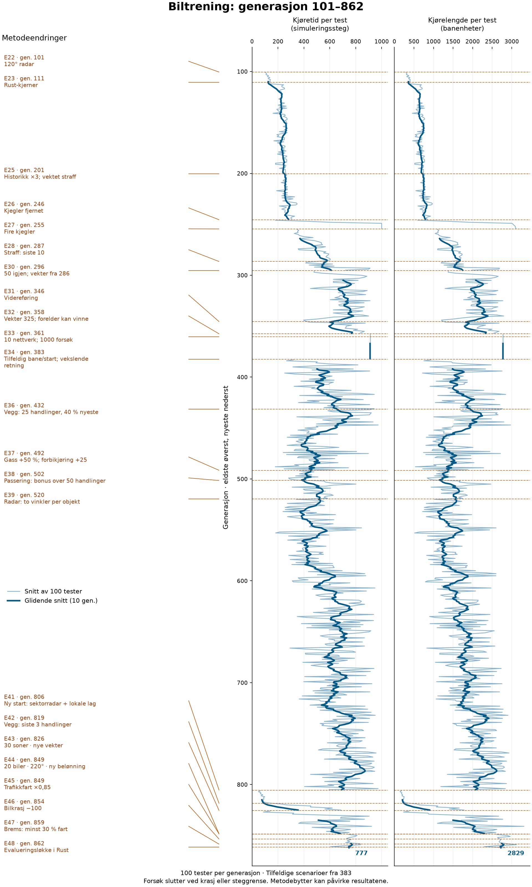

# Tidslinje for biltreningen

Oppføringene følger utviklingsloggen. Hver lenke beskriver forslag, begrunnelse, implementering og resultater. Generasjon er bare oppgitt der overgangen er verifisert; ulike forsøksserier må ikke sammenlignes som én uavbrutt trening.

| Hendelse | Første generasjon / serie | Endring og begrunnelse |
| --- | --- | --- |
| E01 | Se logg; ingen bekreftet grafgrense | [Hukommelse ble delt i to separate spørsmål](../UTVIKLINGSLOGG_BIL.md#endring-01) |
| E02 | Se logg; ingen bekreftet grafgrense | [Fra oval til åttetall, høyde og trafikk](../UTVIKLINGSLOGG_BIL.md#endring-02) |
| E03 | Se logg; ingen bekreftet grafgrense | [Egen treningsbane og mer informasjon om andre biler](../UTVIKLINGSLOGG_BIL.md#endring-03) |
| E04 | Se logg; ingen bekreftet grafgrense | [Visualisering og faktisk treningshastighet](../UTVIKLINGSLOGG_BIL.md#endring-04) |
| E05 | Se logg; ingen bekreftet grafgrense | [Radaren fikk veggskjerming, og så ble det valgt bort](../UTVIKLINGSLOGG_BIL.md#endring-05) |
| E06 | Se logg; ingen bekreftet grafgrense | [Måling lokaliserte flaskehalsen](../UTVIKLINGSLOGG_BIL.md#endring-06) |
| E07 | Se logg; ingen bekreftet grafgrense | [Prosjekteieren utfordret hvordan straffen brukes](../UTVIKLINGSLOGG_BIL.md#endring-07) |
| E08 | Se logg; ingen bekreftet grafgrense | [Fra halvering bakover til hovedvekt før kollisjonen](../UTVIKLINGSLOGG_BIL.md#endring-08) |
| E09 | Se logg; ingen bekreftet grafgrense | [Positiv belønning og evolusjon ble eksplisitte krav](../UTVIKLINGSLOGG_BIL.md#endring-09) |
| E10 | Se logg; ingen bekreftet grafgrense | [Prosjekteieren skjerpet protokollen til 100/20](../UTVIKLINGSLOGG_BIL.md#endring-10) |
| E11 | Se logg; ingen bekreftet grafgrense | [Utvidelse til 30 generasjoner med samme hybridmetode](../UTVIKLINGSLOGG_BIL.md#endring-11) |
| E12 | Se logg; ingen bekreftet grafgrense | [Flere kjegler og smalere radar uten å forkaste vektene](../UTVIKLINGSLOGG_BIL.md#endring-12) |
| E13 | Se logg; ingen bekreftet grafgrense | [Fire radarobjekter og utvidelse av det trente nettet](../UTVIKLINGSLOGG_BIL.md#endring-13) |
| E14 | Se logg; ingen bekreftet grafgrense | [Fortsett fra samme sted, og behold historikken](../UTVIKLINGSLOGG_BIL.md#endring-14) |
| E15 | Se logg; ingen bekreftet grafgrense | [Avgrens til fem generasjoner før ny vurdering](../UTVIKLINGSLOGG_BIL.md#endring-15) |
| E16 | Se logg; ingen bekreftet grafgrense | [Brems, ny initialisering og relativ fart i radaren](../UTVIKLINGSLOGG_BIL.md#endring-16) |
| E17 | Se logg; ingen bekreftet grafgrense | [Resultat etter fem generasjoner med brems](../UTVIKLINGSLOGG_BIL.md#endring-17) |
| E18 | 1 / deep-reset | [To ekstra skjulte lag og 100 generasjoner fra nye vekter](../UTVIKLINGSLOGG_BIL.md#endring-18) |
| E19 | Se logg; ingen bekreftet grafgrense | [Automatisk forbedringslogg per generasjon](../UTVIKLINGSLOGG_BIL.md#endring-19) |
| E20 | Se logg; ingen bekreftet grafgrense | [Trening uten løpende visualisering](../UTVIKLINGSLOGG_BIL.md#endring-20) |
| E21 | 28 / deep-reset | [Asynkron rotasjon av nettverk mellom bilene](../UTVIKLINGSLOGG_BIL.md#endring-21) |
| E22 | 101 / wide120 | [Bredere sidesyn og 300 nye generasjoner med beholdte vekter](../UTVIKLINGSLOGG_BIL.md#endring-22) |
| E23 | 111 / wide120 | [Gradienter, radar og kollisjonsavstander flyttes til Rust](../UTVIKLINGSLOGG_BIL.md#endring-23) |
| E24 | Se logg; ingen bekreftet grafgrense | [Ny video etter observert framgang](../UTVIKLINGSLOGG_BIL.md#endring-24) |
| E25 | 201 / wide120 | [Lengre historikk og større kollisjonsstraff på siste handling](../UTVIKLINGSLOGG_BIL.md#endring-25) |
| E26 | 246 / no_cones | [Uten kjegler; samme vekter og læringsmetode](../UTVIKLINGSLOGG_BIL.md#endring-26) |
| E27 | 255 / four_cones | [Fire kjegler tilbake; beholdte vekter](../UTVIKLINGSLOGG_BIL.md#endring-27) |
| E28 | 287 / four_cones | [Straff på ti siste; 25 % til handlingen nærmest krasjet](../UTVIKLINGSLOGG_BIL.md#endring-28) |
| E29 | Se logg; ingen bekreftet grafgrense | [Hypotese fra prosjekteieren: skille radar fra kantfølere](../UTVIKLINGSLOGG_BIL.md#endring-29) |
| E30 | 296 / four_cones | [Tilbake til 50 oppføringer og vektene fra generasjon 286](../UTVIKLINGSLOGG_BIL.md#endring-30) |
| E31 | 346 / four_cones | [Budsjett utvidet til 800; automatisk videreføring etter 345](../UTVIKLINGSLOGG_BIL.md#endring-31) |
| E32 | 358 / four_cones | [Gjenopprett generasjon 325; gammel modell kan vinne](../UTVIKLINGSLOGG_BIL.md#endring-32) |
| E33 | 361 / four_cones | [Ti nettverk; dobbelt antall treningsforsøk](../UTVIKLINGSLOGG_BIL.md#endring-33) |
| E34 | 383 / random_scenarios | [Tilfeldige 4–8 kjegler og starter; felles retning veksler](../UTVIKLINGSLOGG_BIL.md#endring-34) |
| E35 | Se logg; ingen bekreftet grafgrense | [1000 generasjoner: mål om passeringer og ulike hindringer](../UTVIKLINGSLOGG_BIL.md#endring-35) |
| E36 | 432 / random_scenarios | [Veggkontakt: siste 25, 40 % til nyeste](../UTVIKLINGSLOGG_BIL.md#endring-36) |
| E37 | 492 / random_scenarios | [Gassutgang og belønning for forbikjøring](../UTVIKLINGSLOGG_BIL.md#endring-37) |
| E38 | 502 / random_scenarios | [Jevn forbikjøringsbonus over 50 handlinger](../UTVIKLINGSLOGG_BIL.md#endring-38) |
| E39 | 520 / random_scenarios | [To vinkler per radarobjekt; 31 innganger](../UTVIKLINGSLOGG_BIL.md#endring-39) |
| E40 | Se logg; ingen bekreftet grafgrense | [Video av generasjon 793 i README](../UTVIKLINGSLOGG_BIL.md#endring-40) |
| E41 | 806 / sectors15 | [Ny start: 15 radarsektorer og lokalt synsnett](../UTVIKLINGSLOGG_BIL.md#endring-41) |
| E42 | 819 / sectors15 | [Veggstraff på tre siste lagrede handlinger](../UTVIKLINGSLOGG_BIL.md#endring-42) |
| E43 | 826 / sectors30 | [30 soner, tettere foran, nye vekter](../UTVIKLINGSLOGG_BIL.md#endring-43) |
| E44 | 849 / traffic20 | [20 biler, passeringsbonus og 220° syn](../UTVIKLINGSLOGG_BIL.md#endring-44) |
| E45 | 849 / traffic20 | [Trafikkbilene får 15 % lavere grunnfart](../UTVIKLINGSLOGG_BIL.md#endring-45) |
| E46 | 854 / traffic20 | [Doblet bilkollisjonsstraff](../UTVIKLINGSLOGG_BIL.md#endring-46) |
| E47 | 859 / traffic20 | [Maksbrems ned til 30 % av normalfarten](../UTVIKLINGSLOGG_BIL.md#endring-47) |
| E48 | 862 / traffic20 | [Hele evalueringen flyttet til Rust](../UTVIKLINGSLOGG_BIL.md#endring-48) |
| E49 | 863 / traffic20 | [Ti treningsbiler og GPU-batcher på 50](../UTVIKLINGSLOGG_BIL.md#endring-49) |

## Sammenlignbar del av forsøket

Grafen leses ovenfra og ned, med generasjon på loddrett akse og vannrette endringstekster til venstre. Grafen starter med 120° radar ved generasjon 101. Rust-bytte ved 111 og historikkendring ved 201 er markert. Fra generasjon 246 er kjeglene fjernet; fra 255 er fire kjegler lagt tilbake. Disse miljøendringene starter nye sammenligningsperioder. Fra 296 gjenopprettes 50 oppføringer og vektene fra 286; grafen brytes ved denne tilbakeføringen. Fra 358 gjenopprettes vektene fra 325 og forelderen får vinne. Fra 383 endres kjegler, starter og retning hver generasjon: trendendringer kan skyldes vanskelighetsgrad, ikke bare læring. Oppføringer om videoer og dokumentasjon er med i tidslinjen, men markeres ikke som treningsendringer.

Ved overgang til sektorradar starter et nytt nettverk med nye vekter. Kurve og glidende snitt brytes ved denne overgangen. Kurven viser siste generasjon i lagrede data da grafen ble laget. Den er et øyeblikksbilde, ikke automatisk oppdatert. Glidende snitt bruker de siste ti generasjonene og kan krysse en metodegrense, men nullstilles ved endringer i kjegleantallet og tilbakeføring av vekter. Samvariasjon med en markering viser ikke alene at endringen forårsaket forbedring.

Ved nye endringer: legg først inn begrunnelse og observasjon i utviklingsloggen, deretter hendelse i `car-training-timeline.json` med forsøksserie og første berørte generasjon. Bruk null når grensen er ukjent. Oppdater graf og tidslinje med `.venv-media/bin/python scripts/plot_car_training_progress.py`.
