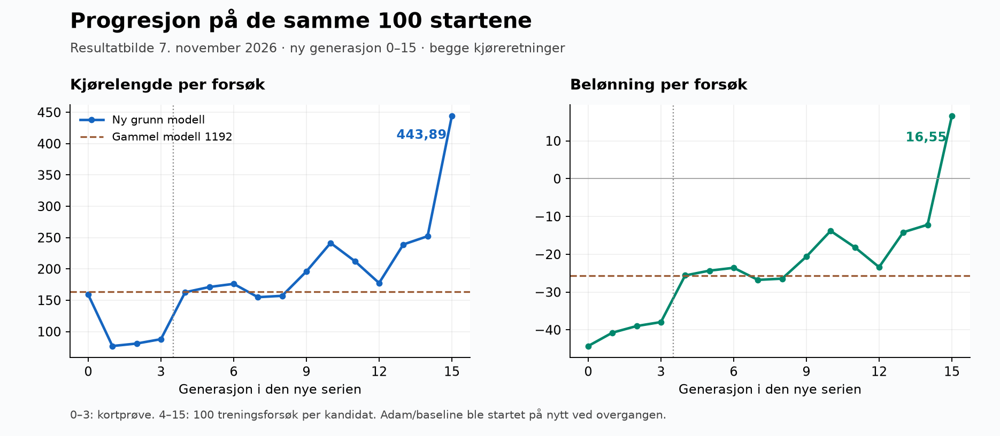

# Laser2: hvorfor sensorresponsen forsvant, tiltak og målt forbedring

**7. november 2026 · resultatbilde til og med ny generasjon 15.**

Den gamle modellen fra generasjon 1192 ga nesten samme styring uansett hva
sensorene viste. Beslutningslaget etter synsdelen var nesten fullstendig
mettet, og gradientene tilbake til synslagene var svært små. Vi startet et
nytt forsøk med ferske vekter, grunnere beslutningsdel, avslått mutasjon og
videreføring av Adam og baseline mellom generasjoner.

På **de samme 100 evalueringsstartene** kjører ny generasjon 15 i gjennomsnitt
**443,89 banenheter**, mot **163,99** for gammel generasjon 1192: **2,71 ganger
så langt, eller 170,7 % forbedring**. Nettverket har også vesentlig større
sensorrespons og gradienter tilbake til synslagene. Dette dokumenterer
forbedring for den samlede endringen i dette forsøket.

[Diagram som SVG](laser2-sensor-collapse-fix-20261107.svg).

## Hva som var feil

### 1. Beslutningsdelen var nesten uavhengig av sensorene

På 120 faste sensorobservasjoner var spennvidden i styringsutgangen bare
**0,000184**. Den varierte fra −0,028056 til −0,027872. Modellen reagerte altså
svært lite på forskjellen mellom veisituasjonene i dette utvalget.

I det første tette laget, **488→64**, var **99,91 % av de målte
tanh-aktiveringene mettede**, definert som absolutt aktivering minst 0,99.
Ingen av de 64 nevronene skiftet fortegn mellom observasjonene. Ved slik
metning er den lokale tanh-gradienten liten, slik at læringssignalet svekkes
på vei tilbake gjennom nettverket.

Et nevron trenger ikke skifte fortegn for å reagere på input. Derfor brukes
fortegnsmålet sammen med utgangsspenn, metning og direkte gradientmålinger.

### 2. Mutasjonsstøyen var stor i forhold til startvektene

Treneren klonet forelderen til seks kandidater. Én kandidat var uendret, mens
de fem andre fikk Gauss-støy med **σ = 0,03 på alle vekter og bias** hver
generasjon. Med `--trained-only` kunne en mutert kandidat bli valgt selv om
den uendrede forelderen hadde bedre resultat.

I 488→64 starter tilkoblingsvektene med standardavvik omtrent
**1/√488 = 0,0453**. Mutasjonsstøyen var dermed omtrent **66 % av startskalaen**
per generasjon. Gjentatt utvalg av muterte etterkommere kan akkumulere denne
støyen. I generasjon 1192 var målt standardavvik for hele laget, inkludert
bias, **0,31579**, omtrent **7 ganger startskalaen**.

Dette støtter akkumulert mutasjon som hovedforklaring på vektveksten og
metningen. Forsøket isolerer ikke mutasjonens bidrag fra de øvrige tiltakene.

### 3. Mange lag svekket gradientene, og treningstilstanden ble nullstilt

Den gamle beslutningsdelen var
**488→64→64→48→32→24→16→8→4→2**. Det ga mange tanh-lag mellom syn og handling.
Målt RMS-gradient fra styringsutgangen tilbake til vektene i de tre synslagene
var **4,28·10⁻⁶** i den gamle modellen.

Den roterende treneren laget også nye policy-objekter i `train_generation`.
Dermed ble både Adam-momentene og baseline-nettet initialisert på nytt hver
generasjon. Informasjonen optimalisatoren og baseline hadde lært, fulgte ikke
den valgte modellen videre.

### 4. Bedre poengsum kunne skjule kortere kjøring

Fartsvektet framdriftsbelønning gir høyere belønning for samme kjørelengde ved
høy fart. En modell med nesten konstant styring kunne derfor få bedre poengsum
ved å øke gassen, uten å lære å følge veien bedre. Belønning alene var ikke et
tilstrekkelig mål på kjøreprogresjon.

Tilsvarende betyr **100/100 krasj ikke at læringen har stoppet**. Modellen kan
kjøre stadig lengre før krasj. Kjørelengde og belønning på sammenlignbare
starter er derfor hovedmålene for progresjon her.

## Hvordan det ble løst

| Tiltak | Konkret endring | Formål |
| --- | --- | --- |
| Slå av mutasjon | `--mutation-sigma` har standardverdi **0** | Stoppe nye tilfeldige vektpåslag mellom generasjonene |
| Starte ny modell | Fersk laser2-modell fra seed 20261123 | Unngå å videreføre de mettede vektene fra 1192 |
| Gjøre beslutningsdelen grunnere | **488→64→32→2**, med de tre lokale synslagene beholdt i arkitekturen | Gi kortere vei for læringssignalet fra handling til syn |
| Videreføre treningstilstand | Baseline-vekter og begge Adam-optimalisatorene kopieres fra valgt forelder | Beholde læringshistorikken mellom generasjoner |
| Fryse tilstanden ved utvalg | Egen kopi av vinnerens vekter, baseline og Adam-momenter | Hindre at senere kreditt fra eldre kjørehistorikk endrer den lagrede foreldretilstanden |
| Logge nettverksrespons | 120 faste observasjoner; utgangsspenn, metning og fortegnsmål per skjult lag | Oppdage ny kollaps tidlig |
| Måle kjøreprogresjon separat | 100 faste kjøreforsøk etter hver generasjon, uten bruk i kandidatvalg | Sammenligne generasjoner uten endrede startforhold |

Den gamle arkitekturen kan fortsatt lastes og avspilles. Den nye standarden
gjelder ferske laser2-modeller. Fartsvektingen, veggstraffen og fordelingen av
kollisjonskreditt ble beholdt i dette forsøket.

## Hvor mye nettverket ble forbedret

Samme 120 sensorobservasjoner brukes for begge modeller. Gradientmålet er
gjennomsnittlig RMS-gradient for styring over de første ti observasjonene,
beregnet over vekter og bias i alle de tre lokale synslagene.

| Mål | Gammel generasjon 1192 | Ny generasjon 15 | Endring |
| --- | ---: | ---: | ---: |
| Spenn i normalisert styringsutgang | 0,000184 | 0,649653 | **3533 ganger større** |
| Mettede aktiveringer i 488→64 | 99,91 % | 0 % | Metning borte på dette utvalget |
| Nevroner i 488→64 som skifter fortegn | 0 % | 20,31 % | Flere nevroner varierer over null |
| RMS-gradient tilbake til synslagene | 0,00000428 | 0,006310 | **1474 ganger større** |
| Standardavvik i 488→64, inkludert bias | 0,31579 | 0,04657 | Nær skalaen ved fersk initialisering |

Større utgangsspenn og gradienter er tegn på gjenopprettet sensorrespons og
bedre gjennomgang for læringssignalet. De er ikke alene et mål på god kjøring.
Det må vurderes med kjøreforsøkene nedenfor.

## Hvor mye kjøringen ble forbedret

Alle tallene under kommer fra **de samme 100 kjøreforsøkene**: 20 scenarioer
med fem startroller, fordelt likt på begge kjøreretninger, maks 1000 steg.
Det er ingen trafikk eller kjegler, og ingen tilfeldig distansegrense i
evalueringen. Framdriftsbelønning, fartsvekting og veggstraff er like.

| Modell/generasjon | Kjørelengde per forsøk | Belønning per forsøk |
| --- | ---: | ---: |
| Gammel 1192 | 163,99 | −25,68 |
| Ny 0, fersk | 159,05 | −44,28 |
| Ny 3, etter kortprøven | 87,86 | −37,94 |
| Ny 4 | 162,73 | −25,60 |
| Ny 6 | 176,16 | −23,58 |
| Ny 10 | 241,43 | −13,81 |
| Ny 12 | 177,49 | −23,40 |
| Ny 14 | 252,20 | −12,19 |
| **Ny 15** | **443,89** | **+16,55** |

- Mot gammel generasjon 1192 øker kjørelengden **170,7 %**, fra 163,99 til 443,89.
- Mot starten av videre treningen, ny generasjon 3, øker den **405,2 %**:
  **5,05 ganger så langt**.
- Belønningen øker **54,49 poeng per forsøk** fra generasjon 3 til 15,
  fra −37,94 til +16,55. Det oppgis poengforskjell fordi prosentvis endring
  blir lite meningsfull når belønningen krysser null.
- Det finnes tilbakeslag, eksempelvis i generasjon 12. Generasjon 15 er ett
  fullført resultatpunkt, ikke et løfte om samme nivå i alle senere generasjoner.

Alle disse modellene krasjer i 100/100 evalueringsforsøk. Forbedringen ligger
i lengre kjøring før krasj og høyere belønning. Forsøket viser derfor progresjon
selv om krasjandelen foreløpig er uendret.

## Hva vi fortsatt ikke har løst eller dokumentert

Fartsutgangen i generasjon 15 ligger mellom **0,99897 og 0,99941** på de faste
observasjonene, altså fortsatt nær full gass. Bedre styringsrespons har ikke
samtidig løst læring av bremsing og fartstilpasning.

Flere tiltak ble gjort samtidig, og forsøket bruker én treningsseed og ett
fast evalueringssett. Vi kan derfor dokumentere forbedringen etter den samlede
endringen, men ikke tilskrive en bestemt andel til hvert tiltak eller hevde at
resultatet gjelder nye baner og trafikkforhold.

Kortprøven kjørte generasjon 1–3 med ti treningsforsøk per kandidat. Videre
trening kjører 4–103 med 100 forsøk per kandidat. Adam og baseline måtte
initialiseres på nytt én gang ved dette prosessbyttet fordi de ikke lå i
modellfilene. Deretter videreføres de mellom generasjonene. Adam-telleren
økte fra **107 ved generasjon 4 til 1432 ved generasjon 15**.

## Kilder, kode og kontroll

- [Frosne målinger til og med generasjon 15](laser2-sensor-collapse-fix-20261107.json):
  alle faste progresjonspunkter, beregnede forholdstall og SHA-256 for modeller,
  sensorobservasjoner og evalueringsstarter.
- [Kortprøven og opprinnelige målinger](laser2-shallow-smoke-20261107.md).
- [Løpende progresjonslogg](laser2-shallow-continue-generation-progress.md).
- [Laser2-arkitektur](../../ai/laser_vision.py),
  [kandidatvalg og videreføring](../../games/car/hybrid.py),
  [roterende trening](../../games/car/rotating.py) og
  [diagnostikk](../../games/car/policy_diagnostics.py).
- Lokale originaldata: `.ai-service/car-road-distance-limits-1500/generation-1192.json`,
  `.ai-service/car-laser2-shallow-no-mutation-smoke-20261107/` og
  `.ai-service/car-laser2-shallow-continue-103/`.
- Verifikasjon ved implementering: **159 V2-tester bestått**, inkludert
  videreføring og kopiering av treningstilstand, metningsmåling og samsvar
  mellom Python og Rust for ny og gammel laser2-arkitektur.

## Overgang til åttetallsbanen

Den opprinnelige planen var overgang etter generasjon 20. Prosjekteieren ba
deretter om å bytte med en gang. Overgangen ble derfor gjort fra siste lagrede
og evaluerte generasjon **16** på treningsbanen. De samme modellvektene videreføres
til **generasjon 17 på `figure_eight`**, med mål om generasjon 103. Resten av
treningsoppsettet beholdes. Overgangen skal gi en tidligere prøve av
fartstilpasning i åttetallsbanens svinger.

Årsaken til at den lengre prøven fortsatt brukte treningsbanen, var at
`hybrid.py` hadde `training` hardkodet. Treneren har nå eksplisitt `--track`
for både trening, evaluering og lagret modellmetadata. En separat kort
prøvegenerasjon på åttetallsbanen fullførte før overgangen ble satt opp;
28 relevante tester bestod. Dette kontrollerer oppsettet, ikke læringsprogresjon
på den nye banen.

Overgangsprosessen kontrollerte modellfilen fra generasjon 16,
stoppet den gamle kjøringen og startet en egen åttetallsserie.
De ferdige modellene og målingene fra treningsbanen beholdes. Adam og baseline
må initialiseres på nytt ved prosessbyttet, og videreføres deretter mellom
generasjonene i den nye prosessen.

Ny lokal kjøring: `.ai-service/car-laser2-shallow-figure-eight-103/`.
Overgangsstatus: `.ai-service/car-laser2-shallow-figure-eight-103.transition.json`.
Den nye serien får en egen progresjonslogg og egne faste evalueringsstarter
på åttetallsbanen. Tall fra de to banene må ikke fremstilles som en direkte
læringstrend under uendret vanskelighetsgrad. Resultatbildet i hovedrapporten
er fortsatt frosset ved generasjon 15 på den opprinnelige treningsbanen.
