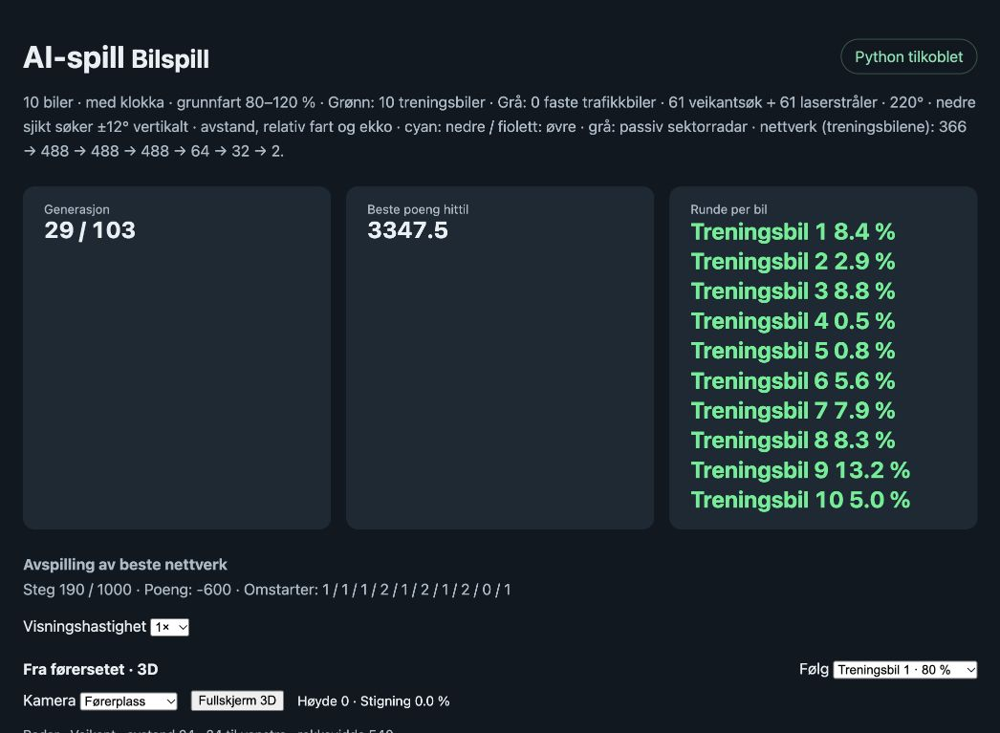

# Veikanten ved endret helning: vertikalt søk og ugjennomsiktig veibane

7. november 2026. Sensorretting på åttetallsbanen, videreført fra generasjon
**29**, med ny trening fra **30** mot 103.

## Feilen og avgrensningen

Bilens og sensorenes helning fulgte allerede bakken. På en vei med konstant
helning er dette tilstrekkelig: flat vei, 19 % oppover og 19 % nedover ga
identiske avstander og 58 kanttreff i nedre sjikt i en kontrollert prøve.

Blindsonen oppstår når helningen endrer seg foran bilen. Det nedre sjiktet
hadde bare én rett måleretning per vinkel, fra høyde 0,5. Strålen kunne da
passere over den to enheter høye veikanten, eller gå ned i veibanen før den
nådde kanten. Veibanen ble ikke behandlet som en ugjennomsiktig flate, så en
stråle under asfalten kunne ende som «ingen treff innen 540».

Den første kontrollen var for snever: 26 kanttreff i en bratt rampe var
hovedsakelig sidetreff. Innenfor ±30° foran bilen var det **0 av 27** kanttreff.
Disse to målene må ikke blandes sammen.

## Rettingen

- Et gyldig, synlig treff med den opprinnelige retningen beholdes.
- Hvis nedre sjikt ikke ser en veikant i en retning, søker det i en vertikal
  vifte på **±12°** rundt den opprinnelige retningen. Det beregner treff med
  den faktiske kantflaten; strålene bøyer seg ikke etter veien.
- Søket prøver retningen nærmest den opprinnelige og den høyeste tilgjengelige
  delen av kanten innenfor viften. Det nærmeste gyldige treffet velges.
- Veibanen bygges som trekanter og blokkerer stråler. En kant skjult bak
  veibanen godtas ikke. Hvis den opprinnelige strålen treffer veibanen og søket
  ikke finner et synlig hinder, rapporteres **veibane**, med faktisk avstand,
  fremfor full rekkevidde som om området var tomt.
- Øvre sjikt beholder sin opprinnelige retning, med samme kontroll mot
  gjennomgang av veibanen. Det vertikale ekstrasøket gjelder bare nedre sjikt.

Søket er en idealisert vertikal sensorvifte, ikke et nytt sett med ekstra
nettverksinnganger. Observasjonene beholder **61 retninger × to sjikt × tre
verdier = 366 innganger**. Arkitektur og alle innlærte vekter er beholdt.

Den nye sensorprotokollen er `laser2_distance_closing_echo_fan_v2`, med
modellmetadata `laser_vertical_fan_degrees=12`. CLI-valget er
`--laser-vertical-fan 12`. Gamle modeller uten dette feltet bruker fortsatt
den gamle protokollen. Python-trening, Rust-evaluering og avspilling bruker
den samme nye innstillingen når den er aktivert.

## Målt forbedring av sikten

Samme bilposisjon og retning, samme bane og samme rekkevidde; bare
sensorprotokollen er endret. Tabellen teller **synlige veikanttreff** blant
27 nedre måleretninger innenfor ±30° foran bilen. Treff i veibanen telles ikke
som kanttreff.

| Punkt på rampen | Helning | Før | Etter |
| --- | ---: | ---: | ---: |
| Segment 100 | −4,2 % | 0/27 | 6/27 |
| Segment 140 | −14,8 % | 1/27 | 24/27 |
| Segment 170 | −19,0 % | **0/27** | **24/27** |
| Segment 200 | −15,8 % | 0/27 | 24/27 |
| Segment 230 | −9,8 % | 0/27 | 27/27 |
| Segment 260 | −4,6 % | 0/27 | 27/27 |
| Segment 290 | −1,1 % | 3/27 | 27/27 |

I segment 170 rapporterte retningen omtrent 23° til høyre tidligere avstand
**540 uten treff**. Med rettingen finner den veikanten på **93,83**.
Enkelte retninger er fortsatt skjult av bakketoppen; rettingen gir ikke syn
gjennom bakken og garanterer ikke at alle kanter alltid kan sees.

[Råmålinger og lokal kjøretidsmåling](laser2-vertical-fan-20261107.json).
En prøve med 70 skanninger per modus målte omtrent **1,1 ms før** og **3,6 ms
etter**. Dette er en lokal sensormåling under annen aktivitet, ikke et
presist anslag på generasjonstid. Søk og siktkontroll koster mer beregning.

## Trening, visning og begrensninger

En kort prøvegenerasjon med seks kandidater og to forsøk per kandidat
fullførte før omstarten. Den verifiserer hele løpet, ikke bedre innlært kjøring.
Deretter ble den gamle kjøringen stoppet og ny trening startet fra siste
ferdige generasjon **29**. Vektene i ny `initial.json` er kontrollert identiske
med `generation-29.json` fra forrige serie. Adam og baseline initialiseres
på nytt ved prosessbyttet og videreføres deretter mellom generasjoner.

Ny kjøring: `.ai-service/car-laser2-vertical-fan-figure-eight-103/`.
Korte kontrollforsøk: `.ai-service/car-laser2-vertical-fan-preflight-20261107/`.
Avspillingen viser den overførte modellen med nye sensorer; sensorbeskrivelsen
viser «nedre sjikt søker ±12° vertikalt».

Fartsvekting, krasjstraff, belønningshorisont, arkitektur og valg av bane
beholdes. Sensorverdiene er endret, så modellen trenger videre tilpasning.
En startmåling med de nye sensorene ble logget før generasjon 30 trente, og
de samme faste startene brukes deretter hver generasjon.

### Direkte sammenligning med identiske vekter

Samme modell fra generasjon 29 er evaluert med gamle og nye sensorer på de
samme 100 startene. At startsettene er identiske, er kontrollert direkte i JSON-filene.

| Sensorer, samme vekter | Kjørelengde per forsøk | Belønning per forsøk |
| --- | ---: | ---: |
| Opprinnelige | 484,56 | +21,54 |
| Vertikalt søk og ugjennomsiktig veibane | 588,60 | +38,28 |

Det er **21,5 % lengre kjøring** ved bytte av sensorer, før videre læring.
Dette gjelder dette ene sjekkpunktet og startsettet; det garanterer ikke
samme gevinst for andre modeller. Læringsprogresjonen etter omstarten er
ennå ikke dokumentert her.

## Verifikasjon

**165 V2-tester består**, og visningens JavaScript passerer syntakskontroll.
De fem nye testene kontrollerer:

1. Identiske målinger på flat vei og jevne oppover-/nedoverbakker.
2. Gjenfunnet veikant foran bilen i den faktiske rampen på åttetallsbanen.
3. At asfalt blokkerer en skjult kant og registreres fremfor falskt fri sikt.
4. Avvisning av manglende eller ugyldig veigeometri.
5. Numerisk samsvar mellom Python- og Rust-evaluering med nye sensorer i rampen.

Kode: [sensorer i Rust](../../rust/ai_native/src/laser.rs),
[geometri og Python-kobling](../../games/car/laser_radar.py),
[tester](../../v2/test_laser_vertical_fan.py).
