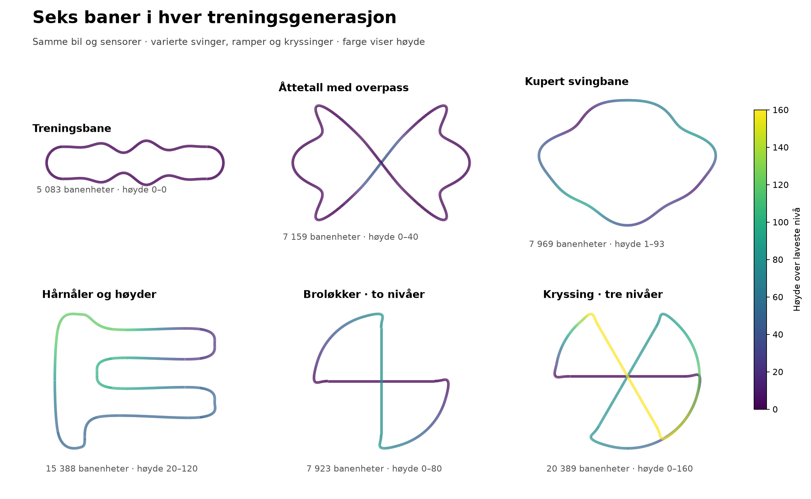
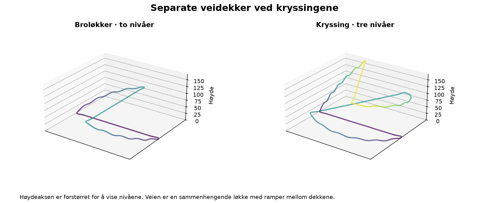
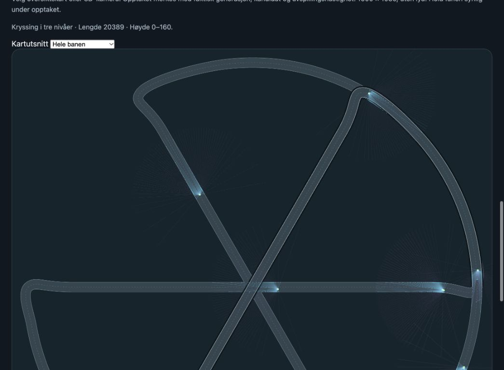
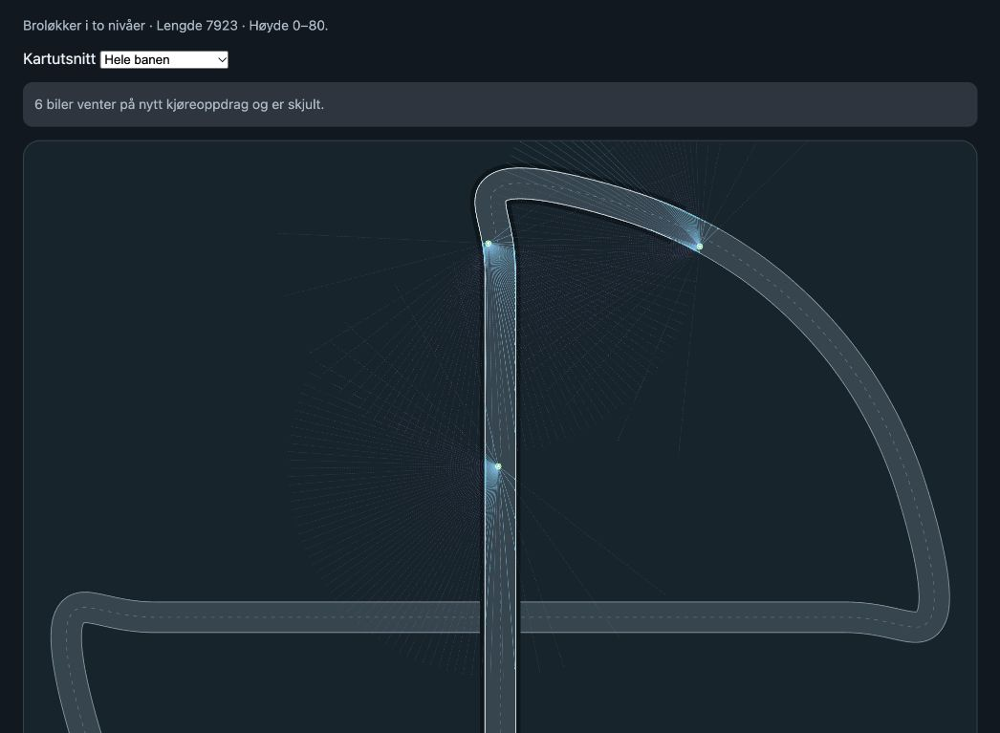

# Seks treningsbaner: svinger, bakker og separate veidekker

Treningen er utvidet fra én bane til **seks baner i hver generasjon**.
De to eksisterende treningsbanene er beholdt, og fire nye baner er lagt til.
Hensikten er å øve på flere kombinasjoner av sving, fart, helning og sikt,
og å oppdage om forbedring på én bane skjer på bekostning av en annen.



## Banene

Alle banene er lukkede og bruker samme veibredde på 76 banenheter.

| Bane | Oppgave | Lengde, omtrent | Høydenivåer |
| --- | --- | ---: | --- |
| `training` | Grunnleggende veifølging og vekslende S-svinger | 5083 | Flat, 0 |
| `figure_eight` | Krappe svinger, bakker og overpass | 7159 | 0–40 |
| `rolling_hills` | Sammenhengende svinger med skiftende helning | 7969 | 1–93 |
| `ridge_switchbacks` | Lange innkjøringer, hårnåler og høydeendringer | 15388 | 20–120 |
| `bridge_loops` | Kryssing med separate broer og ramper | 7923 | Dekker på 0 og 80 |
| `triple_stack` | Tre gjennomgående veidekker og forbindelser mellom dem | 20389 | Dekker på 0, 80 og 160 |



Det er fysisk forskjellige ruter, ikke bare andre startsteder på samme bane.
Den kuperte banen har kontinuerlig høydevariasjon. Hårnålsbanen kombinerer
langsider med vendinger og ramper. Kryssingsbanene har veier over og under
hverandre, med sammenhengende ramper mellom dekkene.

## Hvordan treningen fordeles

- De samme seks kandidatnettverkene trener på **alle seks baner** før
  kandidatvalget i hver generasjon.
- Budsjettet er fortsatt **100 kjøreforsøk per kandidat**, totalt **600**.
  Det fordeles som 16–17 forsøk per kandidat per bane. Resten og rekkefølgen
  roteres, slik at ingen bane alltid kommer sist eller alltid får flere forsøk.
- Hver bane bytter kjøreretning mellom generasjonene. Evalueringene bruker
  begge retninger i hver generasjon.
- Retningen er felles for **hele bilgruppen i en baneøkt**. En bil som
  krasjer og starter igjen, beholder gruppens retning. Alle øktens kjøreforsøk
  avsluttes før bilene erstattes med nye starter i en annen økt. Ingen bil
  snur alene mens andre fortsatt kjører motsatt vei. En ekstra kontroll
  avviser oppstart i motsatt retning hvis andre aktive biler er til stede.
- Adam, baseline og kandidatvekter beholdes gjennom alle banene. Ved neste
  generasjon arves den valgte forelderens treningstilstand som tidligere.
- En ny bane starter med nye biler og tom kjørehistorikk. Historikk fra én
  bane skal ikke få belønning eller krasjstraff fra en annen bane.
- De eksisterende belønningene, fartsvektingen, sensorviften på ±12°, arkitekturen
  og den avslåtte mutasjonen beholdes. Biler er fortsatt uavhengige uten trafikk
  og kjegler i dette forsøket.

Dette skal gi variasjon innen hver generasjon, fremfor at modellen trener
lenge på én bane og eventuelt glemmer de andre.

## Evaluering og progresjon

Kandidatvalget bruker **24 scenarioer totalt**, fire på hver bane, med to
scenarioer i hver kjøreretning. Hvert scenario prøves i fem startroller:
**20 forsøk per bane og 120 totalt per kandidat**. Hver bane får dermed samme
vekt i den samlede poengsummen.

Et separat sett med **120 faste kontrollforsøk**, også 20 per bane, brukes
etter hver generasjon. Disse startene brukes ikke til kandidatvalg. Det
logges kjørelengde og belønning per bane i både Markdown og egen CSV, i tillegg
til samlet resultat. Ekstra kontrollstarter under «holdout» er også separate
fra kandidatvalget.

Nettverkets metning og sensorrespons måles på 120 faste observasjoner,
20 fra hver bane. Resultater fra denne serien må vurderes mot startmålingen
på det samme settet med seks baner, ikke direkte mot snittet fra en tidligere
serie på bare åttetallsbanen.

Banene i kontrollsettet er også treningsbaner, med andre starttilstander.
Dette måler robusthet på de seks oppgavene; det dokumenterer ikke i seg selv
generalisering til helt ukjente baner. Mer variasjon gir et bedre forsøksoppsett,
men er ingen garanti for at bremsing eller annen ønsket atferd blir lært.

## Videreføring og lokale filer

Den nye kjøringen er startet fra siste ferdige modell i sensorvifteforsøket,
**generasjon 30**. Første nye generasjon er **31**, med mål om 103. Modellvektene
beholdes. Adam og baseline må initialiseres på nytt ved dette prosessbyttet;
deretter beholdes de gjennom banebytter og generasjoner i den nye prosessen.
Den gamle kjøringen er stoppet, og ferdige modeller og målinger beholdes.

Aktiv kjøring: `.ai-service/car-laser2-six-track-live-103/`.
Første oppstart og bevarte startmålinger: `.ai-service/car-laser2-six-track-103/`.
[Løpende progresjon](six-track-generation-progress.md).
CSV med tall per bane: `six-track-generation-progress.tracks.csv`, som
genereres når startmålingen er fullført.

CLI-valget er:

```sh
--tracks figure_eight training rolling_hills ridge_switchbacks bridge_loops triple_stack \
--rounds 100 --test-rounds 24 --fixed-evaluation-rounds 24
```

Flere baner krever foreløpig roterende trening, tilfeldige starter, road-only
og ingen kjegler eller tilfeldig distansegrense. Testantall må være delelig
med to ganger antall baner, slik at hver bane og retning får like mange tester.

Avspilling uten eksplisitt `--track` leser nå banen fra modellfilen. Vinneren
lagrer korrekt bane og scenario for avspilling, mens eksperimentmetadata
inneholder hele treningssettet.

## Kontroller som er gjennomført

**173 V2-tester består.** En prøve med to generasjoner, alle seks baner,
to kandidater og korte kjøringer fullførte. Adam-telleren var **6 → 12**, som
bekrefter at tilstanden overlever både bane- og generasjonsbytter i prøven.
Avspilling av modellen fra tredekkbanen ble også startet og kontrollert uten
å angi bane manuelt. Visningens JavaScript passerer syntakskontroll.

Nye tester kontrollerer blant annet:

- Lukkede baner uten nullengdesegmenter og med maksimal stigning under 20 %.
- At ikke-lokale veistrekninger som overlapper i grunnplanet, har over 36
  banenheters høydeforskjell i de undersøkte tette veifotavtrykkene.
- At de tre sentrale veidekkene på 0, 80 og 160 identifiseres separat av
  den faktiske Rust-geometrien.
- Gyldige, gjentakbare starter og lik testfordeling i begge retninger.
- At geometri og fremdriftsfunksjoner gjenopprettes etter evaluering av en
  annen bane, også ved feil.
- Rettferdig fordeling av treningsforsøk, bevaring av Adam og baseline og
  separate kjørehistorikker ved banebytte.

Kontrollene viser at oppsettet fungerer. De korte prøvene dokumenterer
foreløpig ikke bedre innlært kjøring på seks baner.

[Geometrimålinger og fingeravtrykk](six-track-training.json) ·
[SVG-oversikt](six-track-training-overview.svg) ·
[banegenerator](../../games/car/training_tracks.py) ·
[trening og evaluering på flere baner](../../games/car/multi_track.py) ·
[tester](../../v2/test_multi_track.py).


## Direktevisning av den faktiske treningen

Etter ønske om å se en ny bane under trening er det lagt inn direktevisning
fra den roterende treneren. Dette viser posisjonene til de faktiske bilene
som brukes til læring, med kandidatnummer per bil. Visningsprosessen kjører
ingen ekstra kjøreturer og oppdaterer ikke modellene.

Den påbegynte generasjonen 31 ble startet på nytt fra siste lagrede modell,
generasjon 30, for å aktivere visningen. Startmålingene fra første oppstart
ble gjenbrukt etter kontroll av identiske modellvekter og evalueringsinnstillinger.
Faste teststarter, banerekkefølge i testene og testbudsjetter er uendret.
Tredekkbanen ble valgt først i selve treningsrekkefølgen; alle seks brukes
fortsatt før kandidatvalget.

Visningen henter inntil fire øyeblikksbilder per sekund fra treningen og følger
automatisk når den skifter bane. Mens kandidatene evalueres, vises siste
treningsbilde med teksten «Evaluerer modeller». Hastighetsvelgeren er deaktivert;
visningen skal ikke styre treningstempoet.

Kilde: `.ai-service/car-laser2-six-track-live-103/live-frame.json`.
Leseren startes med `python -m games.car.live_training --frames FIL --port PORT`.
Den lokale adressen og prosessene står i kjøringens `.launch.json`.



Ny validering: **178 V2-tester består**, inkludert eksport av faktiske
treningsbilder, lesing uten å flytte bilene og avvisning av feilaktige
gjenbrukte startmålinger. En kort full generasjon med direktebilder og
utsatte starttester fullførte også.


### Rettet visning av ventende biler

Direktevisningen viste tidligere bilplasser uten aktivt kjøreoppdrag som
vanlige biler. Treneren lar slike plasser vente når et nettverk har brukt
sin kvote, mens andre fullfører. Dette kunne se ut som at modellen hadde
bremset helt til stillstand.

Leseren markerer nå disse bilene som `waiting`, de skjules i kartet og begge
3D-visningene, og kameraet følger en aktiv bil. Statusen viser hvor mange
som venter. Under evaluering vises en tydelig beskjed om at bildet er siste
treningsøyeblikk. Eldre bilder merkes som venting på neste bilde.

Fysikken og fartsregelen er uendret: med maksimal brems på 0,7 er minste
aktive fart `3 × speed_factor × 0,3`, altså 30 % av grunnfarten. Aktive
biler i den kjørende prosessen er kontrollert mot denne nedre grensen.
Treningsprosessen ble ikke startet på nytt; bare den separate visningsserveren
ble oppdatert. 17 relevante visnings-, brems- og gasstester består.


