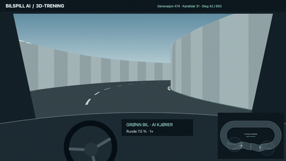

# Bilspill i AI-spill

[Utviklingslogg: forslag, metodeendringer og resultater steg for steg](../../docs/UTVIKLINGSLOGG_BIL.md).

**Pågående eksperiment:** [Begrenset synsfelt og hukommelse](../../docs/BIL_HUKOMMELSE.md). Den lange banen med overpass er implementert, og eksisterende vekter er prøvd uten videre trening. Fargeavlesing og hukommelse tilhører fortsatt steg 2.

## Treningsbane med kjegler og større radar

`--track training` velger en egen lukket bane på omtrent 5083 lengdeenheter, med gjentatte venstre-/høyresvinger og 11 kjegler plassert på ulike sider og midt i veien. Kjeglene er faste og reproduserbare. De vises i kartet, Rust/WebGPU og Canvas-reserven, oppdages av stråler og radar og gir kollisjonsstraff ved kontakt.

```sh
python3 -m games.car.app --track training --traffic convoy --radar-scale 3 --replay
```

Dette viser de eksisterende vektene; det starter ikke trening. Den nye standarden i appen er radar med **540 rekkevidde, radius 270 og sentrum 270 foran bilen**, tre ganger tidligere lineære mål. `--radar-scale 1` gjenoppretter det tidligere feltet. Avstandsstrålene har fortsatt rekkevidde 180. Større radarfelt endrer observasjonene selv med samme vekter.

Radaren rapporterer alle oppdagede biler og kjegler i `targets`, sortert etter avstand. For hvert treff leveres avstand fra eget bilsenter til målets kant, plassering fremover og sideavstand i bilens koordinatsystem: negativt er venstre og positivt er høyre. Nettverket bruker fortsatt bare det nærmeste radartreffet. Radaren skjermes ikke av vegger.

To inputformater finnes:

- `legacy`: eksisterende nærhet og nærhetsvektet retning; brukes automatisk ved avspilling av gamle modeller.
- `spatial`: nærhet `1-avstand/rekkevidde` og uavhengig sideplassering `sideavstand/radarradius`, begrenset til −1…1. Ingen treff gir 0,0. Fortsatt ni inputverdier totalt. Dette er standard for **ny trening** på treningsbanen.

Inputformat og radarstørrelse lagres i nye modeller. Avspilling avviser et inputformat som ikke samsvarer med modellens metadata. `games.car.advance` bruker modellens lagrede format og radarstørrelse; gamle modeller uten metadata bruker tidligere radarstørrelse. Nytt radarformat må trenes med egne vekter, og gamle vekter gir ikke dokumentert mestring av kjegler eller forbikjøringer.

## GPU-rendering

3D-visningen bruker nå **Rust → WebAssembly → wgpu/WebGPU**. GPU-en tegner bane, biler, overpass og førermiljø direkte i nettleseren. JavaScript håndterer grensesnitt og overføring av biltilstand. Statusfeltet over bildet viser «Rust + WebGPU · GPU-rendering aktiv» når dette kjører. Canvas-visningen beholdes som reserve ved manglende støtte eller rendererfeil. Oversiktskart og videoopptak er fortsatt separate fra GPU-rendereren.

De ferdigbygde filene følger repoet. [Byggeinstruksjoner, tester og tekniske begrensninger](../../rust/car_renderer/README.md).

## Fem biler i samme retning

Vanlig oppstart bruker nå `--traffic convoy`: fem biler med faste fartsfaktorer **80, 90, 100, 110 og 120 %** (2,4–3,6 lengdeenheter per steg). De starter jevnt fordelt rundt hele banen, med en femtedels runde mellom hver (omtrent 1432 lengdeenheter på åttetallsbanen). Hver bil har sin egen startplass også etter kollisjon. Alle bruker samme nettverk. Ingen forbikjøringsregel er programmert inn.

```sh
python3 -m games.car.app --track figure_eight --traffic convoy --replay
```

Avspilling kjører nå simuleringen direkte og starter uten å vente på opptak av en hel runde. Den endrer ikke vektene. Velg mellom alle fem biler i 3D-visningen; hver har egen farge og oppgitt fart. `--traffic opposite` gjenoppretter forsøket med to biler i motsatt retning.

Alle sensorstråler finner nærmeste vegg eller aktive bil. De to radarinputene gjelder den nærmeste oppdagede bilen, slik at de lagrede vektene fortsatt passer til ni inputverdier. Kollisjon kontrolleres for alle bilpar; bare involverte biler starter på nytt, og alle andre biler tas med når startplassen kontrolleres. Trafikkoppsettet lagres i metadata ved trening. Et resultat med to biler kan ikke uten videre overføres til dette forsøket.

## Genererte baner med høyde

`Track` i `games/car/track.py` samler banegeometri, høyde, avstand til veikant, framdrift, startposisjoner og data til visningen. `Track.generate(name)` lager tre deterministiske baner:

| Navn | Bane |
| --- | --- |
| `s_curve` | Dagens S-bane med samme geometri og bredde, z=0. Fortsatt standard. |
| `oval` | Ovalen fra V1, representert med samme type samplede senterlinje som de andre banene. V1-arkivet er uendret. |
| `training` | Treningsbane med vekslende svinger og 11 kjegler. |
| `figure_eight` | Lang åttetallsbane med ekstra svinger begge veier, ramper og ett overpass. |

Den nye banen er omtrent **7159 lengdeenheter**, mot **1690** på S-banen: **4,24 ganger så lang** med samme veibredde (76) og bilstørrelse. I krysset er nedre veibane på z=0 og øvre på z=40. Banen har nøyaktig samme senterlinjeform som før, skalert til ¼ i x, y og z. Veien er gjort fire ganger bredere før nedskaleringen, slik at endelig bredde fortsatt er 76. Minste samplede svingradius er omtrent 26 og største stigning omtrent 19 %. Høyden brukes til å velge riktig veidel for sensorer, kollisjoner og framdrift. Bilene følger veihøyden; dette er en enkel kinematisk modell med fast fart i xy-planet, uten tyngdekraft, fjæring eller hopp.

Prøv de eksisterende vektene uten trening:

```sh
python3 -m games.car.app --track figure_eight --replay
```

Åpne <http://127.0.0.1:8766/>. Velg «Hele banen», «Følg valgt bil» eller «Overpasset» under kartutsnitt. Både førerplassen og oversiktskartet bruker den samme geometrien; førerplassen viser også veihøyden. 3D-kameraet følger veiens stigning og bilens høyde. Velg «Førerplass» eller «Bak bilen · 3D», og bruk «Fullskjerm 3D» for større bilde. Brodekket har også underside og sidekanter, slik at det er synlig fra undergangen. Høyde og stigningsprosent vises ved kameraet. Oversiktskartets bil- og sensormarkører tegnes over banen for lesbarhet, også når bilen er under broen.

Den lange banen får som standard 3580 steg per forsøk, nok til omtrent halvannen runde ved dagens fart. `--steps 650` gir en kortere prøve. Nettverket har fortsatt ni inputverdier; fargeavlesing er ikke lagt til. `--replay` bruker den gamle standardmodellfilen hvis `--model` ikke er oppgitt, og endrer ikke vektene. Ny trening på andre baner får et eget standardmodellnavn. `games.car.advance` bruker banens navn og antall steg fra modellens metadata, med mulighet for å overstyre via `--track` og `--steps`.

Egne baner kan opprettes med `Track([(x, y, z), ...], half_width=38, name='...')`. Siste punkt kobles automatisk til det første. Baneklassen avviser ugyldige koordinater og segmenter uten horisontal lengde; den gjør ikke full geometrisk validering av vilkårlige egendefinerte baner.

Bilspillet er en simulering sett ovenfra i 2D. En bane bygges automatisk bit for bit, og en bil uten innebygd kunnskap om kjøring skal lære å følge banen ved hjelp av et nevralt nettverk. Bilen får fire avstandsmålinger til banekanten. Å komme nær kanten gir straff, og å treffe kanten gir en betydelig strengere straff.

All banegenerering, bilfysikk, sensormåling, belønningsberegning og læring skal lages i Python. En eventuell React-klient viser simuleringen og henter oppdateringer fra Python via API. Simuleringen skal kunne kjøres og trenes uten React.

Dette er prosjektets første avgrensning. Det skal foreløpig ikke være trafikk, motstandere, 3D eller avansert kjørefysikk.

## Kjør demoen

V1 er bevart uendret med dokumentasjon i `versions/v1/`. Aktivt bilspill ligger i `games/car/` og bruker den felles klassen `NeuralNetwork` i `ai/network.py`. Alle kommandoer nedenfor kjøres fra prosjektroten.

**V2:** Kjør `python3 -m games.car.app` og åpne <http://127.0.0.1:8766/>. To like biler starter side om side ved samme startlinje midt i S-svingen på nedre langside og kjører i motsatt retning med samme nettverk og fast fart. Dermed kommer neste møte omtrent etter en halv runde hver, avhengig av kjøringen. Startplasseringen gir ingen sporregel til nettverket. Hver bil har sju sensorer ved −90°, −60°, −30°, 0°, 30°, 60° og 90° relativt til bilen. Sensorene måler nærmeste vegg eller bil. Veggkontakt straffes og starter bare den berørte bilen på nytt; den andre fortsetter. Ved bilkollisjon starter begge på nytt. En bil venter utenfor aktiv simulering hvis startplassen er opptatt.

V2 bruker et delt nettverk med ni innganger (sju stråler og to radarverdier), to skjulte lag med åtte tanh-nevroner hver og ett tanh-utslag for styring (9 → 8 → 8 → 1, totalt 161 vekter og biasverdier), trent med utvalg og mutasjon i 100 generasjoner med 36 kandidater. Ingen regel for vikeplikt eller kjørefelt er programmert inn. Treningspoengene består bare av straff for nærhet og kollisjon. Kollisjonsstraffen er redusert fra 350 til 50 poeng; nærhetsstraffen er uendret. De seks beste kandidatene kopieres uendret til neste generasjon, som tidligere. Det nye nettverket trenes fra tilfeldige vekter og bruker en egen modellfil; den gamle modellen overskrives ikke. Framdrift, kjøreretning og rundetelling brukes ikke i belønningen. Hver kandidat evalueres i 650 steg, med individuelle omstarter underveis. Begge tilbakestilles når neste kandidat skal evalueres. Treningen bruker standardstarten på en fast bane med S-sving på nedre langside; etterpå kontrolleres også to forskjøvede startplasseringer. Dette er ikke en test av generell kjøring på nye baner.

Visningen følger selve kandidaten som evalueres, med kandidatnummer, steg, poeng og kollisjonsutfall. Hastigheten kan settes til 1×, 3×, 10× eller 30×; den endrer ventetiden, ikke fysikken. Beste nettverk lagres etter hver generasjon i `games/car/models/model_radar_9_8_8_1.json`. Vanlig oppstart trener på nytt fra tilfeldige vekter; `python3 -m games.car.app --replay` viser den lagrede modellen. Tidligere modeller med framdriftsbelønning brukes ikke. Testene kjøres med `python3 -m unittest discover -s v2 -p 'test_*.py' -v`.

### V1

Kjør `python3 versions/v1/demo.py` og åpne <http://127.0.0.1:8765>. Demoen bruker bare standardbiblioteket i Python. Stopp serveren med Ctrl+C.

Demoen trener et lite nettverk med fire inputverdier, fem skjulte nevroner og ett styreutslag gjennom 60 generasjoner med utvalg og mutasjon. Visningen følger beste nettverk ved starten av hvert forsøk. Treningen starter på nytt når serveren startes; modellen lagres foreløpig ikke.

Denne første demoen bruker en fast oval bane og en enkel SVG-visning som henter tilstand fra Python. Tilfeldig banegenerering, React og evaluering på separate testbaner er ikke implementert ennå. Resten av dokumentet beskriver målet for prosjektet.

## Banen

Banen har fast bredde og skal bli en sammenhengende, lukket løype. Et mulig startpunkt ligger til venstre i visningen; plassering og startretning kan justeres.

Genereringen har tre faser:

1. **Bygg utover.** Legg til korte banestykker med rette partier og svinger. Svinger med klokka skal være mer sannsynlige enn svinger mot klokka, uten at alle svinger må gå samme vei.
2. **Vend tilbake.** Når den samlede retningsendringen er omtrent 180 grader med klokka, begynner generatoren gradvis å styre banen tilbake mot startområdet. Dette betyr at banen beveger seg tilbake, ikke at bilens hastighet reduseres.
3. **Lukk banen.** Når endene nærmer seg hverandre, beregnes en forbindelse som treffer startpunktet med riktig retning og uten å bryte minste tillatte svingradius. Den siste delen skal planlegges, ikke bare trekkes som en rett strek mellom endene.

### Geometriske krav

- Banen beskrives med en senterlinje og en fast bredde. Kantene ligger en halv banebredde på hver side.
- Minste svingradius gjelder senterlinjen og må være større enn halve banebredden, slik at innerkanten ikke kollapser i en sving.
- Retningen skal være sammenhengende mellom banestykker, også der banen lukkes. Det skal ikke være skarpe hjørner.
- Hele banebredden skal være fri for selvkryssing og overlapp mellom ulike deler av løypa. Nabostykker og selve skjøten ved start skal møtes normalt.
- Forbindelsen tilbake til start må kontrolleres mot resten av banen, både for svingradius og ledig plass.
- Hvis en gyldig avslutning ikke finnes, må generatoren gå tilbake og endre tidligere stykker eller prøve en ny bane. Den skal ikke redusere radiuskravet for å tvinge fram en løsning.

### Forslag til første implementasjon

Bruk rette linjestykker og sirkelbuer med kjent radius. Det gjør radiuskravet tydelig og gir et enkelt grunnlag for sensorer og kollisjonskontroll. Ved lukking søker generatoren etter en kombinasjon av buer og rette partier som forbinder sluttposisjon og sluttretning med startposisjon og startretning. En forbindelse godtas først når hele geometrien er validert.

Samlet retningsendring følges uten å nullstilles ved en hel omdreining. Etter omtrent en halv omdreining økes påvirkningen mot startområdet gradvis. Overgangen til lukking bør avhenge av både avstand, retning og tilgjengelig plass. Generatoren må reservere rom for tilkoblingen tidlig nok.

Tilfeldig generering skal støtte en fast seed, slik at samme bane kan gjenskapes. Bredde, minste radius, stykkelengde, sannsynlighet for sving med klokka og grenser for antall forsøk skal være konfigurerbare.

## Bilen og sensorene

Bilen starter på banen med retning langs senterlinjen. Nettverket har ingen ferdig regel for hvordan det skal svinge, og skal ikke få fasiten i form av banens senterlinje eller kommende svinger.

Nettverkets input er fire avstander fra bilen til første banekant langs fire måleretninger. Retningene følger bilen, ikke verdenskoordinatene. Nøyaktige sensorvinkler er ikke bestemt ennå.

Et forslag til første forsøk er målinger mot venstre, skrått framover mot venstre, skrått framover mot høyre og mot høyre. Fire retninger betyr dermed ikke nødvendigvis foran, bak, venstre og høyre. Vinklene skal kunne endres slik at ulike oppsett kan sammenlignes.

Sensorene får en maksimal rekkevidde, og avstandene normaliseres før de gis til nettverket. Ingen kant innenfor rekkevidden rapporteres som maksimal avstand. Kollisjonskontrollen må bruke bilens utstrekning og hele banekanten; fire sensorstråler alene er ikke nok til å oppdage alle sammenstøt.

### Forslag til første bilmodell

Start med fast, positiv fart og la nettverket bare styre svingutslaget. Dermed kan bilen ikke unngå straff ved å stå stille, og første læringsoppgave blir avgrenset til styring. Gass og brems kan vurderes senere.

Bilen har posisjon, retning og en enkel fysisk utstrekning. Python oppdaterer bevegelsen med fast simuleringstidssteg. Bilens maksimale svingutslag og fart må være forenlige med banens minste radius. Tidssteg og kollisjonskontroll må hindre at bilen hopper gjennom en kant mellom to oppdateringer.

## Læring og straff

Hvert treningssteg følger samme løkke: mål avstander, la nettverket velge styring, flytt bilen, kontroller kollisjon og beregn belønning eller straff. Treningsmetode og bibliotek er foreløpig åpne valg.

Belønningssystemet skal inneholde:

- **Straff nær kanten.** Straffen øker når klaringen mellom bilen og kanten blir liten. En mulig utvidelse er ekstra straff når klaringen minker raskt.
- **Kraftig straff ved kontakt.** Kontakt med kanten gir vesentlig sterkere straff enn vanlig nærhet. Første forslag er at dette også avslutter forsøket.
- **Belønning for framdrift.** Som tillegg til straff foreslås positiv belønning for faktisk framdrift langs banen i ønsket kjøreretning. Dette skal gjøre det lønnsomt å fullføre løypa.

Framdrift må måles sammenhengende langs løypa, slik at bilen ikke belønnes for å hoppe mellom nærliggende banedeler eller passere startstreken fram og tilbake. Simulatoren kan bruke senterlinjen til denne beregningen uten at nettverket får den som input.

Et forsøk avsluttes ved kollisjon, fullført runde eller en tidsgrense. Belønningsvektene må prøves ut; ingen konkrete verdier er bestemt. Først brukes en fast bane for å undersøke om bilen lærer. Deretter brukes flere genererte baner og egne testbaner som ikke inngår i treningen.

## Python og React

Python er eneste kilde til simuleringstilstand og har ansvar for:

- Banegenerering og validering av geometri.
- Bilbevegelse, sensorer og kollisjoner.
- Nettverk, trening og beregning av belønning.
- Lagring av baneseed, innstillinger og trente modeller.
- Et API for styring og avlesning av simuleringen.

React er valgfritt og har ansvar for å tegne banen og bilen ovenfra, vise sensorstrålene og presentere treningsstatus. Brukerhandlinger som start, pause og tilbakestilling sendes til Python. React skal ikke beregne fysikk eller læring.

API-et bør kunne levere banegeometri, bilens posisjon og retning, sensoravstander, belønning, forsøksnummer, kollisjonsstatus og framdrift. Hver tilstandsoppdatering bør ha forsøks-ID og stegnummer, slik at visningen kan skille forsøk og håndtere forsinkede oppdateringer. Endepunkter og valg mellom periodisk henting og strømming bestemmes ved implementering.

Treningen og skjermoppdateringen skal ha uavhengig tempo. Python må kunne kjøre mange treningssteg mellom hver oppdatering til React.

## Første milepæler

1. Generer og valider en lukket bane i Python med fast bredde og minste svingradius.
2. Legg til en bil med enkel bevegelse, fire sensorer og kollisjonskontroll.
3. Koble inn et nevralt nettverk og tren styring på en fast bane.
4. Undersøk læring på flere baner og mål resultatet på separate testbaner.
5. Koble på en valgfri React-visning via API.

Første fungerende versjon skal kunne gjenskape en bane fra seed, avvise ugyldige baner, kjøre og trene uten frontend og vise målbare resultater. Relevante mål er framdrift før kollisjon, antall fullførte runder og kollisjoner per forsøk. En pen animasjon alene er ikke dokumentasjon på at bilen har lært.

## Valg som gjenstår

Sensorvinkler, banebredde, minste radius, bilstørrelse, fart, nettverksarkitektur, treningsmetode og belønningsvekter bestemmes gjennom første implementasjon og forsøk. Fast fart, foreslått sensoroppsett og belønning for framdrift er startforslag; Python som kjerne, fire avstandsmålinger, straff ved kanten og 2D ovenfra er prosjektkrav.

### Uavhengig visualisering

Visningshastigheten styrer bare avspillingen av opptak fra faktiske treningsforsøk. Python trener uten animasjonsventing. Visningen fullfører ett opptak før den henter det nyeste ferdige forsøket; noen kandidater vises derfor ikke. Generasjonen som trenes og kandidaten som vises merkes separat.

### Radar

Bilene har i tillegg en radar med en rund deteksjonsboble med radius 90, sentrert 90 lengdeenheter foran bilen. Den oppdager den andre bilens utstrekning mellom sensorstrålene og gir to ekstra inputverdier: nærhet og relativ retning. Banekanter skjermer ikke radar i denne enkle modellen. Et oransje felt viser treff. Nettverket er nå 9 → 8 → 8 → 1 med 161 parametere. Tidligere vekter overføres med nullvekter for radarinputene, som bevarer tidligere styring nøyaktig før videre trening. Modellen lagres separat i `games/car/models/model_radar_9_8_8_1.json`.

### Ta opp banevideo

Trykk «Ta opp banevideo» over banen og deretter «Stopp opptak». Opptaket kan forhåndsvises og lastes ned fra lenken som vises. Bare banefeltet med biler, sensorstråler og radar tas opp, uten lyd, i 1600 × 1080. Nettleseren velger MP4 hvis det støttes, ellers WebM. Hold fanen synlig under opptaket. Last ned videoen før siden lukkes eller lastes på nytt. Treningen fortsetter uavhengig av opptaket.

### Førerplass i 3D

3D-visningen over oversiktskartet kan følge alle fem bilene, fra førerplassen eller bak bilen. Rust/WebGPU bruker samme geometri og bilposisjoner som Python-simuleringen. Førermiljøet har en enkel ramme, dashbord og statisk ratt; høyde og stigning vises over bildet. Canvas-reservevisningen har fortsatt et illustrert rattutslag basert på endring i kjøreretning. Bruk 1× for rolig avspilling. Videoopptaket gjelder fortsatt oversiktskartet. Klippene nedenfor viser den tidligere Canvas-versjonen.

[](../../docs/media/bilspill-3d-training.mp4)

[Se 3D-videoen (ca. 28 sekunder)](../../docs/media/bilspill-3d-training.mp4). Klippet viser faktiske treningsforsøk med et lite oversiktskart som følger begge bilene.

## Videoer fra den aktuelle treningsbanen

Opptak 5. november 2026, første generasjon: [oversiktskart, 31 sekunder](../../docs/media/training-cones-overview.mp4) og [Rust/WebGPU i 3D, 60 sekunder](../../docs/media/training-cones-3d.mp4). Oversiktsklippet viser kandidat 7 og 3D-klippet kandidat 13 ved 1× avspilling, inkludert feil og omstarter. Dette er treningskandidater, ikke en evaluering av en ferdig modell.

Treningsvideoer skal som standard vise hele banen ovenfra, slik at alle fem bilene er synlige samtidig. Kartet får plass mellom tekstfeltene uten at disse dekker biler. «3D-kamera» finnes som et valgfritt supplement. Generasjon, kandidat, steg og avspillingshastighet merkes i bildet. Opptaket følger valgt kameramodus ved 3D-opptak.


Radaren blokkeres nå av veikantene (`road_edges_v1`). Gamle radarvekter er
beholdt, men den nye 1000-generasjoners kjøringen starter fra tilfeldige vekter
uten visning. Se [eksperimentstatus](../../docs/BIL_HUKOMMELSE.md#ny-radar-og-ny-trening-1000-generasjoner-uten-visning).
Videoene over er tatt før siktsperringen ble lagt til.


Gjeldende radar er nå en 120° kjegle med rekkevidde 540, uten veggsperring.
Den gir nærhet, sideposisjon, objektfart og relativ tilnærmingsfart til nærmeste
objekt. Nettverket har 11 input; ny trening kjøres fra tilfeldige vekter.
Se siste avsnitt i [eksperimentloggen](../../docs/BIL_HUKOMMELSE.md).


Med `--backend rust` kjøres også veigeometri og kantfølere i Rust. Installer
den oppdaterte `rust/ai_native`-modulen før kjøring. En kontrollmåling med fem
biler ga ca. 17× raskere evaluering med identiske resultater; se eksperimentloggen.


Eksperimentet med straff for tidligere handlinger finnes i `games.car.temporal`.
Det er kjørt som en separat pilot med 100 stegs historikk per bil. Første pilot
forverret startmodellen; den erstatter ikke evolusjonstreningen. Se resultatene
i [eksperimentloggen](../../docs/BIL_HUKOMMELSE.md#pilot-kollisjonsstraff-tilbake-i-tid-5-november-2026).


Ny hybridvariant: `python -m games.car.hybrid --initial-model <modell.json>
--output <ny-mappe> --rounds 100 --test-rounds 20`. Fem nettverk lærer
uavhengig med belønning for kollisjonsfri kjøring og fremdrift, samt straff
fordelt på de siste 50 handlingene. Etter 100 forsøk testes hvert nettverk
20 ganger i hver bilposisjon før en vinner velges. Se eksperimentloggen.


Nyeste ovenfra-opptak: [60 sekunder med 33 kjegler og 60° radar](../../docs/media/hybrid-33cones-60deg-overhead.mp4).
Filmet 5. november med vinnervekter lagret ved hybridgenerasjon 8, før disse
vektene ble videreført på den tettere banen. Opptaket viser også feil og omstarter.
